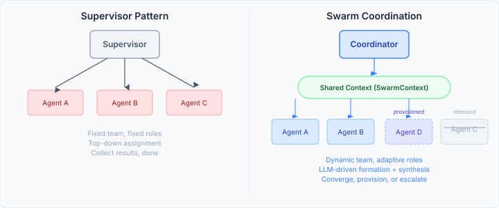
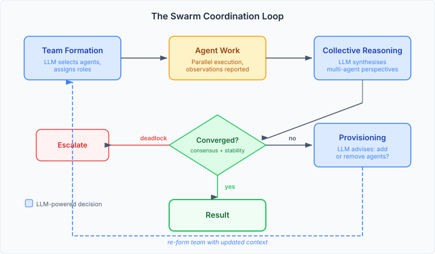
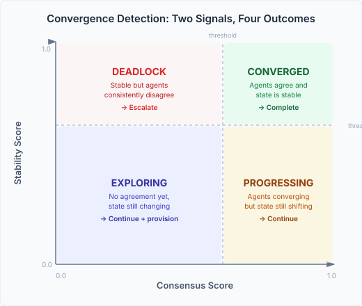

# Swarm Coordination and the Prompts That Learn

Most multi-agent orchestration follows a supervisor pattern. One controller, a fixed roster of agents, predetermined roles. The supervisor dispatches tasks, collects results, done. It works when you know upfront who needs to do what — and it falls apart the moment you don't.

The problems that break the supervisor model share a common shape: the right team depends on what you discover along the way. An investigation that starts with two analysts might need a forensic specialist once the first findings come in. A compliance review might need domain experts the initial reviewer couldn't anticipate. The supervisor can't adapt because its decisions were made before the work began.

## The swarm model

Swarm coordination replaces the supervisor's one-shot decision with an adaptive loop. Three LLM-powered decisions run continuously: *who should work on this*, *what do their combined observations mean*, and *do we need more agents*.

**Team formation** is the first decision. Given a pool of candidate agents with declared capabilities, an LLM selects which to activate and assigns them to named teams with a coordination strategy. It sees agent descriptions, historical experience from similar past cases, and current swarm progress. A heuristic pre-filter caps the candidate set before the LLM sees it — greedy capability-coverage selection ensures diversity without overwhelming the context window.

**Collective reasoning** is where the real value lives. After agents report observations, the LLM doesn't just summarise — it synthesises multi-perspective analysis. Agreements and disagreements are identified with evidence for each position. Complementary observations that only one agent noticed are surfaced. Minority viewpoints are preserved rather than averaged away. Individual agents see parts; the aggregator finds the whole.

**Dynamic provisioning** happens mid-execution. The LLM evaluates whether additional agents are needed based on exploration pace, consensus level, and what capabilities are missing. A deadlocked discussion between two analysts might need a mediator. A compliance review that surfaced financial anomalies might need a forensic agent the team formation step couldn't have predicted.

## Convergence: knowing when to stop

The hardest problem in any iterative multi-agent system is termination. Stop too early and you miss insights. Stop too late and you burn tokens on circular discussion. A single "confidence score" doesn't cut it — an agent can be highly confident and completely wrong.

We track two continuous signals: *consensus* (how much agents agree) and *stability* (how much the state is changing). The combination produces four outcomes:

- **High consensus + high stability = converged.** Agents agree and the state has settled. Done.
- **Low consensus + high stability = deadlock.** Agents consistently disagree and nothing is shifting. Continuing won't help — escalate to a human or a different coordination strategy.
- **High consensus + low stability = progressing.** Agreement is forming but the state is still shifting as new information arrives. Keep going.
- **Low consensus + low stability = exploring.** Early phase. No agreement yet, lots of movement. Continue and consider provisioning additional agents.

The dual-signal approach prevents the two most common failure modes: premature termination (agents quickly agree on the wrong answer — consensus is high but stability is low because the environment is still changing) and infinite loops (stability detects when progress has stalled, regardless of what consensus says).

## What makes it a swarm

The term "swarm" isn't metaphorical. These agents interact through a shared mutable context — what the multi-agent literature calls a stigmergic medium. Team composition, detected roles, progress signals, and coordination strategy are all written to and read from `SwarmContext`. Events flow through as agents complete work, roles shift, and teams reorganise.

The emergent behaviour: the team self-organises around the problem as understanding develops. The coordinator doesn't prescribe the solution path. It creates the conditions for agents to collectively find one.

## The prompts that learn

Each of the three coordination decisions — team formation, collective reasoning, provisioning — runs on a hardcoded base prompt. These prompts encode the coordinator's judgment: how to evaluate candidates, what to prioritise in synthesis, when provisioning is warranted.

The question is: can that judgment improve from experience?

We wired the three prompt sites into an A/B testing framework. For each new swarm execution, a deterministic hash assigns it to either the control prompt (the current default) or an experiment variant. The variant might include curated few-shot examples from past successful coordinations, or an instruction delta that refines how the LLM approaches team formation. The convergence outcome — converged, deadlocked, or failed — feeds back as a quality signal.

Over time, variants that produce better convergence outcomes get promoted to control. The coordinator's prompts self-improve from operational data, without any code changes. The few-shot examples are especially interesting: by showing the LLM examples of team formations that led to convergence, you're giving it case-based reasoning about coordination strategy — pattern matching on what worked before.

The practical effect: a swarm coordinator that has processed a thousand cases forms better teams and synthesises more effectively than one running on its initial prompts. The A/B framework provides the mechanism; the convergence signal provides the feedback; the batch cycle provides the selection pressure.

This is not AGI. It's DSPy-style prompt optimisation applied to coordination decisions — systematic, measurable, grounded in outcomes. The coordinator doesn't understand why a prompt variant works better. It just uses the one that does.
