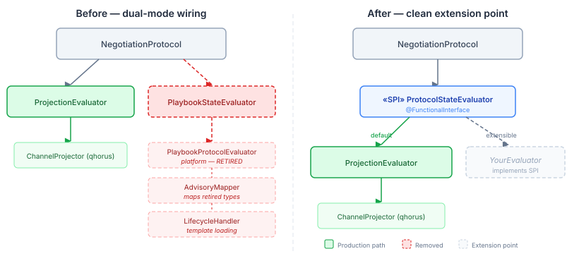

# When Your Dependency Disappears

Platform removed `PlaybookProtocolEvaluator` and its entire `coordination.protocol` package. Not deprecated — removed. The classes are gone, the package is gone, and any consumer that references them no longer compiles.

This is fine. In fact, this is exactly how a pre-release platform should evolve.

The interesting question isn't "how do we fix the build?" — that's mechanical. The interesting question is why agency's protocol evaluation code was structured the way it was, why the removal was clean instead of painful, and what it tells us about building layers that survive foundation changes.

## Two ways to evaluate a protocol

Multi-agent channels need protocol enforcement — rules about who can say what, when, and in what order. Negotiation protocols, for instance, need to track proposals, responses, and counter-proposals, and warn when participants deviate from the expected flow.

We built two evaluation strategies for this:

**Projection-based evaluation** folds the channel's message history through a pure function — a `ChannelProjection` that accumulates state from a message stream. No external state store, no registered templates. The projection derives the protocol state from the messages themselves. Qhorus already provides the `ChannelProjector` infrastructure for this, so the evaluator plugs into existing machinery.

**Playbook-based evaluation** used platform's `PlaybookProtocolEvaluator` — a state machine runtime that registered YAML templates, tracked per-instance state via `CoordinationStateStore`, and evaluated events against transitions. The evaluator held external state and needed lifecycle management: registration on channel creation, state replay on recovery, eviction on teardown.

Both strategies implemented the same SPI — `ProtocolStateEvaluator`, a `@FunctionalInterface` that takes a `ProtocolContext` and returns `List<DispatchAdvisory>`. `NegotiationProtocol` dispatched to one or the other based on a `policyOverrides` key (`negotiation.state-backing`), defaulting to projection.

## Why the playbook path was always fragile

The playbook evaluator carried three dependencies the projection path didn't need: `PlaybookProtocolEvaluator` itself, `ProtocolAdvisory` and its severity/action types for the advisory mapping, and `CoordinationStateStore` for template registration. An `AdvisoryMapper` class existed solely to translate between platform's advisory types and qhorus's `DispatchAdvisory` — a mapping layer that only existed because two different type systems described the same concept.

The playbook path also required a `ProtocolLifecycleHandler` — a CDI bean that loaded YAML templates from the classpath, registered them with the evaluator on channel init, replayed message history on recovery, and evicted state on destroy. None of this complexity existed in the projection path, which derived its state statelessly from the message stream.

In practice, no consumer shipped `coordination-core` with the evaluator bean wired up. The CDI constructor used `Instance<PlaybookProtocolEvaluator>` — if the bean was unsatisfied (which it always was), it silently fell back to projection. The playbook path was dead code protected by a fallback that made its absence invisible.

## What made the removal clean

Three properties of the original design:

**The SPI was dependency-free.** `ProtocolStateEvaluator` depends only on qhorus types (`ProtocolContext`, `DispatchAdvisory`). It doesn't reference any platform coordination types. Removing the playbook implementation doesn't touch the SPI at all.

**The dispatch logic was already a fallback chain.** `NegotiationProtocol.evaluate()` checked for the playbook evaluator, fell back to projection if unavailable, and logged when the fallback happened. The fallback was the production path. Removing the playbook evaluator just removed the branch that was never taken.

**The dual-mode constructor stayed.** `NegotiationProtocol` still accepts `(ProtocolStateEvaluator, ProtocolStateEvaluator)` for programmatic wiring. If a future protocol runtime appears — platform's next-generation playbook engine, a compiled state machine, anything — it implements `ProtocolStateEvaluator` and plugs in. The extension point outlived its first implementation.

## The practical takeaway

When you build an adapter layer on top of an API you don't own, the adapter's SPI needs to stand on its own types. If `ProtocolStateEvaluator` had been defined in terms of `ProtocolAdvisory` and `AdvisorySeverity`, removing the playbook path would have meant rewriting the SPI and every consumer. Because the SPI used qhorus types — types from the layer below, not from the dependency being bridged — the adapter peeled away cleanly.

The projection evaluator, the SPI, the dual-mode dispatch, the fallback logic, the thirteen tests covering all dispatch paths — all survived untouched. The 595 deleted lines were entirely bridge code: the adapter, its mapper, its lifecycle handler, its YAML template, and their tests. Nothing that any consumer actually called.

In a multi-repo platform, every dependency you take is a dependency you might lose. The question is whether your abstractions are shaped by your design or by the dependency's API. If it's the former, the dependency is replaceable. If it's the latter, you'll be rewriting when it changes.
