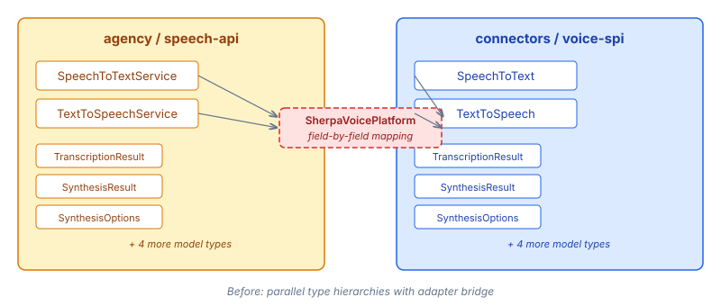
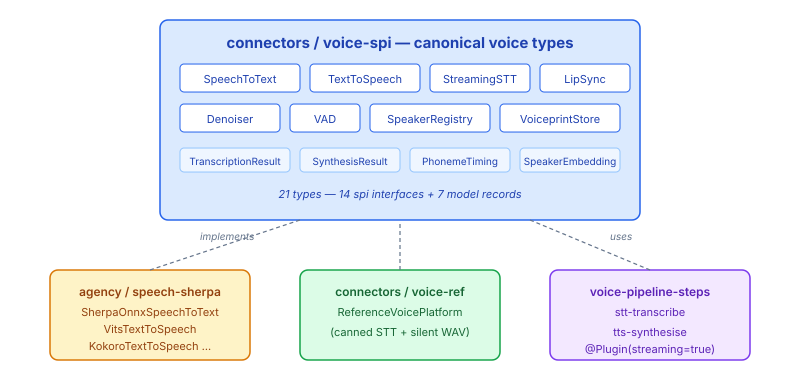
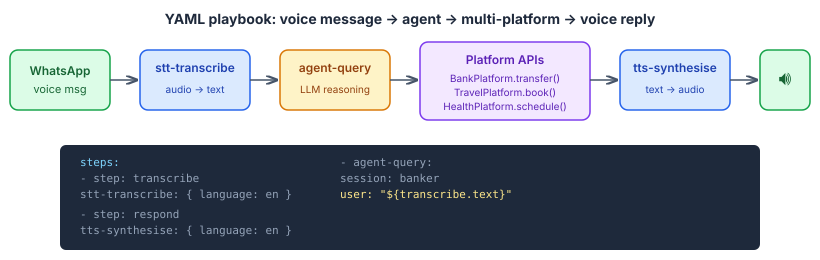

# Voice Where It Belongs

We had a voice platform that worked. Agency had `SpeechToTextService` and `TextToSpeechService` with sherpa-onnx implementations behind them — VITS, Kokoro, Whisper, the full native FFM stack. Connectors had `SpeechToText` and `TextToSpeech` as platform SPIs with the usual pattern: reference implementation, `NoOpVoicePlatform` default bean, simulation eligibility. Both sets of types existed. Both compiled. An adapter called `SherpaVoicePlatform` sat between them and mapped field by field.

The problem wasn't that it was broken. The problem was that it was the wrong shape.

## Two Type Hierarchies Shouldn't Exist

The adapter pattern is seductive when you have two repos with overlapping types. You write a bridge class, map each field, and move on. The code compiles, the tests pass, everyone's happy.

But the adapter doesn't solve the problem — it enshrines it. Now you have two `SynthesisResult` records in two packages with the same fields, two `TranscriptionOptions` records with the same structure, and a class whose only job is copying values between them. Every new field gets added twice. Every signature change propagates through three layers instead of one.



The connectors voice-spi was the canonical location for voice platform types from the start — it follows the same SPI pattern as `ChatPlatform`, `BankPlatform`, `CalendarPlatform`, and every other connector SPI. Agency's speech types should have been using them directly. The adapter was a shortcut that avoided the cross-repo refactoring and left both hierarchies standing.

## The Refactor-Move

The fix was mechanical but precise. Enrich connectors voice-spi to be a superset of both hierarchies, then make agency use it directly.

First, the enrichment. `SynthesisResult` gained a `phonemes` field with a backward-compatible two-argument constructor so existing callers didn't break. `SpeechToText` gained a default `transcribe(Path, TranscriptionOptions)` method — agency's sherpa implementations work with files natively, and the default delegates to the `byte[]` version via temp file. `PhonemeTiming` moved to the connectors model package. A handful of convenience methods filled the remaining gaps.

Then the migration. Agency's implementations switched from `implements SpeechToTextService` to `implements SpeechToText`, from `implements TextToSpeechService` to `implements TextToSpeech`. Imports updated across 96 files in 6 modules. The seven original duplicate types deleted. The adapter deleted. Both repos green.

But the first batch only moved the core types. Agency still had 14 more voice interfaces sitting in `speech-api` that belonged in connectors: `StreamingSpeechToText`, `RecognitionStream`, `PhonemeAligner`, `LipSyncEnricher`, `SpeechDenoiser`, `VoiceActivityFilter`, the speaker identification types. These weren't agency-specific logic — they were generic voice platform capabilities, the same abstraction level as `ChatPlatform`'s channel management or `BankPlatform`'s payment initiation.

So we moved those too. Same pattern: create in connectors, delete from agency, update imports. 21 types total, 96 files changed, adapter eliminated, net 600 lines removed. Agency kept only what's genuinely agency-specific — avatar cognition, conversation prompting, text cleanup, diarization.



## What This Actually Enables

The point of the migration wasn't tidiness. It was composability.

With voice types in connectors, they're available to the YAML playbook infrastructure — the same pipeline framework that already chains agent sessions, handles variable references between steps, and fuses type-compatible streaming steps. `stt-transcribe` and `tts-synthesise` are now `@Plugin(streaming=true)` step types that any playbook can use.

A YAML playbook that takes a WhatsApp voice message, transcribes it, asks an agent, and synthesises the response looks like this:

```yaml
steps:
  - step: transcribe
    stt-transcribe:
      language: en

  - agent-session-open:
      session: banker
      system: >
        You are a banking assistant. You can check balances
        and transfer between accounts.

  - agent-query:
      session: banker
      user: "${transcribe.text}"
      output: response

  - step: respond
    tts-synthesise:
      language: en
```

That's the entire thing. Voice in, text out, agent reasons, text in, voice out. The plumbing is the playbook framework; the voice capabilities are connector SPIs; the agent is a simulated or real LLM behind a session. Each piece is independently testable, independently replaceable, and the YAML is the orchestration surface.



The banking scenario is one example. The same pattern works for travel booking — voice command, transport search, booking confirmation synthesised back as speech. Or healthcare — schedule an appointment by voice, calendar check for conflicts, directions for travel time, all through the same playbook structure. The voice layer is just a UX surface on the existing connector platform APIs.

## Why It Matters

Every connector SPI we've built — bank, travel, health, calendar, email, commerce, location — was designed to be composed. The capability sub-interface pattern, the `supports()` introspection, the reference implementations for testing. Voice was the missing UX layer that makes these APIs accessible to people who aren't sitting at a keyboard.

The migration was about getting voice into the same structural position as every other platform capability: owned by connectors, available to playbooks, testable with reference implementations, composable with everything else. Not hidden behind an adapter in a different repo.

The next step is building the end-to-end integration tests — YAML playbooks as user-facing examples, executed against reference implementations and a simulated LLM. If the playbook framework can orchestrate voice + banking + agent in a few lines of YAML, that's worth proving with running code, not just a diagram.
