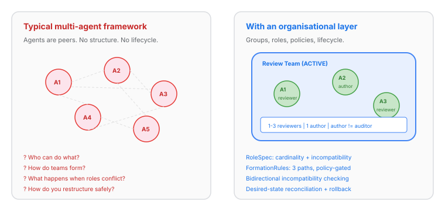
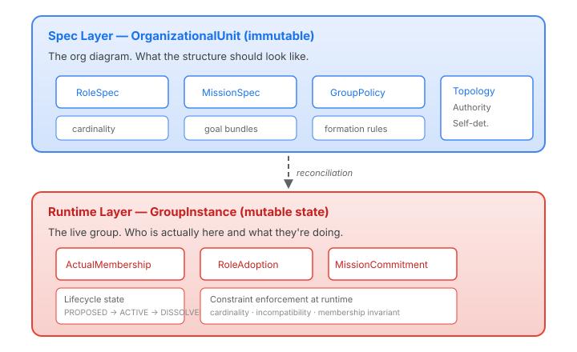
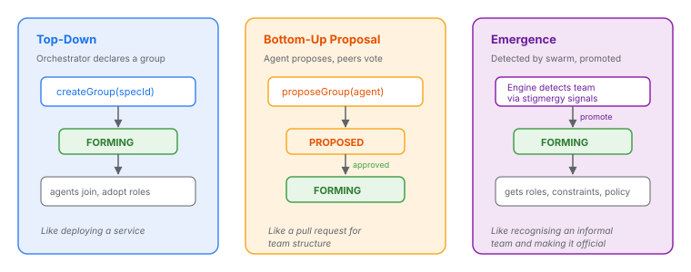
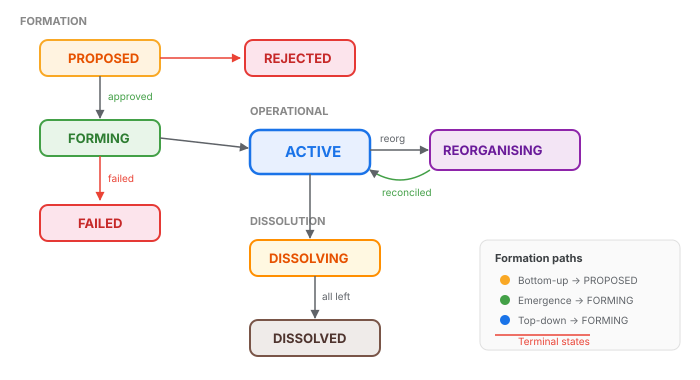

# Why Your Multi-Agent System Needs an Org Chart (and How to Make It Move)

The multi-agent AI space has a blind spot. We've invested enormous effort in making individual agents capable — tool use, chain-of-thought, self-reflection, function calling — but almost nothing in how groups of agents organise themselves. The result is that most multi-agent systems are either a flat list of peers passing messages, or a rigid supervisor-worker hierarchy wired at deployment time.

Neither works for the problems that actually matter.



A flat list of agents can't answer basic operational questions: who is responsible for what? Can this agent take on this task? What happens when two agents need to collaborate on something neither can do alone? And a static hierarchy can't adapt: it can't form a task-specific team, dissolve it when the work is done, or restructure when conditions change. These aren't hypothetical needs. They're the daily reality of any system where more than two agents collaborate.

The missing piece is an *organisational layer* — a runtime that manages group formation, role adoption, policy enforcement, and structural change. Not a workflow engine (those exist). Not a message bus (those exist too). An institutional layer that tracks what groups exist, what roles are available, who holds them, and what rules govern changes.

## The Problem Isn't New. The Solution Is.

In 2002, Hübner, Sichman, and Boissier published the MOISE+ organisational model — a framework for multi-agent organisations with three independent dimensions: structural (roles and groups), functional (missions and goals), and deontic (norms binding roles to missions). It's the clearest articulation of what multi-agent organisations need that I've found in twenty-four years of research.

Most of the AI agent community has never read it. They should.

MOISE+ doesn't have all the answers — its goal decomposition trees duplicate work that execution engines handle better, and its deliberation model assumes agents that are more structured than LLMs tend to be. But its core insight holds: structure, function, and norms are *independent dimensions* of an organisation, and treating them independently gives you a system that can evolve along each axis without breaking the others.

## Two Layers: What Should Be vs What Is

The first architectural decision was the most important. An organisational model needs to distinguish between what the organisation *should* look like (the spec, the plan, the org diagram) and what it *actually* looks like right now (who showed up, what roles they took, what state things are in).



The spec layer is `OrganizationalUnit` — an immutable record that declares roles, their cardinality constraints, incompatibility rules, topology, authority model, and formation policies. It's the org diagram. You can have multiple specs, and switching between them triggers a reconciliation process that migrates the runtime to match.

The runtime layer is `GroupInstance` — a mutable snapshot of the actual group. Who joined, when. What roles they adopted. What missions they committed to. What lifecycle state the group is in. The runtime can diverge from the spec — agents might leave, roles might be under-staffed — and that divergence is the input to policy enforcement and desired-state reconciliation.

This separation pays off immediately. Want to reorganise a team? Don't mutate the live group and hope nothing breaks. Define a new spec, and the reconciliation engine handles the transition atomically — adding members, reassigning roles, rolling back if validation fails. Want to A/B test two organisational structures? Run two groups against two specs and measure the difference.

The separation also means specs are reusable. A "review team" spec with "1-3 reviewers, 1 author, author and auditor incompatible" can instantiate multiple concurrent groups. The spec is the template; the group is the instance.

## Three Ways a Group Can Start

Static systems have one formation path: declaration at boot time. Self-organising systems need three.



**Top-down** is the familiar one. An orchestrator decides a team is needed and creates it. The group starts in FORMING state, agents join, roles are adopted, and eventually the group transitions to ACTIVE. This is how you bootstrap — the initial organisational structure is typically top-down.

**Bottom-up proposal** is where self-organisation begins. An agent observes a need and proposes a group: "I think we need a review team for this PR cluster." The proposal enters a PROPOSED state. Peers evaluate it. The proposal can be approved (advancing to FORMING) or rejected. This isn't a hypothetical feature — it maps directly to real coordination patterns like coalition formation, where agents negotiate about whether a collaboration is worth the coordination cost.

**Emergence** is the most interesting path. In a system with a swarm layer, agents who repeatedly collaborate get detected as informal teams. Promoting a detected team to a formal group crosses a boundary: the team goes from "these agents seem to work together" to "this is a team with defined roles, constraints, and policies." It's the difference between a recurring meeting and a department.

Each path produces the same runtime type: a `GroupInstance` with members, roles, and lifecycle state. The formation origin is tracked but doesn't affect operations — once formed, a group is a group. What changes is the governance path: a top-down group has immediate authority, a proposed group needs approval, an emerged group needs promotion.

## Constraints That Enforce Themselves

Most multi-agent frameworks treat constraints as documentation — "the reviewer should not also be the author" is a comment in a system prompt, not a runtime check. When things go wrong, you find out after the damage is done.

The organisational layer enforces three types of constraints at runtime, on every mutation:

**Cardinality.** Each `RoleSpec` declares a minimum and maximum agent count. "At least 1 reviewer, at most 3" isn't a guideline — it's a hard check on every `adoptRole()` call. Exceeding the maximum fails immediately. Dropping below the minimum is soft: the release always succeeds (agents must be free to leave), but the under-staffed condition fires an event that triggers recovery actions.

**Incompatibility.** Roles that cannot be held simultaneously by the same agent. "Author and auditor are incompatible" is checked bidirectionally on every adoption — both the new role's incompatibility set and the existing roles' incompatibility sets are consulted. This catches separation-of-concerns violations that static org charts handle through departmental boundaries but that flat agent lists ignore entirely.

**Membership invariant.** An agent must be a member of a group before adopting any role. Joining is separate from taking on responsibilities. Leaving automatically releases all held roles. This models real organisational dynamics: you can attend a meeting (join) without being assigned an action item (adopt a role).

Every mutation to a `GroupInstance` goes through the same path: load the current state, validate against the spec's constraints, create a new immutable snapshot, save with optimistic concurrency control (compare-and-swap on a version field). Concurrent mutations retry — they're never silently dropped or partially applied.

```java
// This throws OrgValidationException — Bob is the author,
// and author is incompatible with auditor
lifecycleService.adoptRole(group.instanceId(), "bob", "auditor", tenancyId);
```

The code is unexciting by design. The interesting part isn't how the check works — it's that the check exists at all. Most multi-agent systems are running without seatbelts.

## The Lifecycle State Machine

Groups aren't just created and destroyed. They move through a lifecycle that tracks their operational status.



PROPOSED → (approved) → FORMING → (well-formed) → ACTIVE → (dissolve) → DISSOLVING → (all left) → DISSOLVED. With branches: PROPOSED can be REJECTED, FORMING can FAIL, and ACTIVE can enter REORGANISING when the underlying spec changes.

The interesting states are the transitional ones:

**FORMING** gates operations that only make sense on an active group. You can join a forming group and adopt roles, but the group isn't operationally live until the formation criteria are met. This prevents half-formed teams from being dispatched to tasks.

**REORGANISING** is the desired-state migration in progress. The group freezes membership changes while the reconciliation engine migrates from one spec to another. On success, the group returns to ACTIVE with the new structure. On failure, it rolls back to ACTIVE with the old structure. This gives you atomic organisational transitions — you never have a group in an inconsistent state between two configurations.

**DISSOLVING** allows graceful role release. When a group is dissolved, agents release their roles and leave. The group transitions to DISSOLVED (terminal) only when all members have departed. This prevents the "everyone left but the group still exists" ghost state.

## What This Changes

The practical consequence of an organisational layer isn't just cleaner code. It changes what multi-agent systems can do.

**Dynamic team formation.** A case management system can spin up a review team for a complex case, staff it with agents that have the right capabilities, enforce that the reviewer and the subject-matter expert are different agents, and dissolve the team when the review is complete. Without an organisational layer, this is a hand-rolled state machine. With one, it's a few API calls against a policy that the system enforces.

**Auditable structure.** Every role adoption, membership change, and state transition is a recorded event on an immutable lifecycle. When something goes wrong, you can answer "who held what role when?" — not by parsing logs, but by querying the organisational model.

**Safe restructuring.** When the optimal team structure changes — because workload shifted, or a new policy was enacted, or an agent's capabilities changed — the reconciliation engine migrates the live group to the new structure without ad-hoc mutation. The transition is atomic: it either completes or rolls back.

**Compositional policy.** Formation rules (which formation paths are allowed), role constraints (cardinality, incompatibility), and mission requirements can be composed independently. A "high-security review team" spec can layer stricter constraints on top of a base review team spec without reimplementing the entire organisational structure.

## What Comes Next

This is the structural dimension — the first of three. Two more follow:

**Functional** — `MissionSpec` evolves from a placeholder to a full goal-bundle system. Agents commit to missions at runtime. Missions declare required roles, minimum committers, and goal types (achieve vs. maintain). This is where the MOISE+ functional specification maps — not as goal decomposition trees (that's the execution engine's job) but as declarative work packages that bind roles to objectives.

**Deontic** — norms that activate when an agent adopts a role. Obligations ("the reviewer must produce a review within 24 hours"), permissions ("the lead can reassign roles"), and prohibitions ("the auditor cannot access the author's working files"). These feed into the existing compliance pipeline rather than building a parallel system.

The research backing is solid. The MOISE+ paper is twenty-four years old. The AGR (Agents, Groups, Roles) model is twenty-three. The ideas have been validated in academic multi-agent systems for decades. What's new is applying them to LLM-based agents — where the combination of natural language understanding and structured organisational policy creates a system that is simultaneously flexible (agents can negotiate and reason about roles) and safe (the organisational layer enforces structural constraints regardless of what the agent's language model decides to do).

Multi-agent AI needs an institutional layer. Not because structure is better than flexibility — but because structure *enables* flexibility. You can only safely let agents self-organise if you have guardrails that prevent invalid states. The org chart isn't a cage. It's a safety net.
