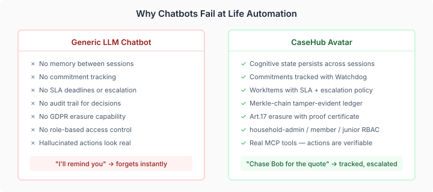
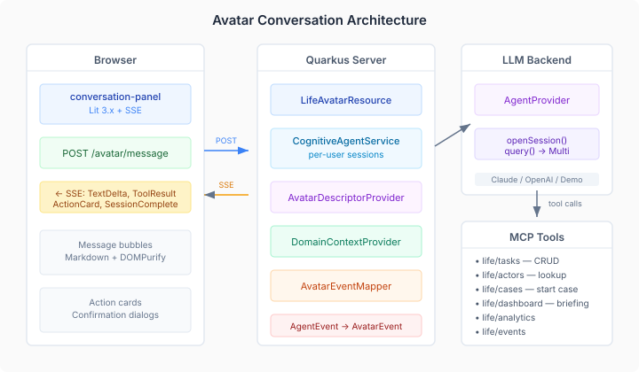

# The Avatar That Does Things

Personal life automation tools fall into two categories. The first is the forms-and-lists approach: create a task, set a deadline, check it off. Calendar apps, to-do lists, Notion boards. They work until you forget to check them, which is most of the time.

The second is the chatbot approach: talk to an AI, get advice, maybe it sets a reminder. It doesn't matter which one — ChatGPT, Gemini, Grok, Claude, Siri. They all feel productive in the moment. Then the moment passes. The assistant forgot what you said. The reminder has no escalation policy. The "I'll follow up with the contractor" was a hallucination dressed as a commitment.

casehub-life just gained a third option — an avatar that actually does things, and proves it did them.

## What makes this different from a chatbot

The avatar has MCP tool access. When it says "I'll create a task for that," it means it. The platform's `@McpDomain` annotation generates dual MCP/REST endpoints from annotated service classes — six domains are already wired: tasks, actors, cases, dashboard, analytics, events. The avatar's LLM session is configured with these tools at session-open time. The LLM calls them during the conversation. The tool results stream back to the UI as structured events.

This is the gap that generic chatbots cannot close:

When the avatar creates a task, it becomes a WorkItem with an SLA deadline and an escalation policy. When it starts a contractor follow-up, that becomes a case with commitment tracking and a Watchdog that fires if the contractor doesn't respond. When it touches personal data, that goes through the GDPR-compliant Merkle-chain ledger. When it approves a financial decision, the approval is tamper-evident and attributable.

Any chatbot — ChatGPT, Grok, Gemini, whatever ships next quarter — can say "I'll remind you." The avatar creates a WorkItem with a breach policy that escalates to the admin channel if the deadline passes. Those are structurally different things.

## The backend — deliberately simple

The user sends a POST request with plain text. The server opens (or reuses) a multi-turn LLM session for that user, injects the household's current state into the system prompt, and streams the response back as Server-Sent Events. No WebSocket on the server side. No custom protocol. POST in, SSE out.

The spec review caught the transport decision before any code was written. The original design proposed WebSocket — bidirectional, full-duplex, the obvious choice for chat. Claude flagged the problem: casehub-life has zero WebSocket infrastructure. Meanwhile, the codebase already has a production SSE endpoint streaming domain events to the dashboard. POST+SSE is also a better semantic fit — a conversation is request-response with a streaming body, not a persistent bidirectional channel.

The backend is five new Java classes:

- **LifeCognitiveAgentService** — manages per-user `AgentSession` instances via `AgentProvider.openSession()`. System prompt assembled from an eidos `AgentDescriptor` plus a domain context summary (overdue items, active cases, pending commitments).
- **LifeAvatarResource** — POST `/avatar/message` returns `Multi<AvatarEvent>` as SSE. DELETE `/avatar/session` closes it. All three household roles admitted.
- **LifeDomainContextProvider** — assembles the household's current state into a compact prompt summary with a dirty flag that invalidates on domain events.
- **AvatarEventMapper** — maps platform `AgentEvent` (6 variants) to `AvatarEvent` (8 variants), filtering out noise like partial tool argument deltas.
- **DemoAvatarAgentProvider** — demo-mode session support with contextual responses, following the existing `DemoCurrentPrincipal` pattern.

## The cognitive stack — why it's not just a system prompt

The avatar's personality comes from the neocortex CognitionCore — a cognitive orchestrator that manages mood (PAD model), drives, user modelling, mental model (BDI extraction), strategy learning, narrative tracking, and goal proposals. This isn't prompt engineering. It's a graph of numeric states that evolve through interaction and get rendered into prompt sections that shape how the LLM responds.

CognitionCore's Maven artifacts aren't published yet — the neocortex extraction from blocks is nearly complete but the last batch hasn't landed. So the current avatar ships as Phase A: the full conversation infrastructure with a static personality. When the neocortex artifacts publish, CognitionCore plugs in with no architectural changes.

I designed the split this way on purpose. The conversation surface, MCP tool access, SSE streaming, domain context injection, per-user session management — none of that depends on cognitive state. The avatar works without CognitionCore. It just doesn't evolve.

## Where the pieces actually belong

Building the avatar surfaced an architectural question I should have asked earlier: where do conversation UI components belong?

The initial implementation put a `life-conversation-panel` Lit component directly in life-ui. That was wrong. The conversation surface isn't life-specific — clinical, IoT monitoring, any CaseHub app with a dashboard benefits from a cognitive agent. The same logic that keeps WorkItem lifecycle in casehub-work rather than in application repos applies here: reusable UI belongs in mosaic.

And mosaic already has more than I realised. The `avatar` package has a full conversation panel with 3D TalkingHead rendering, TTS via Kokoro and Piper (50+ voices), speech recognition, and WebSocket transport. The pages platform has an IntelliJ-style dock workbench (`pages-dock-workbench`), milkdown-based markdown editing with read-only mode, a unified SSE/WebSocket transport abstraction (`PushSource`), and an MCP tool adapter that lets external processes push content into live editors.

What mosaic's avatar package lacks is the text-conversation layer: tool call visibility, action cards, confirmation flows, theme flexibility, a text-only mode without the 3D overhead, and token-by-token streaming. Six gaps, now tracked as mosaic#301 through #307. Once those land, life-ui drops its custom panel and consumes the mosaic component — the same pattern as every other mosaic component in the dashboard.

The same boundary applies to cognitive capabilities. Intent classification — understanding what the user wants from free text — is cognitive reasoning. It belongs in neocortex alongside BDI extraction and drive-based decision making, not in an application repo. Life configures the dispatch rules (which intents route to which tier), but the classification itself is a neocortex capability that any CaseHub app can consume.

Two boundary rules crystallised from this work:
- **Cognitive** → neocortex. Domain application → app repos.
- **Reusable UI** → mosaic. Domain configuration → app UIs.

## The design review that changed the spec

I ran two rounds of adversarial design review — a light decision review (15 findings) and a standard spec review (16 findings across 3 rounds). Between them, they caught:

- **CognitionCore isn't on the classpath.** The spec originally said "we consume the existing API." It doesn't exist as a consumable artifact. The phased delivery split was a direct result.
- **`AgentSession.clear()` has a no-op default implementation.** The spec relied on it for mid-session context refresh. The fix: inject context updates as messages rather than relying on system prompt refresh.
- **The avatar bypasses the accountability infrastructure.** Engine workers go through risk classification, trust routing, and attestation pipelines. Valid concern, deliberately chosen — the avatar starts cases and approves gates; it doesn't execute playbooks.
- **POST+SSE, not WebSocket.** Covered above.

Thirty-one findings across two reviews, and the spec was substantially different afterwards.

## What the avatar opens up

The next issues in the epic need rethinking before implementation. Intent resolution (#144) splits between neocortex (cognitive classification) and life (domain dispatch). Avatar-driven UI (#145) is blocked until the mosaic avatar package gains text-conversation support — and those components should be built in mosaic first, not prototyped in life-ui.

The interesting question is what happens when CognitionCore plugs in. The avatar currently has a static personality — helpful, proactive, warm. With CognitionCore, it will develop mood, track ongoing narratives ("the boiler saga"), build a model of each household member, and propose goals based on patterns it observes. The household assistant that remembers you hate dealing with insurance renewals, notices the renewal is coming up, and starts the comparison process before you ask.

That's the structural advantage of building on an accountability platform rather than wrapping a chatbot API. The avatar doesn't just talk about your life — it participates in it, with every action tracked, every commitment enforced, every decision auditable.
