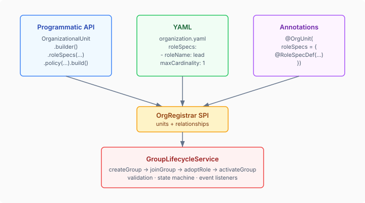
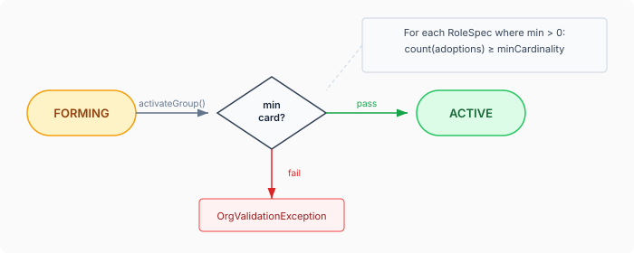
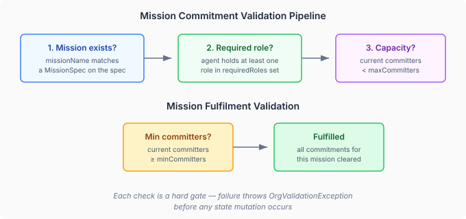

# Shipping the Society Model: Three Surfaces, One State Machine

Yesterday's post described *why* multi-agent systems need an organisational layer. Today's is about *how* — the nine follow-up issues that turned a set of runtime types into a fully usable surface. The difference between "the types exist" and "a consumer can actually use them" is larger than most people expect.

## The Declaration Surface Problem

When you add a new model to a platform, the types are the easy part. `RoleSpec`, `GroupPolicy`, `FormationRules`, `MissionSpec` — records with validation in their compact constructors. The hard part is making them *reachable*. A type that only works through a programmatic builder is a type that only power users will adopt. The first lesson of platform engineering: if you want a feature used, give people three ways to declare it.



The society model has three: programmatic builders, YAML classpath resources, and Quarkus build-time annotations. All three produce the same SPI output — `OrgRegistrar` beans that feed into `OrgBootstrap` at startup. The consumer never thinks about how their org structure was declared. They just call `GroupLifecycleService`.

### YAML: The Zero-Code Path

YAML is how most consumers will declare org structure. Drop a file at `META-INF/eidos/organization.yaml`, declare your units with roles, policies, and missions, and the classpath registrar picks it up automatically.

The implementation turned out to be remarkably simple. Jackson's default record deserialization handles all the new nested types — `GroupPolicy`, `FormationRules`, `RoleSpec`, `RolePolicy`, `MissionSpec` — without any custom deserializer code. The only production change was a single line:

```java
.configure(MapperFeature.ACCEPT_CASE_INSENSITIVE_ENUMS, true)
```

This matters more than it looks. YAML is a human-authored format. Requiring users to write `DISTRIBUTED` instead of `distributed` for an `AuthorityModel` enum is the kind of gratuitous friction that makes people give up on your API. Case-insensitive enum handling applies to all org enums — `AuthorityModel`, `FormationPath`, `NormSpecificity`, `PolicyKind` — with one configuration line.

### Annotations: The Type-Safe Path

For teams that prefer compile-time safety, the annotation surface mirrors every YAML field:

```java
@OrgUnit(
    id = "dev-guild",
    topology = "mesh",
    authorityModel = "DISTRIBUTED",
    selfDetermination = 0.8,
    policy = @GroupPolicyDef(
        normativePriority = 2,
        normSpecificity = "DOMAIN",
        formationRules = @FormationRulesDef(
            allowedPaths = {"BOTTOM_UP", "EMERGENCE"},
            minGroupSize = 3,
            maxGroupSize = 10,
            proposalQuorum = 0.6
        )
    ),
    roleSpecs = {
        @RoleSpecDef(roleName = "lead", minCardinality = 1, maxCardinality = 1,
            policies = @RolePolicyDef(capabilityName = "code-review", kind = "OBLIGATION",
                expectations = @PolicyExpectation(key = "turnaround", value = "24h"))),
        @RoleSpecDef(roleName = "contributor", minCardinality = 2, maxCardinality = -1)
    }
)
```

Six new annotation types (`@GroupPolicyDef`, `@FormationRulesDef`, `@RoleSpecDef`, `@RolePolicyDef`, `@PolicyExpectation`, `@MissionSpecDef`) handle the nesting. The Quarkus build extension extracts them via Jandex at compile time and produces synthetic `OrgRegistrar` CDI beans. Parity tests verify that every `@OrgUnit` annotation field has a matching `OrganizationalUnit.Builder` setter, and vice versa — new fields can't be added to one surface without the test demanding they appear on the other.

The design decision for sentinel values is worth noting. Nested annotations in Java can't be null — `@OrgUnit.policy` defaults to `@GroupPolicyDef`, which defaults all its fields. The processor uses `normativePriority = -1` as the "no policy specified" sentinel, since the actual `GroupPolicy` record requires `normativePriority >= 0`. This is ugly but pragmatic. The alternative — making `@GroupPolicyDef` a separate class-level annotation — would break the visual grouping that makes the annotation readable.

## The Activation Gate

The most important runtime change is the one that didn't exist before: `activateGroup()`. Without it, groups created via `createGroup()` entered FORMING state and stayed there. Nothing transitioned them to ACTIVE. In practice, this meant the entire lifecycle state machine was cosmetic — groups were always FORMING.



`activateGroup()` validates that every role's minimum cardinality is satisfied before allowing the transition. If the spec says "at least 2 reviewers" and only 1 has adopted the role, the activation fails with a clear validation error. This is the gate that makes formation *meaningful* — a group isn't operationally live until its staffing requirements are met.

The implementation validates outside the CAS mutation block, which means a concurrent role release between validation and state change could theoretically pass validation but leave the group under-staffed. This is intentional — strict consistency would require pessimistic locking, which conflicts with the optimistic concurrency model the entire lifecycle is built on. The validation is best-effort, and the under-staffing fires an event that downstream systems can react to.

## Reorganisation as a State, Not an Action

The previous `changeTopology()` was a direct swap — read the current state, write the new topology, done. This works for FORMING groups where the topology is still being configured. It does not work for ACTIVE groups where membership changes, role adoptions, and mission commitments are happening concurrently.

The fix is to make reorganisation a *state*. When `changeTopology()` is called on an ACTIVE group:

1. The group transitions to REORGANISING — membership changes are frozen
2. The topology is updated
3. The group returns to ACTIVE

If step 2 fails for any reason, the group rolls back to ACTIVE with the original topology. At no point is the group in an inconsistent state. And because `adoptRole()` checks for REORGANISING state and rejects mutations during transition, concurrent operations get a clear error rather than a silent race.

This is the pattern that scales to more complex reorganisations. When the deontic dimension lands (Epic 3), norm changes will go through the same REORGANISING flow — freeze, migrate, validate, commit or rollback.

## Mission Validation: Closing the Gap

Missions existed as data but had zero enforcement. Any agent could commit to any string that happened to match a mission name. No role checks. No cardinality limits. No existence validation.



`MissionSpec` grew three fields: `requiredRoles` (agents must hold at least one listed role), `minCommitters` (missions can't be fulfilled with fewer), and `maxCommitters` (missions can't be over-committed). The two-argument convenience constructor preserves backward compatibility — existing code that creates missions with just name and description still works, with all constraints defaulting to "no restriction."

The validation pipeline runs entirely inside the CAS mutation block. If any check fails, no state change occurs. The error message names the specific constraint that was violated and the values that caused it.

## What Made This Work

Nine issues, eight commits, 1170 lines of change. Three things made it possible to complete in a single session:

**Jackson's record deserialization is better than expected.** The entire YAML surface for the new types required zero custom deserializer code. Records with compact constructors that handle null → default conversions map cleanly to YAML. If you're building a Quarkus extension with a YAML configuration surface, records are the right choice.

**The parity test pattern catches drift automatically.** A reflection-based test that compares annotation method names against builder setter names means you can't add a field to one surface without the test failing on the other. This is worth setting up early — it catches the "I added it to YAML but forgot annotations" class of bugs at compile time.

**Optimistic concurrency via CAS makes validation composable.** Every lifecycle mutation runs through the same `mutate()` method — load, validate, transform, save with version check. Adding new validations (mission exists, required role, cardinality) means adding checks inside the transformation function. The concurrency model doesn't change. The retry logic doesn't change. You just add predicates.

## What's Left

The functional dimension is now partially landed. `MissionSpec` has `requiredRoles` and cardinality constraints, which are the structural prerequisites for the full MOISE+ functional specification. What's missing is the goal decomposition — mapping missions to sub-goals, tracking progress, and the achieve-vs-maintain distinction that determines whether a mission is ever "done."

The deontic dimension — norms that bind roles to obligations, permissions, and prohibitions — is Epic 3. It builds on both the structural layer (roles) and the functional layer (missions). The `NormSpecificity` enum sitting on `GroupPolicy` is a placeholder for that work — present in the type system, tested for round-trip preservation, but not yet consumed by any enforcement logic.

The organisational layer isn't a feature. It's a capability that enables features. Every multi-agent coordination pattern — task allocation, escalation, team formation, capability routing — is simpler and safer when there's a runtime that knows what groups exist, who's in them, what roles they hold, and what rules govern changes. The nine issues closed today didn't add new intelligence. They made the intelligence *accessible*.
