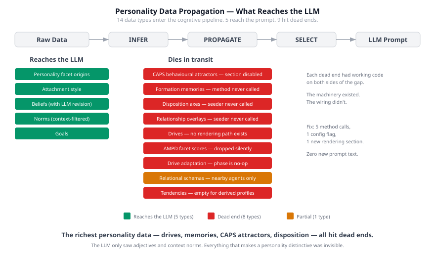
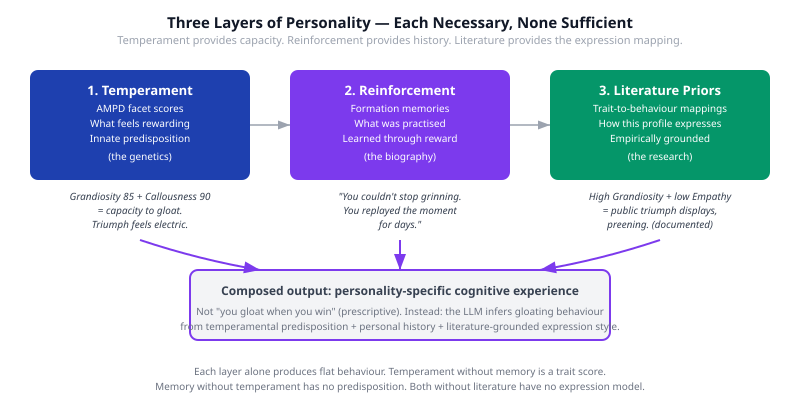

# Signal Starvation

Your AI agent has a paragraph of adjectives in its system prompt. "You are bold, compassionate, and witty." Maybe a backstory. Maybe a list of motivations. The LLM reads it, produces text that sounds bold-ish and compassionate-ish, and you call it personality.

It isn't. It's a description. And the LLM treats it like one — an average across the adjectives, applied uniformly regardless of situation, with no internal structure, no learned history, no mechanism to behave differently under pressure than in calm. This is the approach that dominates AI agent design today, and it is fundamentally wrong.

## 1. What Personality Actually Is

Mischel and Shoda showed in 1995 that personality is not a set of traits. It is a processing system — a network of cognitive-affective units that transforms situations into responses through learned if-then patterns. Their Cognitive-Affective Processing System (CAPS) theory demonstrated that two people with identical mean behaviour across situations can have radically different personalities. The signature is in the variation: person A becomes assertive under threat but passive under praise; person B does the opposite. Same average. Different people.

The trait score collapses the structure that IS the personality.

This matters because every LLM personality implementation I've seen does exactly what the trait score does. It collapses a rich cognitive system into a static description and hopes the model fills in the rest. The model can't. It doesn't have the data. It doesn't know that this character's assertiveness was learned from a decade of being dismissed, or that it only activates when authority figures are present, or that it competes with a simultaneous need for approval that manifests as jaw tension before the first word comes out.

The model can produce plausible personality. It cannot produce specific personality without specific data. And the data has to reach the prompt.

## 2. The Pipeline Architecture

We built the processing system that CAPS describes. Raw personality data — AMPD facet scores, formation memories, drives, disposition axes, relational schemas, attachment styles — flows through a cognitive pipeline with four stages:

**INFER.** What does the raw data mean? A CAPS settling process runs formation memories through a constraint-satisfaction network and produces behavioural attractors — the stable response patterns that this specific personality tends toward.

**PROPAGATE.** How does the inferred meaning flow through the system? YAML personality definitions feed into a cognitive seeder, which populates a MindMap with typed nodes — drives, beliefs, disposition axes, relationship overlays. Consolidation phases (a computational analogue of sleep) periodically process these nodes, adapting drive intensities through reinforcement and evolving relationship stages through familiarity.

**SELECT.** What gets surfaced to the LLM? A rendering layer walks the MindMap and cognitive state, selecting which personality signals appear in the prompt and how. Context matters — relational schemas only render for agents currently nearby; beliefs render with their revision history.

**EMERGE.** Character prose. The LLM writes, drawing on whatever signals survived the pipeline. If the right signals arrive, behaviour emerges. If they don't, it can't.

## 3. What We Found: Nine of Fourteen Dead

We had fourteen personality data types feeding into this pipeline. We assumed they were all reaching the LLM. They weren't.

Five made it through: personality facet origins (text descriptions, not scores), attachment style, beliefs, norms, and goals. These produced characters that sounded different from each other — different enough to pass casual inspection.

Nine hit dead ends inside the pipeline.

The CAPS engine ran settling on formation memories and produced fifty behavioural attractor nodes per character. But the prompt section that renders them was disabled — a boolean flag in a configuration constructor, the 22nd parameter, set to `false`. A method existed to render formation memories as childhood episodes. It was never called. The CAPS engine needed disposition data to seed its resting activations. The seeding method existed — it ran in tests. Nobody called it in production. Relationship evolution needed a people subgraph. The method to create it existed. Same story — tests only.

The richest personality data — the drives, the memories, the CAPS attractors, the dispositional predispositions — all stopped at wiring boundaries inside the pipeline. The machinery existed at each stage. The connections between stages didn't.

I call this signal starvation. The LLM was receiving one sentence of personality signal out of the twelve-plus data types available. It was doing remarkably well with almost nothing. The question was never whether the model could express personality — a direct trigger ("a competitor is praised in front of you") scored 5/5 on proving-worth expression every time. The question was whether the pipeline could get the right signals to the prompt at the right time.

## 4. The Fix Was Plumbing, Not Prompting

The instinct when a character doesn't behave right is to change the prompt. Add more description. Write better adjectives. Give the LLM more explicit instruction about how this personality acts.

This is wrong in a way that matters. More prompt text treats the symptom (weak behaviour) by adding prescriptive instruction (telling the model what to do). Prescriptive text works — gloating explicitly described as "you cackle when you triumph" will produce cackling. But it replaces emergence with direction. The character isn't gloating because its cognitive profile makes gloating feel rewarding; it's gloating because you told it to. The difference is invisible in a single event and unmistakable across a hundred.

The actual fix was wiring:

- Enable one disabled config flag
- Call three existing methods that were built and tested but never invoked in production
- Build one new rendering section for drives
- Fix a property-matching issue in the drive adaptation phase

No new prompt text. No richer descriptions. No more adjectives. The personality data that already existed in the system — painstakingly designed with empirically grounded AMPD scores, formation memories with specific childhood episodes, drive intensities calibrated against published personality models — started reaching the LLM.

Gloating recovered from 2.45 to within baseline range. Not because the LLM learned to gloat, but because a character with Grandiosity 80, Callousness 90, and a formation memory of replaying a childhood triumph for days finally had those signals in its prompt when it succeeded at something.

## 5. Three Layers, Each Necessary

Personality in this architecture is not one thing. It is three layers that compose into behaviour.

**Temperament** provides the predisposition. AMPD facet scores are the computational equivalent of genetic temperament — what feels rewarding, what provokes anxiety, what the default response is before learning shapes it. Grandiosity 85 plus Callousness 90 creates the capacity to gloat. Triumph feels electric for this profile. This is innate, not learned.

**Reinforcement** provides the personal history. Formation memories carry the specific episodes that strengthened or weakened each response pattern. The CAPS weight update mechanism (Rescorla-Wagner learning) models this: repeated reward strengthens an attractor, repeated punishment weakens it. The memories need to capture not just the situation but the expression and the reward — "you couldn't stop grinning, you replayed the moment for days" carries reinforcement information that "you created a plan and felt satisfied" does not.

**Literature priors** provide the expression mapping. Personality psychology has well-documented trait-to-expression mappings. High Grandiosity plus low Empathy produces public triumph displays. High Agreeableness plus low Assertiveness produces deflection and downplaying of success. These are empirically documented, the same class of evidence as the CAPS topology itself. They give the system priors for behavioural expression that are grounded in research rather than guessed at.

Each layer alone produces flat behaviour. Temperament without biography is a trait score — exactly the problem we started with. Biography without temperament has no predisposition, no sense of what the character finds rewarding. Both without literature priors have no model for how this personality profile expresses itself. All three together produce the specific, personal, situation-sensitive behaviour that CAPS theory predicts and that LLMs can generate when given the right signals.

## 6. The Body Knows Before the Mind Names

The last piece was how the LLM represents personality. Barrett's theory of constructed emotion gave us the framework: four channels — body, attention, time, action readiness — through which a character experiences its drives. Not "I feel angry" but "jaw tightens, gaze narrows to the exit, time contracts." Each drive owns unique anatomy. Scheming lives in the fingertips. Gloating lives behind the sternum. Self-preservation lifts the forearm hairs.

When multiple drives fire simultaneously — a crowded room where one person triggers trust, another triggers threat, a third triggers competitive evaluation — each drive occupies its own body territory. The LLM produces prose where the character's body differentiates what its mind hasn't named yet. This is not something you can achieve by writing "you feel conflicted." The four-channel architecture, the body-location anchors, and the pipeline that delivers situation-specific drive activations all have to work together.

We scored this wrong at first. The classifier asked whether a drive "changed the character's behaviour." A character standing alone in a library feeling warmth pool behind their sternum hasn't changed their behaviour. But the warmth IS the output — the cognitive experience that makes the character alive rather than analytical. Fixing the evaluation to score all four channels revealed that the pipeline had been working better than we thought. The measurement was blind to three-quarters of its output.

## 7. What This Means for Agent Architecture

If you are building AI agents that need consistent, distinctive personality across extended interactions, three things follow from this work.

**Architecture beats prompting.** You cannot instruction-tune your way to cognitive depth. A paragraph of personality adjectives will always produce averaged, situation-insensitive, undifferentiated behaviour at scale. The data has to be structured, the pipeline has to propagate it, and the rendering has to be situation-aware. This is engineering, not prompt craft.

**Verify propagation end-to-end.** We had fourteen data types, a working pipeline at every stage, and nine dead ends. The pipeline looked correct from any single vantage point. Only an end-to-end audit — "does this specific data type, for this specific character, appear in the actual prompt the LLM receives?" — revealed the gaps. If you have a cognitive pipeline, trace specific data from source to prompt. You will find dead ends.

**Measure what you care about.** If your evaluation scores whether the character "expressed the right emotion," you are measuring the surface. The cognitive architecture underneath — the channels, the body grounding, the situation sensitivity, the formation memory echoes — is what makes the difference between a character that reports feelings and one that has them. Build your evaluation instrument to match your architecture, not your intuition about what output should look like.

The personality isn't in the prompt. It's in the pipeline that builds the prompt. And if the pipeline has dead wires, the most carefully designed personality data in the world is just documentation the LLM never reads.
