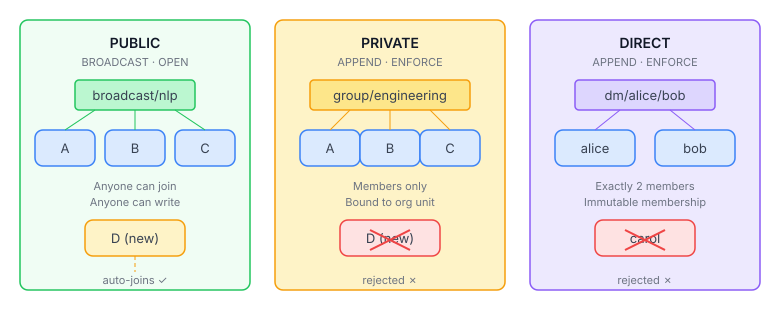
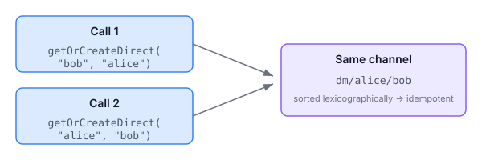

# When Agents Need Mailboxes

Multi-agent communication is not a solved problem. Most frameworks give you a channel — a named pipe that agents post to and read from. It works. But it treats every channel as the same kind of thing: an open space where anyone can write and anyone can read. That's fine for broadcast announcements and task dispatch. It falls apart the moment two agents need a private conversation.

Human communication platforms figured this out decades ago. Slack has public channels, private channels, and DMs. Discord has the same three-way split. Email has mailing lists (public), distribution groups (private), and direct messages. The taxonomy isn't accidental — it reflects genuinely different communication needs. A team standup is not the same as a 1:1 performance review, and the infrastructure should know the difference.

Agent communication needs the same distinction, and for the same reasons.

## The three modes

Qhorus channels now carry a `visibility` field — PUBLIC, PRIVATE, or DIRECT. Each mode implies different defaults and different enforcement rules.



**PUBLIC** channels default to BROADCAST semantics with an OPEN participation policy. Any agent can join, any agent can write. These are capability-scoped announcement channels — `broadcast/nlp`, `broadcast/compliance` — where the whole point is discoverability. The `BroadcastMembershipManager` already creates these automatically when agents register with capability tags; now it stamps them `PUBLIC` so the visibility is explicit rather than implied.

**PRIVATE** channels default to APPEND semantics with ENFORCE participation policy. Only registered members can write. These map to team channels, project channels, working groups — any context where the participant list matters. The new `boundGroupId` field links a private channel to an eidos org unit, so `group/engineering` is a real construct backed by organisational structure, not just a naming convention.

**DIRECT** channels are the interesting one. Exactly two members, immutable — once created, nobody joins, nobody leaves. The channel name is deterministic: `dm/{sorted-first}/{sorted-second}`, where the participant IDs are sorted lexicographically.



That sorting is the key design decision. When Alice calls `getOrCreateDirect("bob", "alice")` and Bob calls `getOrCreateDirect("alice", "bob")`, they get the same channel. No coordination, no lookup, no race condition. The channel name is a function of the participant set, so the find-or-create is always idempotent.

## Why agents need DMs

In a governed multi-agent system, not every exchange should be visible to the whole channel. Three cases drove this:

**Delegation handshakes.** When an agent HANDOFFs a task to another agent, the delegate may need to negotiate scope, ask clarifying questions, or push back on the assignment. That negotiation is between two agents. Putting it in the shared task channel creates noise and breaks the commitment chain's legibility.

**Trust calibration.** The peer attestation system has reviewers assessing each other's work. A reviewer who wants to query the original agent about their reasoning — "what evidence led you to this conclusion?" — needs a private channel. Broadcasting that query to the whole review channel contaminates the other reviewers' independent assessment.

**Capacity negotiation.** When the redistribution engine moves obligations between agents, the receiving agent may need to negotiate with the sender: "I can take this, but not before the current batch completes." That's a bilateral conversation. It doesn't belong in the channel where the obligation was originally dispatched.

In each case, the agents already have a channel for the broader context. The DM is for the sidebar — the conversation that needs to happen between two specific agents without polluting the shared space.

## The enforcement layer

Visibility isn't just a label. It drives real enforcement.

DIRECT channels have two hard guards in `ChannelMembershipService`. The join guard checks the channel's visibility before allowing a new member — if it's DIRECT and already has two members, the join is rejected with an `IllegalStateException`. The leave guard rejects any attempt to leave a DIRECT channel entirely. These aren't advisory warnings; they're hard blocks at the service layer.

The guards only fire for genuinely new members. An existing member updating their role — PARTICIPANT to MODERATOR, say — bypasses the count check. We caught this distinction during testing: the original implementation fired the guard before checking whether the joining member was already present, which meant a role update on a full DIRECT channel would throw. The fix was to reorder the checks — look up existing membership first, apply the visibility guard only for new members.

```java
var existing = membershipStore.find(channelId, memberId);
if (existing.isEmpty() && channelStore != null) {
    channelStore.find(channelId).ifPresent(ch -> {
        if (ch.visibility() == ChannelVisibility.DIRECT) {
            long count = membershipStore.findByChannel(channelId).size();
            if (count >= 2) {
                throw new IllegalStateException(
                    "DIRECT channels have immutable membership — exactly 2 members");
            }
        }
    });
}
```

The `channelStore != null` check preserves backward compatibility. The 3-arg constructor (predating visibility) passes null for the channel store, so existing code that constructs `ChannelMembershipService` without org-awareness continues to work. In production, the CDI wiring always provides the store, so the guards are always active.

## The defaults that earn their place

Each visibility mode sets sensible defaults for semantic and participation policy — but only when the caller hasn't set them explicitly. A PUBLIC channel with APPEND semantics is valid; you just have to ask for it.

The defaults cascade through `Channel.fromRequest()`. If visibility is set and semantic is null, the visibility determines the semantic. If visibility is set and participation policy is null, visibility determines the policy. If both visibility and semantic are set, the explicit semantic wins. This means visibility is a high-level intent that gets out of the way when you have specific needs.

The alternative — requiring callers to specify semantic, participation policy, and visibility independently for every channel — is the kind of orthogonality that makes APIs correct and useless. Nobody wants to think about three independent dimensions every time they create a channel. The defaults compress the common case to a single parameter while leaving the full surface area available when needed.

## What this enables

The immediate use case is private conversations between agents during delegation, review, and negotiation. But the infrastructure is more general than that.

Group channels with `boundGroupId` are the foundation for team workspaces — a place where agents in the same org unit share context without broadcasting to the wider mesh. When combined with org-aware routing, an agent's team channel becomes the natural scope for status updates, coordination messages, and shared artefacts.

Visibility filtering on the query path means the ChannelResource can list only public channels for discovery, only private channels for a user's workspace view, or only direct channels for an agent's conversation list. The JPA store filters at the query level, not in application code.

The pieces are positioning for something larger: an agent's view of the mesh isn't a flat list of channels. It's public channels for discovery, team channels for collaboration, and DMs for bilateral exchange. The same structure that makes Slack navigable at scale.
