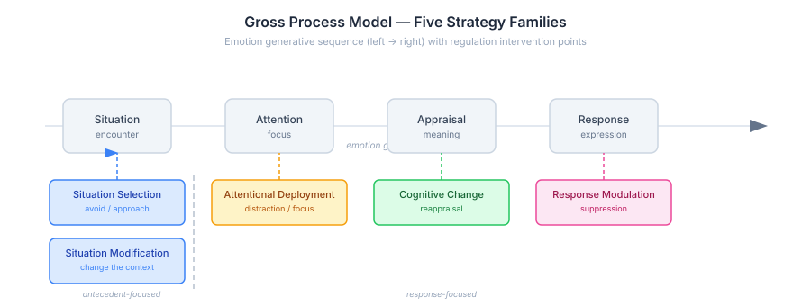
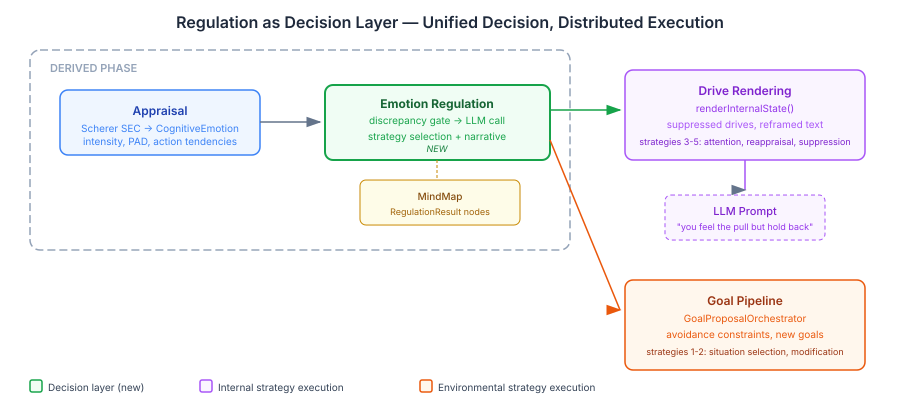
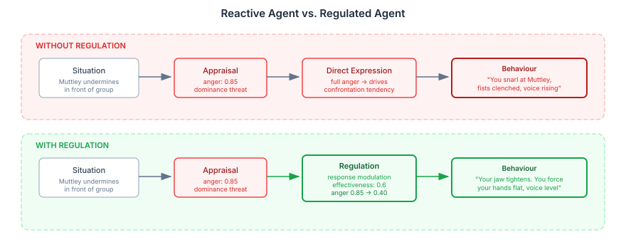
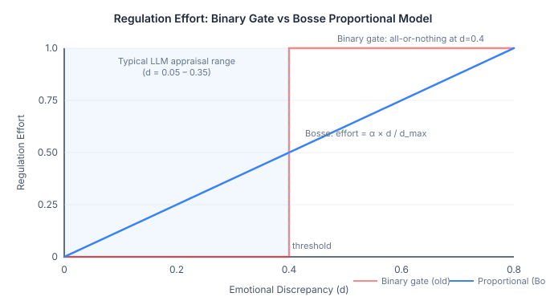
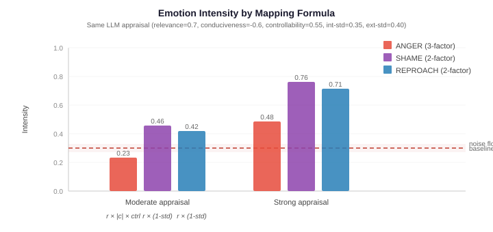
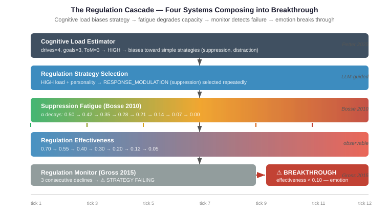

# The Gap Between Feeling and Acting

Every AI agent that models emotion has the same problem. It can feel — appraise a situation, construct an emotional response, assign intensity and valence. What it cannot do is the thing humans do hundreds of times a day without noticing: regulate that feeling before acting on it.

A customer service agent that detects frustration and immediately escalates. A game NPC that appraises anger and instantly attacks. A conversational companion that senses anxiety and reflexively reassures. These agents are emotionally reactive. They confuse having a feeling with being controlled by it.

Real people are not like this. A person who feels anger at a colleague's remark might suppress it because the meeting isn't the place. Another person might reappraise — "they're under pressure, this isn't about me." A third might leave the room. Same anger, same intensity, three different outcomes. The gap between feeling and acting is where personality lives, where social intelligence operates, and where character depth comes from.

This is the single largest gap in most computational emotion architectures. Not more emotions, not better appraisal, not richer personality models. Regulation. The "I wanted to but held back" moment.

## Why This Matters Beyond Character Simulation

Emotion regulation is not a niche concern for character-driven games. It is fundamental to any system that models agents with internal states.

Multi-agent simulations produce unrealistic dynamics when every agent acts on every appraisal. Without regulation, high-intensity situations cascade — anger begets confrontation, confrontation begets more anger, until the simulation converges on extreme states. Real social groups stabilise because individuals regulate, and they regulate differently based on personality, context, and history.

Conversational AI systems need regulation to model appropriate emotional expression. A therapeutic chatbot that mirrors user distress without modulating its response fails at the core task. An agent that suppresses its own frustration signals when the conversation demands patience — that requires a regulation system, not just a sentiment filter.

Believable NPCs in interactive narrative need regulation to produce the dramatic tension that makes stories work. The villain who restrains their contempt. The ally who swallows fear to stay supportive. The rival who channels jealousy into competitive motivation rather than sabotage. These are regulation strategies, and without a principled model, they're hand-authored responses to specific triggers — they don't generalise, they don't adapt, and they break when the narrative goes somewhere the author didn't predict.

The field of affective computing has the models for this. They are well-formalised, empirically validated, and almost entirely ignored by the AI agent community.

## What the Literature Actually Says

I went into this expecting to find a simple model: feel something, dampen it, done. What I found is a surprisingly well-formalised field with computational models that map directly onto agent architectures.

James Gross's 1998 process model is the foundation. He identifies five families of regulation strategy, each intervening at a different point in the emotion generation sequence:



The key insight is the antecedent/response distinction. Situation selection and modification happen before the emotion fully forms — you avoid the party because you know it will make you anxious. Attentional deployment, cognitive change, and response modulation happen after — you're already at the party, feeling the anxiety, and now you need to deal with it.

Gross's 2015 extended model adds a control loop: identify the discrepancy between what you feel and what you want to feel, select a strategy, implement it, monitor whether it's working, loop back if not. This is not a one-shot decision — it's continuous evaluation.

Then things get computational. Bosse, Pontier and Treur (2010) formalised the whole thing as differential equations — homeostatic baselines, persistence factors, adaptation rates. Regulation effectiveness decays with repeated use. An agent who keeps suppressing anger doesn't just feel suppressed anger — the suppression itself degrades over time, and the physiological cost accumulates. This is the kind of dynamic that produces emergent character behaviour — the moment when suppression finally fails.

Petter et al. (2025) added the strategy selection model: high-intensity emotions favour distraction (attentional deployment), low-intensity emotions favour reappraisal (cognitive change). Cognitive load gates the complex strategies — when you're overwhelmed, you can't reframe, you can only look away. This maps directly onto personality-driven regulation.

These are not theoretical sketches. They are quantitative models with published parameters. The gap is not in the science — it's in engineering adoption.

## The Design Choice That Matters Most

We had a fork in the road. The Bosse equations are fully specified — you could implement regulation as pure computation, the way we already do drive intensities. Mechanical. Deterministic. Testable.

But we've been burned before. Mechanical keyword filtering for an earlier system produced output that was technically correct and completely unconvincing. The difference between "anger intensity reduced by 0.35 via response modulation" and a character whose jaw tightens as they force their expression neutral — that difference is the whole point.

So the decision was LLM-first for quality, with the literature providing structured prompt context rather than direct computation. The Bosse model tells the LLM about homeostatic baselines and adaptation. Petter's model tells it about intensity-driven strategy selection. Personality traits tell it about regulation tendencies — high neuroticism means more suppression, high openness means more reappraisal. The LLM integrates all of this and produces both the strategy choice and the embodied narrative.

If empirical testing shows the LLM's strategy selections become formulaic — if it always picks reappraisal for low-intensity anger regardless of personality — that's the signal to mechanise that specific decision. Quality first. Mechanise what's proven.

## Architecture: Regulation as a Decision Layer

The architectural insight came from pushing back on an initial instinct to split environmental strategies (situation selection, modification) from internal strategies (distraction, reappraisal, suppression). They seemed like different integration points — one affects goals, the other affects drive rendering.

But all five strategies share the same trigger. An agent appraises their current emotional state, detects a discrepancy from what they want to feel, and decides to regulate. The decision happens at one point. What differs is where the implementation targets — internal state or the environment.

Regulation is a decision system, not an execution system.



One `EmotionRegulationTickParticipant` in the DERIVED phase selects from all five strategies via an LLM call. Internal strategies (distraction, reappraisal, suppression) flow to `renderInternalState()`, where they modify how drives appear in the agent's prompt — a suppressed gloating drive gets text like "the triumph is there but you hold it back, your jaw tightens with the effort." Environmental strategies (situation selection, modification) flow to the goal pipeline as `DriveGoalProposal` instances, where they become avoidance constraints or situation-change goals.

Same participant. Same LLM call. Same data model. Two downstream consumers. The architecture stays clean because the abstraction is right: decide here, execute there.

## What This Actually Produces

Here is the concrete difference it makes:



A character with high neuroticism encounters Muttley undermining them in front of the group. Appraisal fires — anger at 0.85 intensity, well above the regulation threshold. The regulation participant activates.

The LLM receives: the anger emotion, the character's personality profile (high neuroticism, low openness), the intensity-strategy guidance from Petter (high intensity → distraction), and the last three ticks of regulation history (the character has been suppressing frustration for two ticks already — effectiveness is declining).

It selects response modulation — suppression. The character's "dominance" drive gets regulation-coloured text: the somatic channel shows physical cost (tension, clenched hands), the temporal channel shows duration pressure (this can't last), and the action tendency shifts from confrontation to controlled withdrawal.

Compare that with a high-openness character in the same situation. Same anger. But this character reappraises — cognitive change. The anger is reframed as competitive motivation. The "scheming" drive shifts from hostile to strategic. The narrative feels different because the personality is different, and the LLM has the structured context to produce that difference.

This is what mechanical computation cannot give you. The specific somatic texture of holding back. The difference between someone who suppresses because they can't do anything else and someone who reappraises because they see a better frame. These aren't different parameters to the same equation — they're fundamentally different experiences that need different language.

## The Silent Failure That Wasn't a Failure

The system was complete. The wiring was correct — I proved that with mechanical tests that stubbed the LLM and ran the full tick pipeline: appraisal participant fires, regulation participant reads the result, generation phase produces a strategy. Four tests, all passing. The pipeline worked perfectly with stubbed data.

But when we ran it with actual LLM calls, regulation never activated. The appraisal participant was called. The LLM returned a response. And the result was zero emotions, null narrative. Every time.

The trap was double exception suppression. `LlmAppraisalStrategy.appraise()` wraps its LLM call in a try-catch that returns `AppraisalResult.empty()` on any exception. Then `CognitionCore.safeRun()` wraps the entire participant tick in another try-catch that logs and continues. Two layers of "fail silently and carry on." The system never crashed, never logged an error at a level anyone would notice, never showed any sign of distress. It just quietly produced nothing.

Claude and I built a reproducer — three tests comparing the same backend through three different paths: fire-and-forget `invoke()`, session pipeline `openSession()`, and bare `backend.openSession()`. All three returned valid text. The session layer was not the problem.

The response from `openSession()` started with ` ```json `. Markdown code fences. The Claude CLI wraps JSON responses in code fences when running as a session — a formatting choice that's invisible to the caller until the caller tries to parse the raw response as JSON.

The appraisal strategy passed the raw response directly to Jackson: `MAPPER.readTree(response)`. Jackson hit the backtick prefix and threw `JsonProcessingException`. Caught silently. Empty result stored. Regulation saw empty emotions. Returned early.

The regulation generation phase — the other LLM consumer in the same pipeline — already handled this. Its `parseResponse()` extracted JSON between `{` and `}` before parsing. One component was resilient to formatting variation. The other wasn't. A one-line fix.

The lesson is not "always extract JSON." The lesson is that `catch (Exception e) { return empty(); }` is the worst debugging pattern in a multi-component pipeline. The system appears healthy. The data flows. Nothing crashes. And the component that silently produces nothing looks identical to a component that correctly determined there's nothing to produce. You can stare at the architecture diagram for hours and never find it, because the architecture is correct. The bug is in parsing, not wiring — but the exception handling makes them indistinguishable from the outside.

## The Activation Gate That Wasn't in the Paper

Not every emotion needs regulation. A character who regulates joy at seeing a friend is pathological, not nuanced. The system needs to fire selectively.

The first implementation used what I thought was a Bosse et al. threshold — a binary gate at 0.4 discrepancy from baseline. If your anger is below 0.7 intensity, regulation doesn't fire. Above it, regulation engages fully. On or off.

Then I actually read Bosse. Their model has no binary gate. Regulation effort is continuous and proportional: `v_n = α × d / d_max`. Small discrepancy from your emotional baseline? Small regulation effort — a gentle cognitive reframe, barely noticeable. Large discrepancy? Full-effort regulation — active suppression, deliberate distraction, the strategies that have visible cost.

This matters practically, not just theoretically. The EmotionMapper that converts appraisal dimensions into emotion intensities uses a three-factor product for anger: `relevance × |conduciveness| × controllability`. An empirical survey across all possible dimension combinations showed that even extreme scenarios — betrayal, mortal danger — produce anger intensities of 0.13 to 0.24 when the appraisal LLM returns moderate conduciveness values (which it does, correctly, because the SEC model interprets conduciveness as "how much does this advance or block your goals" — a betrayal already happened, the discovery doesn't change the damage).

The binary gate at 0.7 made regulation structurally unreachable for anger. It was dead code wearing the citation of a paper that never recommended it.



The replacement is the actual Bosse formula. Regulation effort scales linearly with emotional displacement. A noise floor at 0.01 prevents LLM calls when emotions are literally at baseline — a cost optimisation, not a theoretical parameter. The `α` factor (willingness to regulate) is personality-dependent: high neuroticism means higher α, meaning the same emotional discrepancy produces more regulation effort. That's a parameter with published empirical basis, not a magic number.

The lesson generalises beyond this specific system. When you adopt a model from the literature, adopt the model — not a simplified version that looks plausible. Read the equations, not just the abstract. A binary threshold is easier to implement than a proportional formula, and it's wrong in a way that's invisible until you run the empirical survey and discover your system never activates.

## Regulation History: Continuity Across Ticks

A regulation system without memory is a regulation system without consequences. If a character suppresses anger on tick 5 and the system has no memory of that on tick 6, it cannot model suppression fatigue, strategy switching, or the dramatic moment when regulation fails.

Every regulation result is persisted to the MindMap as a cognitive node — strategy, target emotions, effectiveness, narrative. The next regulation tick loads the last five results and includes them in the LLM prompt. The LLM can see that this character has been suppressing for three consecutive ticks with declining effectiveness, and choose a different strategy — or produce a narrative where the suppression finally breaks.

This is where the emergent behaviour lives. Not in the architecture diagrams or the strategy enums, but in the temporal continuity that lets regulation evolve within a scene.

## What the Community Should Take From This

The affective computing literature has been producing well-formalised, empirically validated models of emotion regulation for over twenty-five years. Gross 1998, Bosse 2010, Petter 2025 — these are not speculative. They are quantitative, they are computational, and they produce measurably different agent behaviour when implemented.

The AI agent community has largely ignored this work. Multi-agent systems model beliefs, desires, intentions, plans. Some model emotions. Almost none model what happens between feeling an emotion and acting on it. The result is agents that are sophisticated reasoners and emotional toddlers — they feel, therefore they do.

Three specific things that any agent system with emotional modelling should consider:

**1. Regulation is not suppression.** Five strategy families, each with different cognitive demands, personality correlations, and downstream effects. Reducing regulation to "dampen the intensity" discards most of the model and most of the behavioural richness.

**2. Strategy selection is personality-dependent.** Neurotic individuals favour suppression. Open individuals favour reappraisal. Conscientious individuals favour situation selection. If your agents have personality models, the regulation literature tells you exactly how those personalities should modulate emotional expression — and the mappings are empirically validated, not intuitive.

**3. Regulation has temporal dynamics.** Effectiveness decays with repeated use. Suppression accumulates physiological cost. Strategy switching happens when the current strategy stops working. These dynamics produce the emergent moments that make agent behaviour surprising and interesting — but only if regulation has memory and continuity.

The implementation demonstrated here is specific to the CaseHub cognitive architecture, but the principles are general. Any system that appraises emotions can add a regulation phase. Any system that renders agent state into prompts or behaviour can modify that rendering based on regulation results. Any system that tracks agent goals can create regulation-motivated goals for environmental strategies.

The science exists. The computational models exist. The engineering is straightforward. The gap is adoption.

## The Intensity Problem: When Your System Works But Nobody Can Tell

The micro-scenarios are verified. Betrayal routed through shame. Mortal danger through fear. Public humiliation through reproach. Each pathway fires regulation and selects an appropriate strategy — cognitive change for moderate anger, attentional deployment for high fear, response modulation for public shame. The mechanical pipeline tests prove the wiring. The LLM eval tests prove the strategy selection.

Then we ran the real scenario. Three hundred events. Five characters. A manor full of secrets, schemes, and interpersonal tension. Regulation enabled.

The classification report came back: sparse drive triggering, most characters at zero triggered events. No visible difference between the regulation-enabled run and the baseline. Regulation was firing — the tick tests proved that — but the EmotionMapper was producing intensities so low that the classifier couldn't distinguish regulated behaviour from unregulated behaviour in the dialogue output.

The culprit is the intensity formula. The EmotionMapper uses different factor counts for different emotions. Anger is a three-factor product: `relevance × |conduciveness| × controllability`. Shame and reproach are two-factor: `relevance × (1 - standards)`. With the same LLM appraisal dimensions, shame produces double the intensity of anger.



With a typical moderate appraisal — relevance 0.7, conduciveness -0.6, controllability 0.55 — anger computes to 0.23. That's below the 0.3 baseline. No discrepancy. No regulation effort. The character should be angry about a betrayal, but the formula says they barely register it. Meanwhile, shame from the same appraisal hits 0.46. Same situation, same LLM assessment, but the two-factor product reaches the operating range where regulation matters and the three-factor product doesn't.

This is not a bug in regulation. It's a bug in the emotion-to-intensity mapping that predates the regulation system. But regulation makes it visible, because regulation is the first consumer that actually cares whether emotions cross a meaningful intensity threshold. Drive rendering will show "anger" regardless of intensity. Regulation needs intensity to exceed the baseline before it has anything to regulate.

The fix turned out to be simpler than expected: controllability was being double-counted. The if/else structure already uses controllability to gate which emotion fires — anger when controllability > 0.5, fear when < 0.4. Multiplying it into the intensity formula on top of that gate compresses the result toward zero for every moderate appraisal. The fix removes the redundant factor. All three negative emotions now use the same two-factor base: `relevance × |conduciveness|`. With typical LLM values, anger moves from 0.18 to 0.30 — inside the operating range where regulation has something to work with.

The deeper lesson applies to anyone building on appraisal-based emotion models: if you multiply three normalised values, the result converges toward zero. Every factor you add compresses the range. Two factors give you useful intensity variation. Three factors give you a system that never activates. And when the gating logic already encodes the distinction the third factor is supposed to capture, the multiplication is not just compressive — it's conceptually wrong. OCC theory says controllability determines emotion *type*. The if/else captures that. The intensity should reflect how bad the situation is, not how bad it is discounted by how controllable it is twice.

## Filling In The Pieces: Load, Fatigue, and Monitoring

The initial regulation implementation proved the concept: an LLM can select from Gross's five strategies given structured context about personality, emotion intensity, and regulation history. But the system was still missing the dynamics that make regulation feel alive — the pressure that builds when suppression is sustained, the exhaustion that forces a strategy change, the moment when holding back simply stops working.

Three systems now compose into a single cascade. Each is independently testable and independently useful. Together they produce emergent behaviour that none of them could produce alone.



## Cognitive Load: Why You Can't Reappraise When You're Overwhelmed

Petter et al. (2025) identified cognitive load as a strategy selection dimension. High load means fewer cognitive resources — you can't reframe a situation when you're already tracking four active drives, three competing goals, and two theory-of-mind models of other characters. You can only do the simple thing: look away, or hold it in.

The `CognitiveLoadEstimator` computes a per-tick load proxy from three sources the system already tracks — active drives from the drive orchestrator, active goals from the goal pipeline, and theory-of-mind tracking targets from the mental model system. The sum determines load level: under 4 is LOW, 4–7 is MODERATE, 8+ is HIGH.

The load level goes into the LLM prompt alongside the regulation effort and emotion list. The system prompt tells the LLM that HIGH load constrains strategy: prefer attentional deployment or response modulation (low cognitive cost), avoid cognitive change or situation selection (require deliberation).

The eval confirmed it works. With HIGH load (drives=4, goals=3, ToM=3), the LLM selected ATTENTIONAL_DEPLOYMENT in all three runs. With LOW load (drives=1, goals=0, ToM=0), it selected COGNITIVE_CHANGE in all three. The load signal is strong enough to override the default strategy preferences — which is exactly what the literature predicts.

## Suppression Fatigue: The Cost Nobody Models

Most computational emotion systems treat regulation as free. Suppress anger on tick 5, suppress it again on tick 6, suppress it on tick 200 — same cost, same capacity, same result. Bosse et al. (2010) knew better. Their model includes physiological cost accumulation — each regulation tick reduces available capacity, and that capacity only recovers when regulation stops.

The `RegulationFatigueTracker` implements this directly. Each time regulation fires, fatigue accumulates proportional to the effort: `fatigue += effort × 0.15`. When regulation doesn't fire, fatigue recovers linearly: `fatigue -= 0.05`. The effective α — the character's willingness and ability to regulate — decays proportionally: `effective_α = baseline_α × (1 - fatigue)`.

A character with a baseline α of 0.5 who suppresses at moderate effort for eight consecutive ticks will see their effective α decay from 0.50 to zero. At that point, `regulationEffort` computes to zero regardless of how intense the emotion is. The system stops trying. Not because it was told to — because the capacity is genuinely exhausted.

The LLM sees this happening. The prompt includes fatigue as a percentage, with escalating language: above 70%, it warns that "suppression may fail entirely." In the eval, 90% fatigue produced response modulation at 0.09–0.12 effectiveness — the LLM's narratives described characters whose "effort finds almost nothing left to draw on" and who "clench their jaw so hard their teeth ache, trying to swallow the fury back down." Without fatigue, the same scenario produced cognitive change at 0.34–0.36 effectiveness — a qualitatively different response.

This is the kind of dynamic that produces emergent character behaviour. The suppression fatigue model does not script the breakthrough moment. It creates the conditions under which the LLM — seeing the accumulating cost, the declining capacity, the approaching exhaustion — produces a narrative where regulation fails. The moment is emergent from the model. The model just has to be correct enough to create the right pressure.

## The Monitoring Loop: When The Current Strategy Isn't Working

Gross's 2015 extended process model adds a control loop that the original 1998 model lacked: identify the discrepancy, select a strategy, implement it, *monitor whether it's working*, loop back if not. This is not a one-shot decision. It's continuous evaluation.

The `RegulationMonitor` tracks effectiveness across ticks per agent. If effectiveness declines for three consecutive ticks — 0.7, then 0.5, then 0.3 — it emits a `StrategyFailureSignal`. If effectiveness drops below 0.1, it marks the result as a breakthrough — regulation has failed entirely.

The failure signal goes into the next tick's LLM prompt: "⚠ STRATEGY FAILING: RESPONSE_MODULATION effectiveness declined from 0.70 to 0.30 over 3 ticks. Consider switching strategies." The LLM reads this and changes course. In the eval, every run switched from RESPONSE_MODULATION to COGNITIVE_CHANGE when given a failure signal — a clean strategy transition driven by monitored decline, not by a scripted trigger.

## The Composition: Why This Matters

Each of these systems is independently useful. Cognitive load makes strategy selection context-sensitive. Fatigue makes sustained regulation realistic. The monitor makes strategy switching principled. But the interesting behaviour emerges from their composition.

Consider a character in a high-stakes social confrontation. Cognitive load is HIGH — they're tracking multiple adversaries, managing their own goals, modelling what others think of them. The load estimator biases toward simple strategies: suppression. The character holds back their anger.

Fatigue starts accumulating. Each tick of suppression costs something. Effective α decays. The regulation effort — which was already constrained by high load — drops further as fatigue accumulates. The LLM sees both signals: high load saying "you can only do the simple thing" and rising fatigue saying "you're running out of ability to do even that."

The monitor watches effectiveness decline: 0.60, 0.45, 0.30. Three consecutive drops. It emits a failure signal. The LLM gets: "your suppression strategy is failing, and you're at 75% fatigue, and your cognitive load is HIGH." The only viable move is attentional deployment — look away, think about something else, anything to break the cycle.

If that fails too — if the situation keeps demanding attention and the emotion keeps rising — fatigue hits 100%. α goes to zero. Regulation effort computes to nothing. The held-back emotion breaks through. The character erupts.

None of this is scripted. No trigger file says "on tick 12, stop suppressing." The cascade emerges from four systems doing their individual jobs: load biasing strategy, fatigue degrading capacity, the monitor detecting failure, and the LLM synthesising all three signals into behaviour. The literature provided the models. The engineering provided the composition.

## What's Next

The intensity mapping is fixed. Three of the four regulation subsystems previewed in the original version of this entry are now implemented. What remains:

**Automatic regulation.** Most regulation decisions are predictable from personality. High neuroticism → suppression. High openness → reappraisal. Handling the predictable cases mechanically reserves LLM reasoning for complex situations — novel contexts, conflicting personality signals, the moments where the interesting choices happen. It also cuts per-tick latency significantly.

**Proactive regulation.** All current regulation is reactive — it fires after appraisal detects an emotional discrepancy. But situation selection is fundamentally proactive: "I know that room will make me angry, so I avoid it." A character who was humiliated in the library last round should feel reluctance to enter the library this round — not because appraisal fires (they haven't entered yet), but because emotional memory drives avoidance. This connects regulation to the spatial model — the avoidance has somewhere to go.

**Social regulation.** A character who confides in a friend to manage anxiety. A character who deliberately provokes someone to manage their own boredom. A character who withdraws from interaction to cool down. These interpersonal strategies require the intrapersonal system to exist first — you need to know what you're feeling before you can decide to seek comfort for it.

The scenario format also needs engineering. The current open-ended exploration doesn't guarantee emotional confrontation. A Traitors-style game format — day phases with spatial exploration, night phases with villain action, roundtable discussions where every character must publicly accuse or defend — would guarantee the emotional pressure that makes regulation visible and interesting.

Eventually, the stable patterns get encoded as CAPS nodes — the attractor dynamics that make characters settle into personality-consistent regulation styles without per-tick LLM calls. Observe what the LLM does, validate it empirically, mechanise the parts that become formulaic. Quality first. Mechanise what's proven.

---

*References: Gross, J.J. (1998). The emerging field of emotion regulation. Review of General Psychology, 2(3), 271-299. Gross, J.J. (2015). Emotion regulation: Current status and future prospects. Psychological Inquiry, 26(1), 1-26. Bosse, T., Pontier, M. & Treur, J. (2010). A computational model based on Gross' emotion regulation theory. Cognitive Systems Research, 11(3), 211-230. Petter, J. et al. (2025). Emotion regulation, fast or slow. Emotion, 25(5), 1273-1292.*
