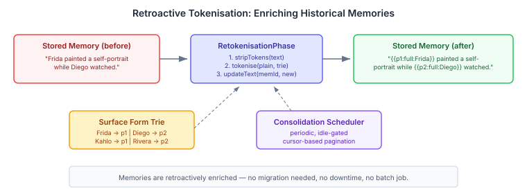
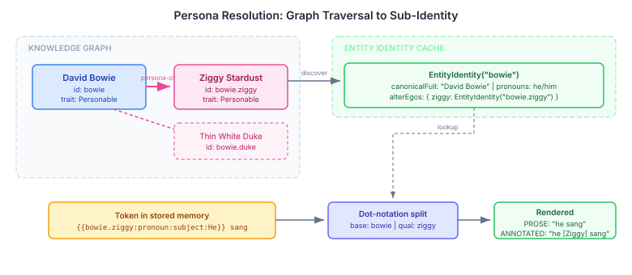

# She Said — But Who Is She?

The [entity tokenisation](2026-11-03-mdp03-names-are-not-identity.md) design was deliberately minimal: stable identity tokens in stored text, dynamic name resolution at render time. The [last-mile wiring](2026-11-04-mdp02-the-last-mile-for-entity-tokens.md) closed the pipeline. Everything works — for single entities with single names that were tokenised at write time.

Real identity is messier. Thousands of memories predate the tokeniser and still contain literal names. David Bowie is also Ziggy Stardust — a memory about Ziggy needs to resolve to Bowie's identity graph, not float as an orphan. And when tokenised text reaches a sub-LLM for analysis, "she" is ambiguous. The sub-LLM doesn't know who "she" refers to.

Most AI agent frameworks never face these problems because they never separate identity from surface form in the first place. The agent's prompt says "Alice told Bob about the project" and that string is the entire representation. It works until it doesn't. The question for any system that does separate them: does the abstraction hold when reality gets complicated?

## Retroactive Tokenisation

The tokeniser works at write time — Aho-Corasick scanner recognises surface forms, tokens replace them. But what about the thousands of memories already stored with literal names?

The conventional answer is a migration script. Run once, update everything, move on. Entity identities change constantly — new aliases appear, entities merge, preferred names shift. A one-shot migration is obsolete the day after it runs.

The consolidation engine already runs periodic maintenance phases — merge detection, experience graduation, community summarisation. Re-tokenisation slots in as another phase. Each run, it scans a batch of memories, strips any existing tokens back to plain text, re-tokenises against the current surface form trie, and writes the result back via `updateText()` — a new SPI method added to the memory store.



The cursor persists on a sentinel node in the MindMap's TYPE_SYSTEM subgraph, so the phase picks up where it left off across consolidation cycles. No batch job, no downtime, no migration. Memories are retroactively enriched as a background process, using the latest identity data every time.

This is the deeper point: memories in a cognitive system are not immutable records. They're living documents that the system refines over time. Adding `updateText()` to the store SPI made that principle explicit. Re-tokenisation is just one consumer — sub-thought extraction, belief revision, and narrative enrichment all write back to stored memories through the same method. The moment you accept that stored text is mutable, a whole category of "impossible without migration" problems disappears.

## Personas — When Identity Fragments

David Bowie performed at Hammersmith Odeon. So did Ziggy Stardust. Same person, same stage, same night — but a system that merges them into one entity loses something real. Bowie *as Ziggy* carried a different voice, different songs, different relationships with the audience. An AI agent modelling a person with multiple public identities — an author with a pen name, a performer with a stage persona, a professional with a personal identity — needs both the connection and the distinction.

The MindMap already has the vocabulary mechanism for typed edges. A `persona-of` edge links a persona node (Ziggy Stardust) to its base entity (David Bowie). The `EntityIdentityCache` discovers personas by traversing these edges during its scan — any node with an inbound `persona-of` edge gains alter egos in its `EntityIdentity` record.



Tokens use dot-notation to address sub-identities: `{{bowie.ziggy:full:Ziggy Stardust}}`. The renderer splits on the dot, looks up the base entity, then resolves the qualifier into the alter ego's identity. Same token format, same rendering pipeline, no special cases. If the cache can't find the qualifier — maybe the persona was removed — it falls back to the original surface form. Graceful degradation throughout.

The `CognitiveProfile` also follows persona edges. When the system asks "what do you know about David Bowie?", the profile resolver follows `persona-of` edges inward, collects persona node IDs, and queries memories across all of them. Ziggy's relationships and experiences appear as part of Bowie's complete knowledge. One entity, multiple identities, unified retrieval.

## Annotated Rendering — Same Token, Different Consumer

The third stress test is the most subtle. PROSE mode resolves `{{p1:pronoun:subject:She}}` to "she" — correct for the agent's own prompt, where narrative flow matters. But when the same text is forwarded to a sub-LLM for appraisal or extraction, "she" is ambiguous. The sub-LLM has no entity context. It doesn't know who "she" refers to.

ANNOTATED mode resolves the same token to "she [Frida]" — the pronoun followed by a disambiguation label in brackets. The renderer already has the entity ID from the token and the canonical first name from the identity record. Three lines of code in the resolution path:

```java
if (mode == RenderMode.ANNOTATED && token.variant().startsWith("pronoun:")) {
    String label = identity.resolveVariant("canonicalFirst");
    if (label == null) label = identity.canonicalFull();
    return resolved + " [" + label + "]";
}
```

Non-pronoun tokens pass through unchanged — "Frida" doesn't need a `[Frida]` label. The mode is a per-call parameter, so analysis pipelines opt into annotated rendering while prompt composition uses prose. Same stored text, same token format, different rendering per consumer.

## Why This Matters Beyond This System

The conventional wisdom in AI agent frameworks is that entity handling is a solved problem — or rather, not a problem at all. Store the text, embed it, retrieve it. Names are just strings. This works until you need to rename an entity across thousands of memories, until two entities share a name, until a sub-LLM needs to know who a pronoun refers to, until an entity's public identity shifts.

These aren't edge cases. They're the normal conditions of any system that maintains long-term memory about people, places, and organisations. The reason most frameworks don't encounter them is that most frameworks don't have long-term memory worth the name.

Three capabilities that weren't in the original design: re-tokenisation required a new SPI method on the memory store but no changes to the token format. Personas required a new edge type and a graph traversal but no changes to the renderer — dot-notation fell out of the existing resolution logic. Annotated rendering required three lines and a new enum value.

The token format absorbed all three because it separated the right concerns: identity (the entity ID) from presentation (the variant) from provenance (the surface form). That three-way separation is the thing worth stealing. If you're building an AI system that maintains persistent memory about entities, baking names into stored text is technical debt that compounds silently until the day it doesn't.
