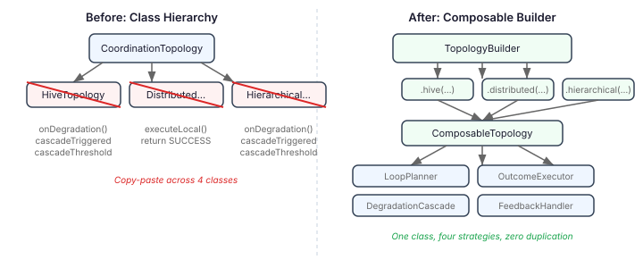

# The Class Hierarchy That Wasn't Earning Its Keep

A few days ago I wrote about the [six topologies](2026-11-03-mdp01-six-topologies-one-primitive.md) we'd built on the `CoordinationTopology` SPI — centralised, distributed, hierarchical, hybrid, graduated, and hive. The SPI was clean: three methods, constructor-injected dependencies, a `TopologyContext` record that stays universal. The closing line was confident: "When the topology is a factory, changing coordination strategy is a configuration change. When the topology is a coordinator, changing strategy is a rewrite."

That claim held up. What didn't hold up was the code underneath it.

## The post-landing audit

A hardening pass across the society integration found five concrete problems. The critical one: `HivePatternAdapter.executeSupervisor()`, `executeDebate()`, and `executeVoting()` all returned `CompletableFuture.completedFuture(SUCCESS)`. No orchestration. No delegation. Three methods that compile, pass their tests, and do nothing.

But that finding was the symptom. The disease was structural.

## The same thirty lines, four times

Every topology that supports degradation cascade — Hive, Hierarchical, Hybrid, and Graduated — contains the same code:

```java
if (event.fallbackActive() && !cascadeTriggered.get()
    && cascadeThreshold != null
    && cascadeThreshold.isBreached(degradedLoops,
            loopPriorities.size(), loopPriorities)
    && cascadeTriggered.compareAndSet(false, true)) {
    // ... cascade response
}
```

Identical threshold-checking, identical `AtomicBoolean` guard, identical `ConcurrentHashMap<String>` tracking. Only the cascade response diverges — Hive switches orchestration patterns, Graduated forces scope reduction, the others activate triggers.

That's not reuse. That's copy-paste.

Four classes also share the same fields: `degradedLoops`, `cascadeTriggered`, `cascadeThreshold`, `loopPriorities`, `cascadeTriggers`. Five identical field declarations, initialised in four different `configure()` methods with the same boilerplate.

And the outcome execution? Every topology — including the ones that didn't stub theirs — returns `completedFuture(SUCCESS)` for most `DecisionOutcome` variants. Six classes, one honest implementation.

## The wrong question

The natural fix for hollow execution methods is to fill them in. Wire `HivePatternAdapter` to the actual pattern builders. Implement `executeRouting()` on `CentralisedTopology`. Make `executeDelegated()` on `HierarchicalTopology` do something real.

That's a reasonable roadmap if you treat each topology as an independent component. But look at what the existing design spec says about Hive:

> "Hive is not a separate construct — it is a group configured with roles, policy, orchestration patterns, and a private Qhorus channel."

If Hive isn't a type, it shouldn't be a class.

The same logic applies to the rest. `DistributedTopology` is a topology where every agent has an independent loop with stigmergy communication. `HierarchicalTopology` is a topology where loop scope narrows with tree depth. These aren't different kinds of thing. They're different configurations of the same thing.



## Three concerns, not six classes

The six topologies differ along three orthogonal axes:

**Loop planning.** How many decision loops, with what scope and communication mode. Distributed creates N peer loops. Hierarchical creates a tree with depth-based scope narrowing. Hive creates one coordinator and N workers. This is pure configuration — different numbers plugged into the same `DecisionLoopDescriptor`.

**Outcome execution.** What happens when a loop produces a `DecisionOutcome`. This is where real work lives — and where all the stubs are. A `DecisionOutcomeExecutor` is already a functional interface. It just needs real implementations.

**Degradation.** How the topology responds to pressure. Four topologies share threshold-checking mechanics. Only the response differs: activate triggers, switch patterns, or force scope reduction. Extract the mechanics into `DegradationCascade`, parameterise the response with a `CascadeBreachHandler`.

Once you see these as separate concerns, the class hierarchy evaporates. A `TopologyBuilder` with factory methods — `.hive()`, `.distributed()`, `.hierarchical()` — each composing a `LoopPlanner`, a `DecisionOutcomeExecutor`, and an optional `DegradationCascade`. One implementation class: `ComposableTopology`. Five topology classes deleted.

`CentralisedTopology<C>` stays. Its swarm-specific reasoner wiring (routing, aggregation, provisioning as separate strategies) is too entangled to extract in this pass. That's the right call — trying to generalise everything in one step usually means generalising nothing well.

## Why this matters beyond code hygiene

Topology-as-configuration unlocks something the class hierarchy couldn't: runtime topology changes. The society model has a REORGANISING lifecycle state where a group can transition from swarm to hive, or mesh to distributed. When topologies are classes, a transition means replacing one object graph with another — constructing a new `HiveTopology`, tearing down the old `DistributedTopology`, somehow migrating state between them.

When topologies are configurations, a transition means calling a different factory method with the same agent roles. The `ComposableTopology` stays. The `LoopPlanner` changes. The loops rebuild with new descriptors on the next `configure()` call. No object graph surgery.

The same applies to YAML composition. `TopologySpec.Hive` needs a factory that produces a configured topology — not a factory that produces a specific topology *class*. When the YAML surface and the runtime surface both speak configuration, the compiler between them is a one-to-one mapping. When they speak different languages — YAML talks configuration, Java talks inheritance — you need a translation layer that bridges the gap.

## The pattern adapter becomes generic

`HivePatternAdapter` had a good idea trapped in a bad scope. Orchestration pattern execution — routing through a supervisor, debating among agents, collecting votes — isn't Hive-specific. Any topology could use it. The replacement, `OrchestrationPatternExecutor`, implements `DecisionOutcomeExecutor` and is available to any topology configuration that needs pattern-based coordination. The Hive factory composes with it. A future topology could compose with it too.

The `volatile OrchestrationPatternType` field survives. When the degradation cascade fires, the hive's `CascadeBreachHandler` switches the pattern type — DEBATE to VOTING to SUPERVISOR — as a last-resort fallback. The pattern degrades toward simpler coordination under pressure. That behaviour was always the interesting part of the hive design. It was just hidden behind stubs that never ran it.

## What I'm watching for

The `DegradationCascade` extraction is the most load-bearing change. The copy-paste between four topologies wasn't just duplication — it was also the only implementation that actually ran under degradation. If the extracted version loses a subtle timing property (the `compareAndSet` ordering, the relationship between `degradedLoops` tracking and the threshold check), cascades break silently. The refactoring tests need to be exact-behavior preserving, not just "it compiles."

The `FeedbackHandler` for graduated topology is the other one to watch. `GraduationState.recordFeedback()` drives a sliding-window scope adjustment that's the graduated topology's entire reason to exist. If the extraction drops or reorders feedback signals, agents stop earning broader scope. That's a failure mode you'd only notice over time — the tests pass, the agents run, they just never graduate.

Both of these are cases where the refactoring is correct in structure but must also be correct in behaviour. The implementation plan sequences structural refactoring before execution model work specifically to create a clean surface for real implementations. Stubs stay during the migration; real execution gets built on the clean foundation.
