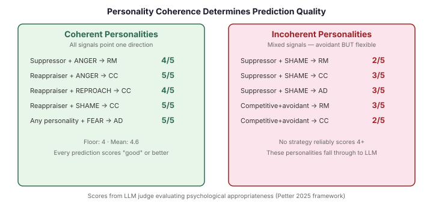
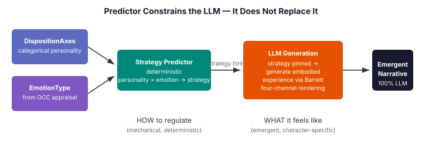

# When Personality Isn't Enough

*Continues from [The Gap Between Feeling and Acting](2026-11-04-mdp01-the-gap-between-feeling-and-acting.md).*

The regulation system works. An LLM selects from Gross's five strategies given personality, emotion intensity, fatigue, and cognitive load. The strategy drives the embodied experience through Barrett's four-channel rendering. Characters suppress, reappraise, redirect — and the prose that emerges is specific to who they are.

But every regulation tick costs an LLM call. In a 300-tick scenario with five characters, regulation fires fifty to a hundred times. Petter et al. (2025) documented that personality predicts strategy choice — high neuroticism correlates with suppression, high openness with reappraisal. If the personality signal is strong enough, the strategy is predictable. Why ask the LLM to reason about something the personality model already determines?

That was the hypothesis. What I found is more interesting than what I expected.

## The First Attempt: Personality Alone

The initial predictor mapped DispositionAxes — the five categorical personality dimensions extracted from each character's biography — to regulation strategies. Avoidant conflict style plus conservative risk appetite → RESPONSE_MODULATION (suppress). Analytical conflict style plus strict rule-following → COGNITIVE_CHANGE (reappraise). Bold plus competitive → ATTENTIONAL_DEPLOYMENT (redirect attention).

The categories are structured data, not free text. DispositionAxes is a record with five fields, each drawn from a small controlled vocabulary: socialOrient takes "cooperative", "competitive", or "independent"; conflictMode takes "avoidant", "analytical", "cooperative", "competitive", or "confrontational". Checking set membership against these categories is a legitimate computation — the personality extraction pipeline already made the semantic judgment.

I ran the predictor against the LLM to measure agreement. Same personality, same scenario, same emotions. The predictor picks a strategy; the LLM picks a strategy; how often do they agree?

The answer was 50%. And the reason was more revealing than the number.

## The LLM Is Non-Deterministic

The same avoidant personality facing the same public confrontation produced RESPONSE_MODULATION in one run and ATTENTIONAL_DEPLOYMENT in the next. Identical inputs. Different strategies. Three separate runs showed three different distributions. The LLM's strategy selection has a stochastic component that makes agreement-based testing unreliable.

This means the original quality gate — "mechanical predictions must match LLM selections at 80% or higher" — is testing against a rubber band. You cannot calibrate a deterministic predictor against a non-deterministic reference.

The solution was an LLM judge: a separate LLM instance evaluating whether the predictor's strategy choice is psychologically appropriate for the given personality and emotion, scored 1-5. The judge evaluates plausibility, not agreement. A score of 4 means "good choice, personality-congruent and executable." A score of 5 means "clearly the best choice this personality would make."

## What the Judge Taught Us

I ran the judge across eight personality-emotion combinations and three strategies. The scores revealed a pattern I had not anticipated.

Reappraiser personalities — analytical, strict, cooperative, high autonomy — scored 4-5 for COGNITIVE_CHANGE across every emotion type. The judge's reasoning was consistent: "the analytical style naturally engages with the meaning of events rather than avoiding them." This personality can reappraise anger, shame, and reproach. The trait profile is coherent — every signal points toward cognitive engagement.

The suppressor personality was where things broke. I had defined the archetype as independent, flexible, conservative, moderate, avoidant. The judge scored RESPONSE_MODULATION at 3-4 for anger — acceptable but docked because "flexible rules and independent thinking suggest latent capacity for reappraisal." The personality's avoidant traits pulled toward suppression while its flexible traits pulled toward reappraisal. The judge saw the tension.

For shame, every strategy failed. RM scored 2 — "shame festers when suppressed." CC scored 3 — "avoidant personality won't engage with reframing." AD scored 3 — "avoidance reflex, not best-fit." Seven runs across three strategies, and nothing reliably scored above 3.

## The Coherence Principle

The insight came from asking why the reappraiser always scored well and the suppressor kept failing: the reappraiser's traits are coherent. Analytical, strict, cooperative, high autonomy — every dimension reinforces the same regulatory tendency. There are no counter-signals for the judge to notice.

The suppressor archetype had counter-signals baked in. "Flexible" enables reappraisal. "Independent" enables self-directed cognitive restructuring. These traits are not suppression traits — they are reappraisal traits wearing a suppressor's coat. The judge correctly detected the incoherence and scored accordingly.

The fix was not to tune the weights or adjust the thresholds. It was to check for coherence before predicting. A personality with strong suppressor signals AND strong reappraisal-enabling signals is genuinely ambiguous — the strategy choice depends on situational nuance that the predictor cannot see. These personalities should go to the LLM.

The coherence check: `isSuppressor` requires suppressor signals (avoidant, conservative, competitive) at three or higher AND reappraisal-enabling signals (analytical, strict, cooperative, flexible, independent, bold, high autonomy) below two. A personality with both kinds of signals is incoherent — it falls through.

A coherent suppressor — cooperative social orientation, moderate rules, conservative risk, low autonomy, avoidant conflict — has no reappraisal-enabling traits. The judge scored this personality's RESPONSE_MODULATION at 4 consistently: "personality-congruent and executable."

## Shame Is Different

Even with a coherent suppressor, shame remained unresolvable. Anger works for suppression because anger is externally directed — someone wronged you, and containing the impulse to retaliate is a complete response. Fear works for attentional deployment because fear is about an uncontrollable threat — redirecting attention is both natural and healthy. Reproach works for suppression because it is other-directed — containing visible judgment is socially functional.

Shame is self-evaluative. The agent failed its own standards. Suppression does not resolve the self-judgment — it traps it. Attentional deployment does not resolve it either — it delays it. The only regulation that addresses the underlying self-evaluation is cognitive reappraisal: reframing what the standard means, what the failure implies, whether the judgment is proportionate. But a coherent suppressor lacks the traits to execute reappraisal. The personality cannot do the one thing the emotion requires.

This is not a limitation of the predictor's design. It is a property of the psychological model. Some personality-emotion combinations do not have a mechanically predictable resolution. A suppressor facing shame needs the LLM to read the specific situation — what standard was violated, how public the failure was, what the social context permits — and make a contextual judgment that no categorical personality model can replicate.

Three directions remain open. Temporal regulation — suppress now, reappraise when safe — models what avoidant people actually do with shame and might score differently because it acknowledges the reprocessing need rather than treating suppression as a terminal state. A continuous derivation model, where the CognitiveDerivationEngine computes reappraisal capacity as a number rather than a boolean, might find that a cooperative-avoidant personality has enough capacity (0.3 on a 0-1 scale) for shame's mild reframing requirement even if it lacks the capacity for full situational reappraisal. And improving the LLM's system prompt with personality-aware shame guidance addresses the problem from the other end — making the fall-through path smarter rather than trying to eliminate it.

## The Architecture Correction

I initially built the predictor to bypass the LLM entirely — mechanical strategy selection plus template narratives. "You hold the feeling in check, keeping your expression steady despite the inner turbulence." Three static strings for three strategies.

This was wrong in a way that violated the system's core principle. The cognitive architecture is emergent: personality signals flow through the pipeline, the LLM reads them, and the character's experience emerges from the intersection of personality, situation, and embodied rendering. The regulation narrative — how suppression feels in this character's body at this moment — must emerge from the same process. A template replaces emergence with prescription.

The corrected architecture separates HOW from WHAT. The predictor decides the strategy mechanically — a deterministic computation from categorical personality data and OCC emotion type. The LLM generates the embodied experience — the somatic channels, the temporal pressure, the action readiness — for that strategy applied to this character. The predictor constrains the LLM's strategy reasoning; it does not replace the narrative generation.

The cost saving comes from a simpler prompt. Instead of "choose a strategy and describe the experience," the LLM receives "the strategy is RESPONSE_MODULATION — describe the experience." The reasoning about which strategy to use is eliminated. The narrative generation — which is where the character-specific quality lives — remains fully emergent.

## What the Predictor Actually Covers

Five cases score at 4 or above consistently. Three cases fall through to the LLM with documented reasons.

Suppressor personality facing anger → RESPONSE_MODULATION. Containment of an externally-directed impulse is personality-congruent and psychologically functional.

Reappraiser personality facing anger, shame, or reproach → COGNITIVE_CHANGE. The analytical, high-autonomy profile excels at reframing across all three emotion categories.

Any personality facing fear → ATTENTIONAL_DEPLOYMENT. Uncontrollable threats produce a universal redirect response regardless of personality (Petter 2025).

Suppressor facing shame → falls through. Self-evaluative emotion with no mechanically predictable resolution.

Competitive plus avoidant personality → falls through. Engagement drive conflicts with avoidance drive, producing passive-aggressive risk under suppression.

Incoherent personality (mixed suppressor and reappraisal signals) → falls through. The strategy choice depends on situational nuance the predictor cannot access.

The emotion type does the work that the initial personality-only predictor could not. OCC emotions encode controllability — ANGER means the agent believes it can act, FEAR means it feels powerless, SHAME means it failed its own standards. Controllability determines which strategies are viable. Personality determines which viable strategy this character would choose. Both dimensions are necessary. Neither is sufficient alone.

## What This Means Beyond Regulation

The coherence principle generalises. Any system that maps personality categories to behavioural predictions will face the same problem: some personalities have internally consistent traits that produce clear predictions, and some have contradictory traits where the resolution depends on context. The value of a mechanical predictor is not in covering every case — it is in reliably identifying which cases it can handle and which it cannot.

The shame finding also generalises. Some emotion-personality combinations are structurally unresolvable because the emotion demands a regulatory capacity the personality does not possess. This is not a design flaw — it is a property of the model that the predictor makes visible. The LLM handles these cases not because the predictor failed, but because the psychology is genuinely complex. Mechanical prediction and LLM reasoning are complementary, not competitive. The predictor handles the predictable; the LLM handles the contextual. Neither replaces the other.
