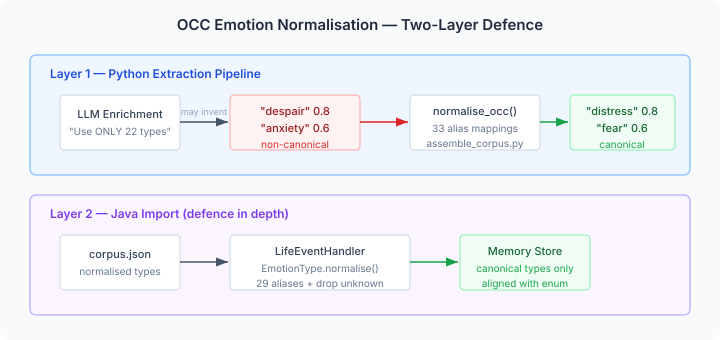
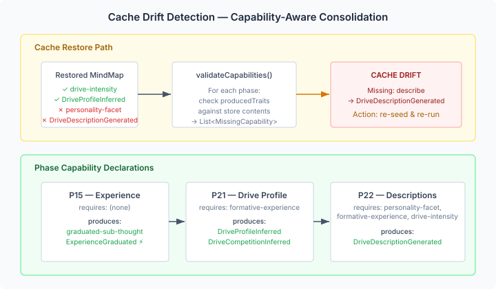

# When the Model Invents Feelings

Ask an LLM to classify emotions against a fixed vocabulary and it will comply — mostly. Run it across hundreds of biographical passages and you discover a 12% invention rate. The canonical OCC model defines 22 emotion types. The LLM returned 65.

The invented types aren't random. "Despair" is a richer word than "distress" — the model reaches for precision. "Anxiety" feels more specific than "fear." These are reasonable English-language choices that happen to fall outside the vocabulary the downstream cognitive pipeline expects. The pipeline computes PAD projections, maps to Frijda action tendencies, and feeds CAPS input activations. Every step expects `EmotionType` enum values. A `String` type of "despair" passes through silently, matches nothing, and the emotion simply vanishes from the cognitive state.

This is the quiet failure mode of any system that uses natural language as a typed interface. The LLM generates plausible output. The consumer accepts it without validation. The error surface is invisible until someone audits the data and finds that 144 memories across 347 have emotion types that don't exist in the ontology.

## The Vocabulary Alignment Problem

The immediate fix is normalisation — map "despair" to `DISTRESS`, "anxiety" to `FEAR`, "frustration" to `ANGER`. We added 29 alias mappings to `EmotionType.normalise()`, covering every non-canonical type the extraction pipeline had produced. The LLM prompt now says "Use ONLY these 22 types" instead of listing them as suggestions.

But the fix surfaced a deeper problem. The Python extraction pipeline and the Java runtime had different ideas about what the canonical 22 types actually are.

The Python set included `interest`, `disgust`, and `surprise`. These are Ekman basic emotions — facial-expression categories from the 1970s. They're not OCC types. The OCC model (Ortony, Clore, Collins 1988) defines emotion types by *cognitive appraisal*: what event caused the emotion, whose goals were affected, and whether the outcome was desirable. "Satisfaction" is the emotion when a hoped-for outcome arrives. "Disappointment" is when it doesn't. These are distinct prospect-confirmation types in OCC — but the Python normalisation was collapsing `satisfaction` → `gratification` and `disappointment` → `distress`, destroying the appraisal semantics.



The fix aligned both canonical sets with the Java `EmotionType` enum — the single source of truth. The Python `sorry-for` became `pity` (the OCC name). The three Ekman types were removed from the canonical set and added as normalisation aliases. The normalisation layer now operates identically at both ends of the pipeline: the Python assembler catches non-canonical types before they enter `corpus.json`, and the Java `LifeEventHandler` catches any that slip through during biographical import.

Two-layer defence. The prompt constrains the LLM. The assembler normalises what gets through. The importer validates a second time. Non-canonical types get mapped to their nearest canonical neighbour. Unrecognised types get dropped. The stored emotion vocabulary is now guaranteed to align with the enum.

## Silent Pipeline Failures

A different kind of silent failure: the consolidation cache. The cognitive pipeline runs ~20 consolidation phases at scheduled intervals — merge detection, experience graduation, drive profiling, description generation. Phase 22 (DriveDescriptionGenerationPhase) uses an LLM to generate somatic drive descriptions from personality facets and formation memories. Without these descriptions, characters run with bare labels like "curiosity: 0.7" — no body sensation, no Barrett channels, no experiential texture.

The failure path: restore the MindMap from a previous session's saved state. The state contains drive-intensity nodes (so the scheduler doesn't skip), but if the seeding step was skipped, personality facets and formation memories are missing. P22 checks for drives, finds them, looks for personality and formation data, finds nothing, and returns silently. No error. No warning. The character runs without somatic descriptions for the entire session.

I found this because three hundred ticks of eval data showed `hand-authored-fallback` for every drive across five characters. The cognitive dump confirmed: zero generated descriptions. The root cause traced back to a stale cache file from the previous day.

## Making the Pipeline Self-Describing

The fix wasn't to add a special case for P22. The problem is structural: consolidation phases have implicit dependencies. P22 needs personality facets and formation memories. P21 (DriveProfileDerivationPhase) needs formation memories. These dependencies exist only in the code — there's nothing for an external system to query.

We added a capability declaration to the `ConsolidationPhase` SPI:

```java
default ConsolidationCapability capability() {
    return ConsolidationCapability.empty();
}
```

Each phase declares what node kinds it requires (prerequisites) and what traits it produces (outputs). P22 declares:

```java
new ConsolidationCapability(
    Set.of("personality-facet", "formative-experience", "drive-intensity"),
    Set.of("DriveDescriptionGenerated"));
```

The scheduler aggregates these into a `ConsolidationManifest` — a snapshot of the full pipeline with a hash that changes when phases are added or removed. The `validateCapabilities()` method checks the MindMap store against every phase's declared outputs and returns a list of what's missing.



An external orchestrator that restores cache state can now call `validateCapabilities()` before deciding whether to re-seed. The contract is explicit: if the manifest says the pipeline produces `DriveDescriptionGenerated` and the store doesn't have any nodes with that trait, something is wrong. The cache is stale. Re-seed.

This is a pattern worth noting beyond the specific use case. Any pipeline where phases have implicit dependencies and idempotency checks will eventually hit the same failure mode: a phase skips because its outputs already exist, but its *inputs* were never created. Making dependencies declarative turns a debugging session into an API call.

## What Vocabulary Enforcement Actually Buys You

The OCC work and the cache drift fix are superficially different — one is about emotion types, the other about consolidation infrastructure. The common thread is typed contracts between pipeline stages.

When the LLM produces "despair" and the pipeline stores it as a string attribute, the contract between producer and consumer is implicit. Both sides work. Neither side validates. The error is silent until someone counts distinct values and finds 65 where there should be 22.

When P22 skips because personality facets are missing, the contract between the seeder and the consolidation phase is implicit. The seeder didn't run. P22 didn't complain. The character runs without descriptions for three hundred ticks.

Making contracts explicit — whether through `EmotionType.normalise()` or `ConsolidationCapability` — turns silent failures into detectable conditions. The engineering isn't glamorous. But the alternative is debugging at the symptom level, wondering why a character sounds flat or why emotion distributions look wrong, when the root cause is a string that didn't match an enum three pipeline stages upstream.m
