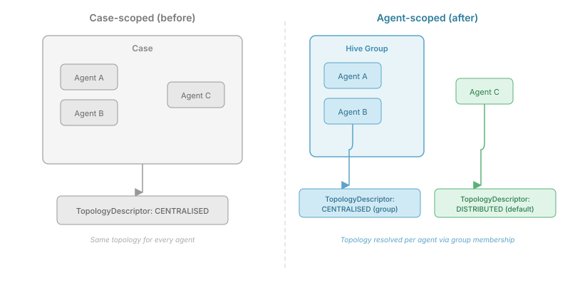

The society model describes groups with topologies — swarm, hive, mesh, many. Each topology determines how agents within that group coordinate. The design is clean on paper. But the engine's SPI for querying topology was wrong.

`TopologyProvider` had a single method: `describeTopology(UUID caseId)`. One topology for the entire case. Every agent in the case got the same answer.

That's fine if your case has one group. It falls apart the moment you have two groups with different coordination patterns — a hive team doing structured investigation alongside a swarm cluster doing exploratory research. The hive agents need `CENTRALISED` topology to know there's a coordinator. The swarm agents need `DISTRIBUTED` to know there isn't one. A case-scoped query can't tell them apart.

## The fix is architectural, not cosmetic

The new SPI is agent-scoped:

```java
public interface TopologyProvider {
  TopologyDescriptor topologyFor(String agentId, String tenancyId);

  default OptionalDouble effectiveSelfDetermination(
      String agentId, String tenancyId) {
    return OptionalDouble.empty();
  }
}
```

`topologyFor` resolves through the agent's group membership. An agent in a hive group gets `CENTRALISED`. An ungrouped agent gets the case default. The same agent can get a different answer after joining or leaving a group — which is exactly what happens when the society restructures itself.



`effectiveSelfDetermination` resolves the same way. For grouped agents, the group's selfDetermination value wins — it governs how freely that group can restructure. For ungrouped agents, the value falls back to `IntegrationPolicy`, which is the case-level default. This two-tier resolution means a tightly governed hive group (selfDetermination 0.2) and a highly autonomous swarm group (0.8) can coexist in the same case with correct per-agent behaviour.

## GroupMembershipQuery — the lighter SPI

The resolution needs to know which groups an agent belongs to. Rather than pulling in a full `OrgRegistry` with lifecycle management, formation protocols, and desired-state reconciliation, the engine defines a query-only SPI:

```java
public interface GroupMembershipQuery {
  List<GroupMembership> unitsFor(String agentId, String tenancyId);
}
```

Each `GroupMembership` carries the group's topology type, lifecycle state, and selfDetermination value — everything the engine needs to resolve topology without depending on the orchestration layer that manages group lifecycles. The desiredstate module implements this against its `GroupLifecycleService`; the engine never sees that dependency.

## Promoted agents and duplicate detection

The second gap was in team detection. CaseHub's swarm engine watches for agents that cluster naturally — shared interests, complementary capabilities, co-active signal patterns. When a cluster stabilises, the society runtime promotes it to a formal group.

The problem: after promotion, those same agents kept showing up in subsequent detection rounds. The detector didn't know they'd been promoted. It would detect the same cluster again, attempt to promote it again, and the system wasted cycles on groups that already existed.

The fix threads `GroupMembershipQuery` into the detector. Before building the affinity matrix, it filters out any agent that belongs to a non-dissolved group. Once a group dissolves — mission complete, membership released — those agents re-enter the detection pool. The suppression lifts automatically because the lifecycle state changes.

## What selfDetermination actually resolves

selfDetermination is a value between 0 and 1 on each group. It governs autonomy: how freely the group can restructure, whether it can spawn sub-groups, whether topology transitions need external approval.

Before this change, the only selfDetermination value in the system lived on `IntegrationPolicy` — a case-level configuration. Every agent got the same autonomy setting regardless of group membership. A hive coordinator and a swarm explorer had identical governance constraints, which makes no sense operationally. A hive exists because you *want* structure. A swarm exists because you *want* autonomy.

The per-group resolution means you can configure a case with a restrictive default (selfDetermination 0.3) while giving specific groups the freedom they need. The hive team stays tightly governed. The swarm cluster self-organises. Same case, different governance, correct per-agent behaviour.

## The lifecycle event gap

One missing piece: `onTopologyChanged`. When a group transitions topology — swarm to hive after stabilisation, hive to mesh when scaling out — nothing in the engine's event model captured it. The `AgentWorkLifecycleListener` had events for work state changes, task assignments, role adoption and release. No topology transitions.

Qhorus needs this event to activate channel-ready protocols. When a group becomes a hive, private channels need to be provisioned for coordinator-member communication. When it becomes a mesh, relay and federation channels activate. Without the event, the communication layer can't react to structural changes.

## The communication mode that wasn't there

`CommunicationMode` had three values: `STIGMERGY`, `DIRECT_MESSAGING`, `BROADCAST`. Missing: `GROUP_CHANNEL` — the private channel that Qhorus provisions for intra-group communication. Every hive group uses it. Every mesh group uses it. It was defined in the Qhorus API but absent from the engine's coordination model, which meant the engine couldn't reason about which communication mode a group was using.

## What this means in practice

These are SPI changes — they define contracts, not implementations. The desiredstate module provides the implementation of `GroupMembershipQuery`. The agency module's topology implementations (`CentralisedTopology`, `DistributedTopology`, `HiveTopology`, and the rest) need to adopt the new `topologyFor` signature. The engine's role is to define the correct abstractions and consume them.

The consequence: any code that asks "what topology governs this agent?" now gets the right answer. Not the case's topology. The agent's topology, resolved through its group membership, reflecting the society structure that may have changed since the case was created.
