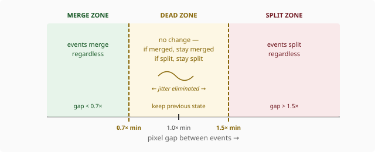
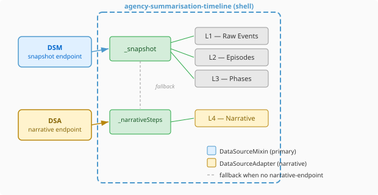

# Why Your Timeline Clusters Jitter (and What Hysteresis Fixes)

Any timeline component that clusters dense events faces the same problem: zoom in a fraction and two clusters split apart; zoom back and they snap together; hover the boundary and they flicker between states. The base algorithm is correct at every frame. The animation is still unusable.

The fix is hysteresis — a dead zone between the split and merge thresholds where the clustering algorithm preserves whatever state it had before. The concept comes from control systems and electrical engineering, but it applies directly to any discrete-state visualization driven by a continuous parameter like zoom level.

## The problem with stateless clustering

A naive gap-based clustering function takes the current events, the visible time range, and a minimum pixel separation. It sorts events by timestamp, walks them in order, and starts a new cluster whenever the gap exceeds the threshold. Pure, stateless, deterministic.

The trouble is that "minimum pixel separation" changes on every zoom interaction. A smooth pinch-zoom generates dozens of intermediate zoom levels per second. At each level, the threshold shifts slightly — and near boundary conditions, a pair of events oscillates between "close enough to merge" and "far enough to split" frame by frame. The visual result is a flickering, unstable mess.

You can't fix this by debouncing. Debouncing delays the update, which makes the entire timeline feel laggy on zoom. The problem isn't that updates happen too often — it's that the algorithm has no memory.

## Hysteresis: a dead zone that absorbs jitter

The fix is two thresholds instead of one:

- **Merge threshold** (0.7× the base pixel separation) — events only merge when closer than this
- **Split threshold** (1.5× the base pixel separation) — events only split when farther apart than this

Between those two thresholds is the dead zone. Inside it, the algorithm preserves whatever grouping was already in place. If two events were merged, they stay merged. If they were split, they stay split.



The implementation stays functional — `clusterEvents` takes an optional `previousClusters` parameter and returns the new clusters. The caller holds the reference; the algorithm has no hidden state. Each call computes a base clustering from scratch, then checks whether any proposed split or merge falls within the dead zone. If it does, the previous grouping wins.

```typescript
export function clusterEvents(
  events: readonly RawEvent[],
  visibleRange: TimeRange,
  containerWidth: number,
  minPixelSeparation: number,
  previousClusters?: readonly EventCluster[],
): EventCluster[]
```

Without `previousClusters`, the function behaves exactly as before — backward compatible, no hysteresis. The first render call passes `undefined`; subsequent calls pass the result of the previous render.

## Stable keys make CSS transitions possible

Hysteresis solves jitter. But the user still sees clusters jump to new positions on zoom. To animate the transition, you need DOM element identity — the browser needs to know that "this cluster element at position 200px" is the same element that should now be at position 350px.

Every `EventCluster` now carries a `key: string` field. When hysteresis preserves a cluster's grouping across a zoom step, it also preserves its key. When a genuine split happens, new keys are assigned to the fragments. Lit's `repeat` directive uses these keys to maintain DOM identity:

```typescript
${repeat(
  clusters,
  c => c.key,
  c => c.count === 1
    ? this._renderDot(c.events[0]!)
    : this._renderCluster(c)
)}
```

With stable DOM identity, CSS transitions on `left` and `width` handle the rest — 200ms ease-out gives a smooth slide when clusters reposition during zoom. No JavaScript animation loop, no requestAnimationFrame choreography.

## Decoupling data sources in a multi-lane timeline

The clustering work was paired with a data architecture change worth discussing separately. The SummarisationTimeline renders four lanes — raw events, episodes, phases, and a narrative lane — and until now they all drank from a single JSON blob fetched by a hand-written `fetch()` call in the shell component.

Two problems with this. First, it's a pattern that doesn't compose with the rest of the platform. Every other data-consuming component uses `DataSourceMixin` — a Lit mixin that manages endpoint configuration, loading states, error handling, and the fetch lifecycle. A component that rolls its own fetch is a component that reimplements all of that, badly.

Second, the narrative lane (L4) has a different data lifecycle from the event lanes. Narrative data comes from a separate subsystem — a summarisation pipeline that runs asynchronously. Bundling it into the same endpoint means the entire timeline blocks on the slowest data source.



The shell now uses `DataSourceMixin` for the primary snapshot (L1–L3) and a separate `DataSourceAdapter` instance for the narrative endpoint (L4). Both are managed by the shell; lanes remain pure property-driven renderers — they don't know or care where their data comes from.

When no `narrative-endpoint` attribute is set, L4 data falls back to the main snapshot. This preserves backward compatibility and supports backends that bundle everything into one response. The decoupling is opt-in — you only pay for it when you have a reason to fetch narrative data independently.

## What this pattern generalises to

The hysteresis pattern applies anywhere a continuous input (zoom, scroll position, window resize, slider value) drives a discrete output (cluster boundaries, breakpoints, layout modes). Without it, boundary conditions produce visual noise that users perceive as instability. With it, the interface feels solid — changes happen when they should, and don't happen when they shouldn't.

The dual data source pattern applies whenever a composite visualization has lanes or panels with different data lifecycles. A monitoring dashboard where metrics come from Prometheus and annotations come from a separate service. A conversation viewer where messages stream in real time but summaries batch-update every 30 seconds. The shell owns the coordination; each source is independently fetchable, independently cacheable, independently refreshable.

Both patterns are small enough to fit in a single file each. Neither requires a framework or a library. They're the kind of thing you end up building eventually — the question is whether you build them before or after users notice the jitter.
