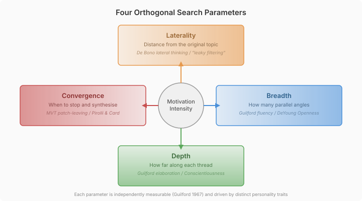
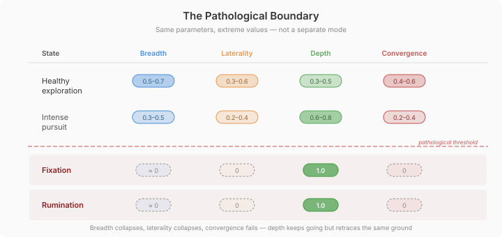
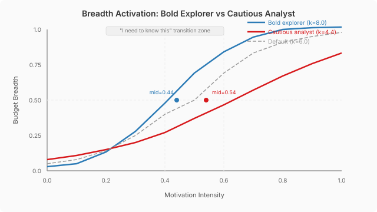

# How Much Should an Agent Think?

Ask two people to investigate the same question and they'll do it differently. One fans out, chases tangents, makes improbable connections. The other picks one thread and follows it to the source. Neither is wrong — they're allocating cognitive effort according to disposition, mood, and how badly they need the answer.

AI agents don't do this. A cautious agent and a bold one approach the same information gap identically. There is no personality-shaped exploration style.

I've been designing a model to fix that. Not a heuristic or a prompt template — a general model grounded in 50 years of cognitive psychology research, wired into the neocortex cognitive architecture so that personality, drives, mood, and threat state all shape how an agent explores.

## The problem is effort allocation

The question isn't "what should the agent think about" — that's handled by the drive system, goal management, and appraisal pipeline. The question is: *given that the agent is motivated to investigate something, how much cognitive effort should it spend, and what shape should that effort take?*

A curiosity-driven investigation looks different from a threat-driven one. Curiosity fans out, ranges wide, follows tangents. Threat narrows focus, stays close to the known, converges fast. Competence drive goes deep along one thread. A relaxed agent explores more broadly than an anxious one.

These aren't arbitrary distinctions. They trace to measurable personality traits and published effect sizes.

## Four orthogonal parameters

I started with the obvious two-dimensional model — exploration vs. exploitation — and found it under-specified. The literature separates what I was conflating.

Guilford (1967) measured divergent thinking along four independent dimensions: fluency (how many ideas), flexibility (how different the ideas are), elaboration (how far each is developed), and a convergent evaluation phase. De Bono (1970) separately defined lateral thinking as distance from the problem — not the same as breadth.

The distinction is real. You can pursue many angles all within the same domain (high breadth, low laterality) or follow a single thread that makes a large associative leap (low breadth, high laterality). These are different cognitive operations.



The four parameters:

- **Breadth** — how many parallel angles to pursue. Driven primarily by Openness (DeYoung 2015; meta-analysis effect size r=0.20 for divergent thinking, Grajzel et al. 2023).
- **Laterality** — how far from the starting point to range. De Bono's "finding a different place to dig the hole." Collapses to zero under threat (Frijda 1986 approach/avoidance).
- **Depth** — how far to follow each thread. Conscientiousness drives systematic, sequential search. High Impulsivity (PID-5) makes depth shallow.
- **Convergence pressure** — when to stop exploring and synthesise. Modelled on the Marginal Value Theorem (Charnov 1976) — you leave a patch when the marginal insight gain drops below what you'd get by switching. Pathological convergence failure (fixation, rumination) is the natural endpoint when neuroticism prevents disengagement.

All four are in [0, 1]. All four are independently controllable. Personality sets the baseline distribution; transient state (drives, mood, appraisal) modulates in real time.

## Personality shapes the baseline — but not through guesswork

The issue description I started with had a table mapping Big Five traits to search parameters. Reasonable-looking, intuitive — and not grounded in what the system actually represents.

The neocortex personality model uses PID-5 facets (Anxiousness, Risk Taking, Impulsivity, Withdrawal, Suspiciousness, Emotional Lability) and Jungian disposition axes (ruleFollowing, riskAppetite, etc.). These aren't Big Five traits. The mapping had to go through PID-5 facets directly — following the pattern already established by `CognitiveDerivationEngine.deriveExpressionStyles()`, which derives expression style profiles from facet interactions without constructing synthetic Big Five scores.

The derivation chain:

- **Breadth** ← `GraphStructureDefaults.connectiveBias` (how associative the agent's knowledge graph is) + Risk Taking facet score. A bold, open-networked agent gets a steeper activation curve — the "I need to know this" threshold opens a wider search envelope.
- **Laterality** ← Low Withdrawal + low Intimacy Avoidance + low Suspiciousness. An agent low on all three is open to distant associations. High Suspiciousness constrains lateral exploration — everything is evaluated through a threat lens first.
- **Depth** ← ruleFollowing (String→numeric: "strict"→0.8, "moderate"→0.5, "flexible"→0.2) + low Impulsivity. A methodical agent follows threads further before surfacing.
- **Convergence** ← ruleFollowing modulated by Anxiousness + Emotional Lability. High Anxiousness lowers the pathological threshold — the point where convergence collapses entirely and the agent enters fixation.

Every link in this chain has a published citation. Openness to divergent thinking: Grajzel et al. 2023, meta-analysis across 63 studies. Neuroticism to perseveration: Davis & Nolen-Hoeksema 1998, perseverative errors on the Wisconsin Card Sorting Test. Conscientiousness to systematic search: the behavioral indicators literature. PID-5 to Big Five correspondence: Krueger et al. 2012.

## No composition function needed

An early design question was how multiple motivations compose. When curiosity is 0.7 and goal urgency is 0.9, which one shapes the search? I proposed three options — dominant-wins, weighted sum, layered — and each time was told to stop guessing and find the literature.

The literature said: you already have the answer.

The CAPS model (Mischel & Shoda 1995) resolves multiple simultaneous activations through constraint satisfaction in a recurrent network. Frijda's control precedence (1986, 2007) says the highest-urgency action tendency claims priority while others modulate. Schmidt & DeShon (2007) showed resources shift toward the largest discrepancy.

The neocortex already has subsystems that do this. `DriveOrchestrator` composes four axes into a `DriveProfile` with a `compositeMotivation` and `dominantDrive`. `AppraisalTickParticipant` produces action tendencies. `GoalPrioritizationPhase` computes per-goal priority. Each uses its own principled composition mechanism.

The search budget doesn't need its own composition function. It reads the already-composed outputs. The `dominantDrive` determines the *character* of the search. The `compositeMotivation` + appraisal intensity + goal urgency determine the *size*. The personality baseline from `CognitiveDefaults` provides the starting distribution.

## The pathological boundary isn't a separate mode

Fixation and rumination aren't special states that require separate handling. They're what happens when the same parameters hit extreme values with no resolution.



When intensity is maximal and habituation fails — when the observation counter goes up but novelty doesn't decay — convergence drops to zero. The agent can't stop exploring because the "I need to know this" signal never subsides. Breadth collapses to a single thread. Laterality collapses to zero. Depth keeps going, but retraces the same ground.

The mechanism: high PID-5 Anxiousness + `HabituationState` failure (observation count exceeds threshold but novelty score remains high) + unresolved drive intensity → convergence function's pathological floor activates.

The distinction between fixation and rumination isn't in the numeric parameters — both produce breadth≈0, laterality=0, depth=1.0, convergence=0. It's in the observation count. Fixation has low counts (the topic is new but the agent can't look away). Rumination has high counts (the same material has been reprocessed many times). The LLM prose generated at consolidation time captures this distinction — fixation prose emphasises the pull of the unresolved question; rumination prose emphasises the repetitive return.

## Why cognitive state descriptions, not directives

The prompt section renders the search budget as a felt cognitive state — "This pulls at your attention from multiple angles" — not as a directive — "Explore from several angles."

This isn't a stylistic preference. Anthropic's "Functional Emotions" paper (April 2026) found that internal representations of emotion concepts in Claude causally influence outputs. Not metaphorically — they measured it through causal interventions on internal representations. Describing a cognitive state activates those representations. A directive uses the instruction-following pathway, which is a different mechanism.

The existing cognitive system is built on this principle. `BehavioralPromptSection` renders "You have a deeply ingrained tendency toward caution." `AppraisalPromptSection` renders "You feel strong fear." The search budget follows the same pattern — describe the state, let the model figure out the behaviour.

The prose isn't templated. A consolidation-time LLM call generates contextual descriptions from the personality-derived search style — the same two-layer pattern used by `DriveDescriptionGenerationPhase`. The tick-time participant computes numeric parameters independently; the prompt section combines the crystallised prose with the current modulation.

## Intelligence is not personality — and the search budget needs both

There's a gap in this model that became clear during the design. The four parameters describe how an agent *distributes* cognitive effort — but they don't capture how *far* that effort can productively reach.

DeYoung's Big Five Aspect Scales split what we call "Openness" into two distinct traits. **Openness** — aesthetic sensitivity, perceptual exploration, the desire to experience. **Intellect** — engagement with abstract ideas, enjoyment of problem-solving, capacity for sustained reasoning. Nusbaum and Silvia (2011) showed the split is real: Openness predicts creativity but not fluid intelligence. Intellect predicts fluid intelligence but not creativity.

The current search budget captures Openness. It doesn't capture Intellect. An agent with high Openness will want to explore laterally, but wanting to make distant associations doesn't mean being able to chain them. That's a capacity question, not a personality question.

Halford's Relational Complexity theory (1998) makes this concrete. Processing capacity is bounded by the number of relations that can be held simultaneously — unary (one variable), binary (two), ternary (three), quaternary (four). This is effectively "how many hops away from the problem" an agent can reason. Fluid intelligence correlates strongly with relational complexity capacity. Higher Gf means more relations, longer chains, deeper reasoning.

Cattell's Investment Theory (1987) adds the developmental arc: fluid intelligence gets invested in learning over time, producing crystallised intelligence. Higher capacity means more productive exploration, which means a broader and deeper knowledge base. Capacity shapes exploration, and exploration shapes what you know.

Mednick's Remote Associates work (1962) makes the lateral dimension concrete. Finding connections between distant concepts requires both the desire (Openness — wanting to look far) and the capacity (Intellect — being able to bridge the gap). People with "flatter associative hierarchies" access a wider range of weakly related concepts. The RAT correlates r=0.38 with Raven's Progressive Matrices — capacity matters for lateral distance, not just depth.

This points toward something beyond the current four-parameter model: an intelligence layer that sets the *ceiling* for each parameter.

| Capacity dimension | What it bounds | Literature |
|---|---|---|
| Relational reasoning (Halford RC) | Depth ceiling — how many reasoning hops | Halford et al. 1998; Gf correlation |
| Associative reach (Mednick) | Laterality ceiling — how far associations can bridge | Mednick 1962; RAT × Raven's r=0.38 |
| Working memory span | Breadth ceiling — how many threads simultaneously | Newell & Simon 1972; depth-first preference from WM limits |

Personality says "allocate effort toward depth." Intelligence determines how much depth is actually achievable. A high-Openness, low-Intellect agent wants to explore laterally but can't chain distant associations productively. A high-Intellect, low-Openness agent can chain deep but doesn't pursue the connections.

I haven't built this layer yet. The search budget as designed captures the personality-shaped distribution. But the capacity ceiling is where this work leads — and it would mean modelling different *types* of intelligence, not a single IQ-like scalar. Relational reasoning capacity for depth. Associative reach for laterality. Working memory span for breadth. Each independently derivable, each bounding a different parameter.

## Why this matters — and why prompt templates don't

Most AI agent frameworks give every agent the same cognitive style. You can tell the LLM "you are cautious" or "you are creative" in the system prompt, but the Wharton "Playing Pretend" study (2026) showed expert personas don't improve task performance — they shift tone without changing how the model actually reasons. Saying "be thorough" doesn't make the model explore more carefully. It makes it *sound* more careful while doing the same thing.

The search budget works differently. It doesn't describe who the agent is — it describes what the agent is experiencing. "This pulls at your attention from multiple angles" activates different internal representations than "explore broadly." Anthropic's functional emotions research showed these cognitive state descriptions causally influence model output through measurable internal mechanisms, not just stylistic effects.

This matters for three practical reasons.

**Characters that think differently, not just talk differently.** A detective NPC driven by competence and high conscientiousness will trace one thread to its source, follow evidence systematically, and converge once the chain is complete. A journalist NPC driven by curiosity and high openness will scan broadly, chase tangents, make lateral connections, and resist premature conclusions. These aren't different scripts — they're the same model with different parameter distributions derived from the same personality construct that shapes everything else the character does.

**Threat response that isn't scripted.** When an agent appraises a situation as threatening, the search budget collapses laterality to zero — the agent stops making distant associations and focuses on the immediate. This isn't a rule someone wrote; it follows from Frijda's approach/avoidance dynamics fed through the same activation function that handles normal exploration. The narrowing is proportional to threat intensity, not binary.

**Pathological states that emerge rather than being coded.** Fixation and rumination aren't special modes with separate code paths. They're what happens when intensity is maximal, habituation fails, and convergence drops to zero through the same piecewise function that handles normal convergence. An anxious character with high Emotional Lability enters fixation at a lower threshold than a stable one — because the PID-5 facets that shape the pathological threshold are the same facets that shape everything else. You don't code rumination. You code personality accurately enough that rumination falls out of the math.

The pattern generalises. Every cognitive subsystem that needs the LLM to problem-solve — curiosity about information gaps, goal pursuit under deadline pressure, threat assessment, mastery-seeking — can provide its own intensity. The search budget converts that intensity into a personality-shaped exploration envelope. The same four parameters. The same activation functions. Different consumers, coherent output.

## Does it actually work?

The implementation is complete — seven components across five modules. The question that matters: does it produce meaningfully different cognitive behaviour for different personalities?

I ran two contrasting profiles through the derivation engine. A bold explorer (high Risk Taking 0.9, low Withdrawal 0.1, low Anxiousness 0.1, flexible rule-following, high connectiveBias 0.8) and a cautious analyst (low Risk Taking 0.1, high Withdrawal 0.7, high Anxiousness 0.8, strict rule-following, low connectiveBias 0.3).

The results:

```
                    Bold    Cautious  Default
breadthSteepness:     8.0       4.4       6.0
breadthMidpoint:     0.44      0.54      0.50
lateralityMidpoint:  0.38      0.55      0.50
depthMidpoint:       0.58      0.40      0.50
pathThreshold:       1.76      1.14      1.40
```



The bold agent's breadth activates earlier (midpoint 0.44 vs 0.54) and more sharply (steepness 8.0 vs 4.4). It also reaches laterally at lower motivation (0.38 vs 0.55). The cautious agent goes deep earlier (0.40 vs 0.58) and enters pathological fixation at a much lower threshold (1.14 vs 1.76). These aren't arbitrary numbers — each traces through a PID-5 facet to a published personality construct.

The sigmoid activation function at k=6.0 produces a clear threshold: intensity below 0.3 yields a budget under 0.15 (barely registers). Above 0.7, the budget exceeds 0.85 (full engagement). The "I need to know this" transition happens in the 0.3–0.7 range.

Drive-specific modulation at intensity 0.8 shows differentiation too. Curiosity pushes breadth to ceiling (1.0) while pulling convergence down (0.76). Competence pushes depth to ceiling while accelerating convergence (0.96). Affiliation drops depth (social scanning is shallow) and converges fast (consensus-seeking).

One thing worth watching: at high intensity (above 0.8), the base activation is already 0.86, so the additive drive modulations (±0.08 to ±0.15) are proportionally small. Personality differences nearly vanish. Everyone explores hard regardless of disposition.

I initially dismissed this as a calibration issue — make the constants bigger. The literature says something more interesting.

## When personality should disappear — and when it shouldn't

Situational Strength Theory (Meyer, Dalal & Hermida, 2010) predicts exactly this compression: in "strong" situations — clear cues, high constraints, unmistakable demands — personality differences shrink. A meta-analysis of 153 studies found personality predicts behaviour at r=0.23 in weak situations but only r=0.09 in strong ones. Extreme motivation IS a strong situation. The model is doing what the theory predicts.

But it's doing it uniformly, and that's where it breaks.

Yerkes and Dodson (1908) showed the optimal arousal curve shifts by personality. Neurotics peak earlier and decline faster — they can't sustain performance at extreme arousal because they're already chronically near their ceiling (Eysenck & Eysenck 1985). A neurotic agent at extreme motivation shouldn't just explore like everyone else — they should start *failing* to explore coherently. Convergence should collapse further. Attention should fragment. The personality doesn't disappear at extreme intensity — it amplifies in a specific direction.

Conscientiousness works the opposite way. A disciplined person can maintain hyper-focus and systematic depth even when motivation is maximal. This is what Dalal et al. (2015) call "personality strength" — the other side of the situational strength coin. Some personalities resist the compression. A highly conscientious agent should sustain its depth advantage at extreme intensity, not lose it to the ceiling.

Easterbrook (1959) adds the mechanism. High arousal narrows the range of cues attended to — a direct map to breadth and laterality. But the narrowing rate differs: impulsive agents narrow faster, anxious agents lose breadth to internal worry (Sarason 1975), and introverts narrow earlier than extraverts because their baseline arousal is higher.

So the real picture isn't "personality disappears at high intensity." It's:

- **Conscientiousness sustains** — depth differentiation should be maintained because discipline resists situational pressure
- **Neuroticism amplifies** — convergence failure gets worse, not better, under extreme motivation. The anxious agent enters fixation while the stable one keeps exploring
- **Openness actually narrows** — even creative people lose breadth under extreme arousal (Yerkes-Dodson peak exceeded). The open agent doesn't get MORE creative at maximum stress — they get overwhelmed
- **Fatigue matters** — can the agent sustain hyper-focus, or does cognitive load accumulate? Conscientiousness predicts sustained effort; neuroticism predicts fatigue and distraction. The degradation rate is personality-specific

The additive modulation model treats extreme intensity as a uniform ceiling. The literature says it's a personality-specific transformation. Some traits amplify, some compress, some invert. This isn't a calibration fix — it's a different function shape at the extremes, and it needs empirical validation to get right (#839).
