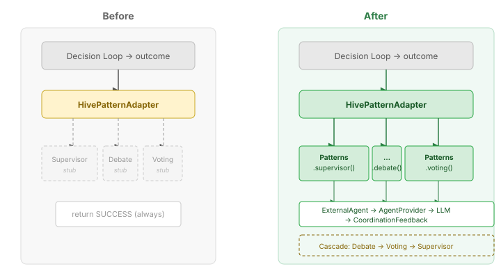
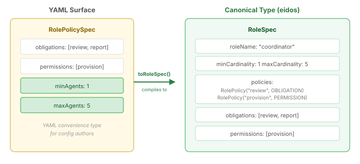

# The Stub That Always Said Success

Three methods. Each one took a `DecisionOutcome`, ignored it, and returned `CompletableFuture.completedFuture(SUCCESS)`. The supervisor pattern didn't supervise. The debate pattern didn't debate. The voting pattern didn't vote. The infrastructure around them — degradation cascades, budget pools, decision loops — all worked. But the thing at the centre, the part that actually coordinates agents, was a no-op.

This is the most common failure mode in compositional architecture: the abstractions are right, the wiring diagram looks correct, and the system runs without errors. It runs without errors because nothing actually happens.

## Where the Gap Was

HiveTopology is the centralised coordination topology in agency — a coordinator agent manages a group of workers through decision loops. When a loop produces a `DecisionOutcome`, it flows to `HivePatternAdapter`, which is supposed to subject the outcome to multi-agent coordination. The topology supports three orchestration modes with a degradation cascade: Debate → Voting → Supervisor. Under pressure — when loops degrade, when latency thresholds breach — the cascade automatically downgrades to cheaper coordination.

The cascade worked. The budget system tracked costs. The degradation triggers fired correctly. But the three methods that actually execute the coordination patterns just returned SUCCESS without calling anything.



## What Real Wiring Looks Like

The fix is straightforward once you see it. Agency already has a compositional pattern library — `Patterns.supervisor()`, `Patterns.debate()`, `Patterns.voting()` — with configurable routing, aggregation, and termination strategies. The adapter just needed to build and execute these patterns with agents drawn from the topology descriptor.

Each method now creates `ExternalAgent` refs backed by the `AgentProvider`. When the supervisor pattern runs, it routes the outcome to the coordinator agent via an LLM call. When the debate pattern runs, it sets up a round-robin among the non-submitting agents with a three-round cap. When voting runs, all topology participants cast votes through majority aggregation.

```java
private CompletionStage<CoordinationFeedback> executeSupervisor(
        String agentId, DecisionOutcome outcome, TopologyContext ctx) {
    var coordinatorId = ctx.descriptor().coordinatorAgentId()
            .orElseThrow(() -> new IllegalStateException(
                    "Supervisor pattern requires a coordinator"));
    var coordinator = createAgentRef(coordinatorId, "supervisor reviewer");

    return Patterns.<DecisionOutcome>supervisor()
            .agents(coordinator)
            .terminate(new MaxIterationsTermination<>(1))
            .task("hive-supervisor-review")
            .execute(outcome)
            .map(result -> mapToFeedback(agentId, outcome, result))
            .onFailure().recoverWithItem(
                    new CoordinationFeedback(agentId, outcome, FeedbackSignal.FAILURE))
            .subscribeAsCompletionStage();
}
```

The key design choice: each `ExternalAgent` wraps `StructuredAgentInvoker.invokeText()` — the same invocation utility used by LLM routing, triage, and decomposition across the platform. The agent receives a rendered `DecisionOutcome` and provides its assessment. `ExecutionResult` maps to `CoordinationFeedback` — `Completed → SUCCESS`, `Failed → FAILURE`, `Escalated → PARTIAL`. Any exception in the chain recovers to `FAILURE` feedback rather than crashing the decision loop.

## The Role Model Problem

A separate but related issue: the role model was fragmented. Eidos defines `RoleSpec` — the canonical organisational type with cardinality constraints, incompatibility sets, and typed policies (`RolePolicy` with `PolicyKind.OBLIGATION` or `PERMISSION`). Agency's YAML surface had its own `RolePolicySpec` with just two flat lists: obligations and permissions. No cardinality. No typed policies. No compilation path between them.



The fix makes `RolePolicySpec` a YAML convenience type that compiles to eidos's `RoleSpec`. It gains `minAgents` and `maxAgents` fields for cardinality, and a `toRoleSpec(roleName)` method that maps obligations to `RolePolicy(OBLIGATION)`, permissions to `RolePolicy(PERMISSION)`, and cardinality values to `RoleSpec`'s `minCardinality`/`maxCardinality`. YAML authors keep writing the compact format. Internal consumers get the canonical type.

## Why This Matters

The stub pattern is seductive. It lets you build the surrounding infrastructure first — the topology, the budget system, the degradation cascade — and defer the hard part. That's fine during design. The problem is when "deferred" becomes "forgotten." The system compiles, tests pass, the architecture diagram looks complete. But the central operation — the thing the system exists to do — is a `return SUCCESS`.

The compositional pattern library existed specifically so that wiring a new coordination mechanism is a builder call, not a from-scratch implementation. `Patterns.supervisor()` already handles routing, activation, aggregation, and termination. The adapter just composes it with the right agents and maps the result back. That's the value of compositional architecture — once the primitives are real, connecting them is API work.

The role model alignment is the same principle at a different layer. Three representations of the same concept — YAML convenience, agency internal, eidos canonical — is not necessarily wrong. What's wrong is when they don't compile to each other. A `RolePolicySpec` that can't produce a `RoleSpec` means every consumer invents its own mapping, and they'll diverge.

The degradation cascade is real now. When a debate deadlocks, it falls back to voting. When voting can't reach quorum, it falls back to supervisor review. The cascade was always there — but until the methods did something, it was a cascade of no-ops.
