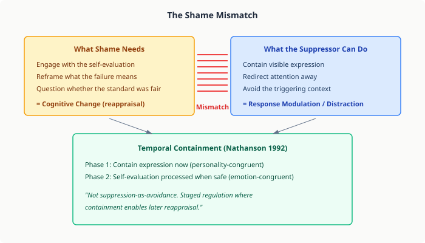
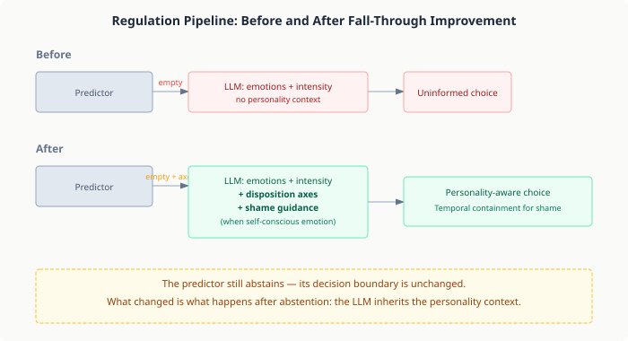

# When the Predictor Lets Go

*Continues from [When Personality Isn't Enough](2026-11-05-mdp01-when-personality-isnt-enough.md).*

The predictor knows its limits. A coherent suppressor facing shame gets `Optional.empty()` — the predictor says "I can't confidently pick a strategy for this." That is the correct answer. But the system that receives that answer does nothing useful with it. The LLM gets the emotion, the intensity, the regulation history — and no personality context at all. It makes a strategy selection flying blind.

This is the gap between being right and being helpful. The predictor is right to abstain. But abstaining without context leaves the LLM worse off than if no predictor existed, because the predictor had information the LLM could have used.

## What the LLM Doesn't See

When the predictor successfully pins a strategy, the LLM's prompt includes: "Strategy: RESPONSE_MODULATION (personality-derived)." The LLM knows what to do and focuses on generating the embodied experience. When the predictor falls through, that line disappears. The LLM sees emotions, intensity, fatigue, load — everything the regulation system tracks. But it does not see the personality that the predictor just consulted and decided was too ambiguous to predict from.

The personality data is right there. `DispositionAxes` — five categorical dimensions that describe how this character handles conflict, follows rules, takes risks, exercises autonomy, and orients socially. The predictor read these axes, counted the signals, found them inconclusive, and discarded them. The LLM never learns they exist.

For most emotions, this is not a problem. The LLM is good at selecting regulation strategies from context — the emotion type, the scenario, the history of what has worked before. For shame, it is a critical problem. Shame is the one emotion where the right strategy depends entirely on who you are, not what happened.

## Shame Is Self-Evaluative

Every other negative emotion is about the world. Anger is about someone else's action ("they wronged me"). Fear is about an external threat ("something might hurt me"). Reproach is about someone else's standards violation ("they failed what I expected"). These emotions have situational answers — the world provides enough information for the LLM to select a sensible strategy.

Shame is about the self. "I failed my own standards." The world is irrelevant to the core question: what do I do with this judgment I'm making about myself? And the answer depends entirely on personality. An analytical person reappraises — "was the standard reasonable? Was the failure as bad as I'm telling myself?" An avoidant person contains — "hold the expression steady, don't let anyone see, deal with it later." These are fundamentally different responses, and without knowing which personality is experiencing the shame, the LLM has to guess.

The published literature is specific about this. Webb, Miles, and Sheeran's 2012 meta-analysis of 306 emotion regulation studies found that cognitive change (reappraisal) outperforms response modulation (suppression) overall — effect sizes of 0.36 vs 0.16. But that aggregate masks an important interaction: for self-evaluative emotions, the key factor is whether the regulation engages with the self-evaluation. Pure suppression "leaves the self-evaluation unaddressed." You can hold back the expression, but the internal judgment continues unresolved.

This creates the fundamental mismatch the predictor identified. Shame demands engagement with the self-evaluation (cognitive change). Avoidant personalities cannot execute cognitive change (they lack the reflective traits). No single strategy satisfies both constraints. The predictor was right to abstain.

And shame compounds in ways other emotions do not. Unlike anger or fear, which are responses to present events, shame is memory-triggered. A character who was publicly humiliated last round doesn't just feel shame about this failure — they feel the accumulated weight of every similar failure their memory retrieves. The salience-scored memory system surfaces previous shame episodes during appraisal, and each retrieved memory amplifies the current intensity. An avoidant personality facing compounding shame has even less capacity for the reappraisal that shame requires, because the cognitive resources are consumed by the memory flood.

Shame is also relationship-modulated. Missing your nephew's birthday produces a different quality and intensity of shame than missing your own child's — the self-judgment scales with relational closeness, obligation depth, and the specific role you occupy in that relationship. A character who fails a casual acquaintance's expectations feels mild discomfort. A character who fails someone they are responsible for — a mentee, a dependent, a partner — feels shame that cuts to the core of their self-concept as a protector or provider. The relationship type doesn't just amplify intensity; it changes what the self-evaluation is about. "I forgot" vs. "I failed them as a parent."

The compounding deepens with repeated promise-violation. A character who misses their child's birthday once feels shame. A character who misses it again, after explicitly promising they would be there this time, feels shame layered on broken trust, layered on the memory of the previous failure and the previous promise. Each cycle doesn't just add intensity — it undermines the character's self-narrative as someone who keeps their word. The shame isn't just about this failure; it's about the pattern the failures reveal.

But personality mediates how deeply shame lands. The same promise-violation cycle that produces accumulating, identity-threatening shame in a conscientious personality produces surface-level discomfort in some Cluster-B profiles. High grandiosity can reframe failure as someone else's fault ("they should understand how important my work is"). High callousness can simply not register the other's hurt as relevant to self-evaluation. The PersonalityFacets system in the CDE already models these dimensions — grandiosity, callousness, manipulativeness — and the expression style derivations show how they interact. A character with high grandiosity and high callousness may experience shame as a brief social inconvenience rather than a self-concept threat. The regulation system needs to account for this: the same emotion type (SHAME) requires different regulation not just because of disposition axes, but because of how deeply the personality allows the shame to penetrate.

This combination — memory retrieval compounding the current episode, relationship structure shaping its meaning, personality depth determining how far the self-evaluation reaches — makes shame qualitatively different from other negative emotions in the regulation pipeline. It recruits its own history as fuel, the relational context determines how hot that fuel burns, and personality determines whether the fire reaches the foundation or stays on the surface.

## Temporal Containment

The literature offers a resolution that the predictor's binary framework cannot express. Nathanson's compass of shame (1992) describes avoidance as a *temporary* strategy — one that "eventually allows the individual to reappraise the situation or attempt to solve the problem." This is not suppression as an endpoint. It is suppression as a bridge.

Yang et al. (2025) found neural evidence for this temporal sequence in avoidant individuals. ERP studies show that suppression works in early processing phases (300-500ms, reduced late positive potential) but decays in later phases (500-800ms, where avoidant individuals show stronger LPP than secure individuals). Reappraisal shows the opposite pattern — more sustained effects over longer time windows. The neuroscience matches the clinical model: avoidant people can contain effectively in the short term, but the containment degrades. The reprocessing has to happen eventually.

This resolves the shame mismatch by respecting both constraints. The avoidant personality contains the expression — something it can execute naturally. The self-evaluation is not suppressed but deferred — something the emotion requires. The two-phase strategy satisfies the personality (contain) and the emotion (engage with the self-judgment, later).

## What We Built

Two changes to the regulation pipeline, both triggered when the predictor falls through.

First: the LLM now receives the personality's disposition axes. When the predictor returns `Optional.empty()`, the user message includes the five categorical dimensions the predictor just evaluated — conflict mode, social orientation, risk appetite, autonomy, rule-following. The prompt explicitly states "predictor did not pin a strategy" to signal that this is a case requiring personality-aware reasoning.

Second: when the dominant emotion is self-conscious (shame or remorse) and no strategy is pinned, the LLM receives literature-grounded guidance about temporal containment. The guidance explains that shame is self-evaluative, that pure suppression is insufficient (Webb et al. 2012), and that temporal containment — contain now, reprocess when safe — is adaptive for avoidant personalities (Nathanson 1992, Yang et al. 2025).

Both changes follow the existing pattern in the user message builder: conditional sections that appear only when relevant, the same way cognitive load, fatigue, and strategy failure signals are injected. The system prompt stays generic. The personality-specific context goes in the user message alongside the emotions and history.

## What We Cannot Measure Yet

The predictor eval judges the predictor's strategy selection. It runs the predictor, takes its chosen strategy, and asks a judge LLM: "is RESPONSE_MODULATION appropriate for this personality facing this emotion?" When the predictor falls through, the eval records "FELL_THROUGH" and skips the case.

Phase 1 improved the LLM path — what happens after the predictor falls through. The predictor eval cannot see this improvement. suppressor-shame still shows "FELL_THROUGH, -1, predictor not confident." The improvement is invisible to the instrument that measures predictor quality.

This is not a gap in the implementation. It is a gap in the evaluation. The system needs an end-to-end regulation eval that runs the full pipeline — predictor falls through, LLM receives personality context and shame guidance, LLM selects a strategy — and judges the LLM's chosen strategy, not the predictor's. This is prerequisite for Phase 2.

## Why This Matters for AI Agents

Most agent systems that model personality do it through prompting — a paragraph of character description injected before each generation call. The personality influences tone, vocabulary, decision-making. But when the system needs to make a mechanical decision *about* the personality — "given these traits, what regulation strategy should this character use?" — the personality data is locked in prose. You cannot compute on prose.

The CaseHub approach extracts personality into structured data (DispositionAxes, PersonalityFacets) and then computes on it. The predictor counts suppressor signals. The CognitiveDerivationEngine derives mood baselines, trust rates, appraisal weights. These are legitimate computations because the upstream extraction already made the semantic judgments. The structured data is an investment that pays dividends across every cognitive subsystem.

But structured data has limits. Categorical axes — avoidant, cooperative, analytical — produce binary classifications. A personality is either a suppressor or it isn't. A personality either has reappraisal capacity or it doesn't. The shame problem exposes exactly where binary classification fails: when the right answer is "partial capacity" — enough to contain, not enough to restructure.

Phase 2 will explore continuous regulation weights derived from the same disposition axes. Not "is this a suppressor?" but "how much suppression capacity does this personality have?" — a number, not a boolean. Whether that resolves the shame problem is an empirical question that depends on whether 0.3 reappraisal capacity is enough for the mild form of cognitive change that shame requires (reframe the self-judgment) even though it is insufficient for the full form (restructure the situation).

The design of those continuous weights will be grounded in published personality-regulation correlations — not intuited from what "seems right." The research findings from this session, the eval gap analysis, and the end-to-end eval results will inform the architecture. Empirical evidence first, then mechanism.

## The Principle

A predictor that knows when it cannot predict is more valuable than a predictor that always predicts. The value is not in the abstention — it is in what happens next. The predictor that abstains and discards its evidence wastes the computation. The predictor that abstains and passes its evidence to the next decision-maker — "here is what I saw, here is why I couldn't conclude, here is the personality context you need" — makes the fallback path smarter than the default path.

The fallback is not failure. It is the recognition that some decisions require contextual reasoning that mechanical prediction cannot provide. The architecture that embraces this — mechanical where possible, contextual where necessary, transparent about which is which — is the architecture that produces believable behaviour across the full range of personality-emotion combinations, not just the predictable ones.

---

*References: Webb, T.L., Miles, E. & Sheeran, P. (2012). Dealing with feeling: A meta-analysis of the effectiveness of strategies derived from the process model of emotion regulation. Psychological Bulletin, 138(4), 775-808. Nathanson, D.L. (1992). Shame and Pride: Affect, Sex, and the Birth of the Self. Norton. Yang, H. et al. (2025). Electrocortical modulation of reappraisal and suppression in avoidant and secure attachment. Hughes, D.J., Furnham, A. & Batey, M. (2020). Personality traits and emotion regulation: A targeted review and recommendations. Emotion, 20(1), 63-74. Petter, J. et al. (2025). Emotion regulation, fast or slow. Emotion, 25(5), 1273-1292. Gross, J.J. (1998). The emerging field of emotion regulation. Review of General Psychology, 2(3), 271-299.*r
