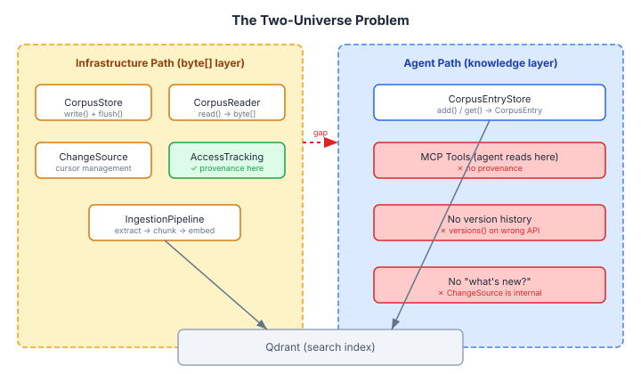
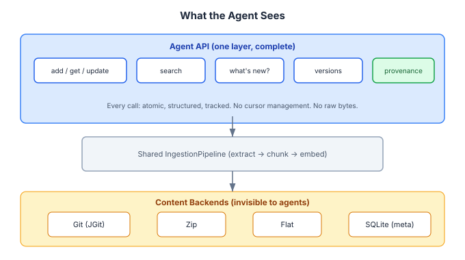

# The API the Agent Never Asked For

A few weeks ago I audited our corpus management module and found thirteen Hortora-specific leaks in what was supposed to be a generic API. That audit ended with a clear architectural split: corpora (curated libraries) and workspaces (agent-driven research desks) are fundamentally different things that share storage and search primitives.

This week I went to build the next piece — a git-backed corpus store, so agents can work with knowledge that lives in a git repo instead of zip archives. The implementation went well. The code review didn't.

## What git changes about a corpus

Our original corpus design was ZIP-centric. Rolling archives with chain manifests, content hashing, compaction modes. Built for scale — millions of files where filesystem performance degrades. Flat files existed as a convenience mirror for developers who wanted to grep and browse.

But with the shift toward small, curated knowledge — the kind an LLM agent actively maintains and searches — git becomes the interesting backend. Not because of storage, but because of what git gives you for free: version history per file, commit-based change detection immune to clock skew, atomic multi-file commits, and a collaboration model (branches, PRs, reviews) that's already understood.

The implementation was straightforward. `GitCorpusReader` reads from a configurable ref via JGit's tree walk. `GitChangeSource` diffs between commit SHAs instead of comparing filesystem timestamps. `GitCorpusStore` writes to the working tree and auto-commits on flush. All three pass the shared contract tests.

But that's infrastructure. The question that mattered came after.

## Two universes that never meet

Claude ran the code review with a specific brief: evaluate this through the lens of what an LLM agent actually needs, not what a Java developer expects. The finding was uncomfortable.

We'd built two parallel API layers:

On the left, the infrastructure path: `CorpusReader` returning `Optional<byte[]>`, `ChangeSource` with opaque cursor management, `AccessTrackingReader` wrapping reads for provenance. Designed for the ingestion pipeline, built by and for backend implementors.

On the right, the agent path: `CorpusEntryStore` returning structured `CorpusEntry` objects with typed metadata, exposed through MCP tools. What agents actually call.

These layers never meet. The provenance tracking wraps `CorpusReader` — the byte-level API that agents don't use. Agent reads go through `CorpusEntryStore`, completely untracked. The write path was worse: `CorpusEntryStore.add()` stored metadata in SQLite and pushed embeddings to Qdrant, but never called `CorpusStore.write()`. The `ContentSerializer` I'd just built had zero callers. Programmatic writes never reached the git backend.

The version history API — `versions()` and `readVersion()` — lived on `CorpusReader`. Inaccessible from the agent path. An agent couldn't see a document's history through the MCP tools.

Change detection? Internal plumbing for the ingestion pipeline. No MCP tool for "what changed since yesterday?" An agent maintaining awareness over a corpus had no way to ask.

## The training-data trap

Here's the part I think is worth naming explicitly. We built a conventional Java storage layer because that's what the pattern-matching says to build. SPIs with multiple implementations. Decorator chains. CDI producer methods resolving optional dependencies. Contract test suites with abstract base classes. Every design pattern is defensible in isolation.

But the consumer isn't a Java developer wiring CDI beans. The consumer is an LLM agent making MCP tool calls. It doesn't care about `Optional<byte[]>`. It needs structured knowledge it can reason about, returned in one call, with provenance tracked automatically.

This is a trap that's easy to fall into. LLMs — including Claude — have internalised massive amounts of Java API design from training data. When asked to design a corpus store, the statistical prior points toward what Java corpus stores look like: storage SPIs, read/write separation, cursor-based change detection, byte-level content access. These are fine patterns for infrastructure consumed by developers. They're the wrong patterns for a system consumed by agents.

## What agents actually need

I sat with this for a while before proposing fixes. What does an LLM agent working with a knowledge corpus actually want to do?

**"Find me documents about X"** — search that returns content, not just IDs and scores. The most common operation shouldn't require follow-up reads.

**"Read this document"** — structured content with metadata, version info, and freshness signals. Not raw bytes to decode and parse. Tracked automatically for provenance.

**"Save this knowledge"** — one call, atomic, persisted to the backend and indexed. No write-then-flush two-step.

**"What's new?"** — changes since a timestamp or since the agent last asked. System-managed cursors. No opaque cursor strings to store and pass back.

**"What versions exist?"** — history with commit authors and timestamps, accessible through the same API the agent uses for everything else.

None of these mapped cleanly to what we'd built. The agent had to know about two different API layers, manage invisible state between calls, and accept that its reads were untracked.

## The fixes

We fixed the correctness bugs immediately. `SqliteCorpusEntryStore.add()` now calls `ContentSerializer.serialize()` → `CorpusStore.write()` → `flush()` before the pipeline. Every programmatic write reaches the git backend. Auto-flush inside each operation — the agent never sees the two-step.

`AccessTrackingEntryStore` wraps `CorpusEntryStore` the same way `AccessTrackingReader` wraps `CorpusReader` — construction-time decorator with a `Consumer<EntryAccessEvent>` callback. Provenance now tracks agent reads through the API agents actually use.

Three more issues are queued for the next sessions: agent-facing change detection with system-managed cursors, version history on `CorpusEntryStore`, and search results that include content previews. These are the UX improvements that turn the infrastructure into something an agent would want to use.

## The broader point

Building for LLM agent consumption is a different discipline from building for developer consumption. The conventions Java developers expect — fine-grained SPIs, explicit state management, byte-level content access — become friction when the consumer is an agent making tool calls.

An agent needs fewer, richer operations. Each call should be complete: no setup, no follow-up, no invisible state to manage. Return types should carry everything the agent needs to reason — not raw data it has to parse and reassemble.

This isn't specific to corpus management. Any platform building MCP tools for agent consumption will hit the same tension: the infrastructure patterns that serve developers well create a hostile experience for agents. The fix is to design the agent-facing API first, as its own surface, and let the infrastructure serve it — not the other way around.

We built the infrastructure first and assumed the MCP layer would paper over the gaps. It didn't. The gaps were architectural, not cosmetic. I'll know better next time.