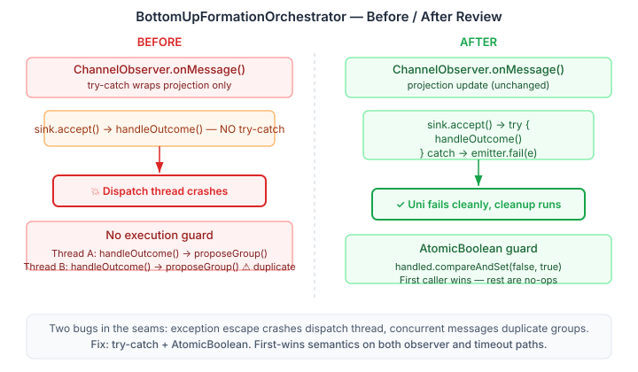

# The Review That Found Real Bugs

The society integration epic landed five fixes across four sessions — HivePatternAdapter wired to real patterns, BottomUpFormationOrchestrator connecting coalition evaluation to group creation, RolePolicySpec aligned with eidos, TopologyContext enriched, HiveTopologyCompiler bridging YAML to runtime. Everything compiled, tests passed, architecture looked complete.

Then we reviewed it.

## Where the Bugs Were Hiding

Claude ran five parallel review forks across the landed code: one per component plus a cross-cutting wiring audit. The component reviews were clean — HivePatternAdapter delegates properly, TopologyContext backward-compatible, RolePolicySpec maps correctly. The orchestrator review found two real problems.



The first was a thread safety issue hiding in the subscriber callback. When `ChannelObserver.onMessage()` calls the subscriber's lambda, any exception in that lambda escapes to the message dispatch thread. The try-catch in `onMessage()` only wraps the projection update — not the `sink.accept()` call. If `GroupLifecycleService.proposeGroup()` throws inside `handleOutcome()`, the dispatch thread crashes and the Uni never completes. The orchestrator sits there until timeout, but the thread is dead.

The second was a duplicate-execution race. Two messages arriving concurrently on different threads can both see `state.outcome().isTerminal() == true` and both call `handleOutcome()`. Mutiny's emitter is idempotent — only the first `complete()` wins — so the Uni result is correct. But the side effects run twice: `proposeGroup()`, `approveProposal()`, `joinGroup()` all execute twice, creating duplicate groups in eidos.

```java
var handled = new AtomicBoolean(false);

var subscription = observer.subscribe(event -> {
    var state = observer.currentState();
    if (state.outcome().isTerminal() && handled.compareAndSet(false, true)) {
        try {
            emitter.complete(handleOutcome(state, proposal));
        } catch (Exception e) {
            emitter.fail(e);
        }
    }
});
```

The fix for both is small. Wrap the callback in try-catch with `emitter.fail()` for exception propagation. Guard `handleOutcome()` with `AtomicBoolean` — `handled.compareAndSet(false, true)` gates both the observer callback and the timeout recovery path. First caller wins, everyone else is a no-op, exceptions propagate cleanly instead of killing infrastructure threads.

## The Composition Gap

The cross-cutting review surfaced a different kind of gap. Every component works individually. The types are correct. The tests pass. But the pieces don't compose into a running system yet. `TopologyContext.groupId()` exists but no topology reads it. `RolePolicySpec.toRoleSpec()` compiles but nothing calls it from production code. `BottomUpFormationOrchestrator` creates groups but they sit in FORMING state — nothing activates them.

That last observation drove the remaining work. The YAML-to-runtime compiler was the missing piece connecting the YAML surface to the runtime topology — the reason `toRoleSpec()` had no caller. `HiveTopologyCompiler` takes a `TopologySpec.Hive` and produces a `CompiledHive` carrying the `HiveTopology`, the `OrchestrationPatternType`, the agent role map, and the compiled `RoleSpec` list. The vocabulary fix went in at the same time — `RolePolicySpec` now carries an optional vocabulary field so `toRoleSpec()` can produce correct cross-vocabulary role matching instead of hardcoding each role as its own vocabulary.

## What's Left

The maturity epic captures what remains: six items across three tiers. The critical path is formation activation — bridging `JointIntention` to `GroupLifecycleService.activateGroup()` so formed groups actually reach ACTIVE. Below that: deployment wiring so consumers don't call the compiler manually, and threading `groupId`/`tenancyId` through HiveTopology so the coordinator can query the org model.

The pattern here is worth naming. Building blocks land correct and tested. The review that catches real bugs isn't the per-line code review — it's the composition review. Each piece in isolation is fine. The bugs live in the seams: what happens when the observer callback throws, when two threads race through the same outcome handler, when five components all exist but none calls the one it was built to feed. Compositional architecture earns its keep when the compositions actually compose.
