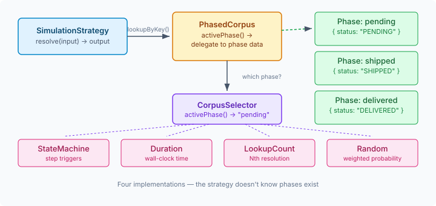
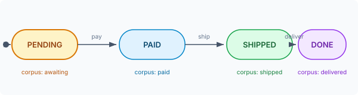
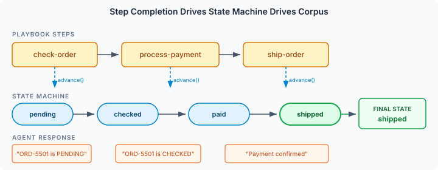

# The Test Double That Changes Its Mind

A static mock returns the same response every time. That's fine for unit tests where the input determines the output — ask for patient 123, get patient 123's record. But systems don't stand still. An order starts as PENDING and becomes SHIPPED. A health check returns OK until the service goes down. A payment gateway approves most charges but occasionally times out.

If you're testing a workflow that polls an API six times and expects to see a status change on the fourth poll, your test double needs a memory. It needs to know where it is in the story.

## The gap in static corpus

CaseHub's simulation infrastructure already handles the static case well. A `simulation.yaml` maps qualified names to strategies and corpus data:

```yaml
methods:
  rest-request:
    strategy: key-lookup
    key-extractor: "field:url"
    corpus:
      - key: "/api/orders/ORD-7742"
        output: { status: "PENDING" }
```

Every lookup for that URL returns PENDING. Always. The corpus is seeded once at startup and never changes. This is the right answer for deterministic tests — same input, same output, every time.

But it can't model progression. It can't model degradation. It can't model the 5% of requests that return garbage because the upstream service has a flaky serialiser. For those, you need corpus data that changes based on something — time elapsed, number of calls made, a step completing in your workflow, or just weighted randomness.

## Corpus selection: the abstraction

The design I landed on puts the switching logic *below* the strategy layer. A `PhasedCorpus` wraps the real corpus and delegates every lookup to whichever phase is currently active. The strategy — `KeyLookupStrategy`, `SequentialStrategy`, whatever — doesn't know phases exist. It calls `corpus.lookupByKey()` and gets back the right answer for the current phase.



This is the key design decision: the selector is invisible to everything above it. Generated `@Decorator` classes don't change. `SimulatingAction` in the playbook runtime doesn't change. The entire existing simulation stack works exactly as before — the new capability is purely additive.

A `CorpusSelector` interface returns the name of the active phase. Four implementations cover the cases that matter:

**State machine** — the most expressive option. You declare states and transitions, and the selector advances when external triggers fire. A payment step completing moves the order from PENDING to PAID. A health check event moves the system from NORMAL to DEGRADED. The transitions map to business process milestones, not arbitrary counters.



**Duration** — time-based phase switching. A health endpoint returns OK for 10 seconds, then starts returning 503s. At 10x simulation speed, that 10-second window collapses to 1 second of wall-clock time — the `SpeedMultiplier` bridge ensures duration-based selection respects the same speed controls as the rest of the simulation runtime.

**Lookup count** — the simplest progression model. The first three resolutions return PENDING, the next two return SHIPPED, everything after that returns DELIVERED. No external triggers, no time dependency — just a counter that advances on each successful resolve.

**Random** — stateless, probabilistic. 80% success, 15% timeout, 5% corrupt response. Each lookup independently selects a phase by weight. This is chaos testing from a YAML file — no infrastructure needed, just declare your failure distribution and let the simulation inject it.

## What the YAML looks like

The `corpus-selection` block replaces `corpus` on a method — they're mutually exclusive, because the phases carry their own corpus data:

```yaml
methods:
  rest-request:
    strategy: key-lookup
    key-extractor: "field:url"
    corpus-selection:
      type: state-machine
      initial: pending
      transitions:
        pending:
          process-payment: completed
        completed:
          ship-order: shipped
      phases:
        pending:
          - key: "/api/orders/ORD-5501"
            output: { status: "PENDING" }
        completed:
          - key: "/api/orders/ORD-5501"
            output: { status: "PAID" }
        shipped:
          - key: "/api/orders/ORD-5501"
            output: { status: "SHIPPED" }
```

The state machine transitions are driven by step names in the playbook. When the `process-payment` step completes, the selector advances from `pending` to `completed`. The next time anyone asks for order ORD-5501, they get `PAID` instead of `PENDING`.

For chaos testing, the config is even simpler:

```yaml
corpus-selection:
  type: random
  phases:
    - name: success
      weight: 0.80
      corpus:
        - key: "/api/payments/charge"
          output: { status: 200, body: { status: "APPROVED" } }
    - name: timeout
      weight: 0.15
      corpus:
        - key: "/api/payments/charge"
          output: { status: 504, body: { error: "GATEWAY_TIMEOUT" } }
```

Run your playbook against this config and your error handling gets exercised without deploying anything.

## The lifecycle hook

One subtlety worth calling out. `LookupCountSelector` needs to count resolutions — but `activePhase()` gets called from both `canResolve()` and `resolve()` inside a strategy. If the counter incremented on every `activePhase()` call, each resolution would double-count.

The fix: `activePhase()` is pure read, no side effects. A separate `onResolved()` callback fires after each successful `strategy.resolve()`. The runtime wraps every strategy that has a corpus selector in a thin delegating wrapper that calls `selector.onResolved()` after `resolve()` returns. Callers never see the wrapper — it's the strategy they get back from `strategyFor()`.

This is the kind of thing that only surfaces when you think about the actual call path. The generated `@Decorator` calls `canResolve()` then `resolve()` — both go through the corpus. Without the separation, lookup-count-based selection would advance twice per actual use.

## Step names as triggers

The state machine needs something to drive it. The answer turned out to be the simplest possible thing: step names. When a named playbook step completes successfully, `advanceStateMachines(stepName)` fires on every registered `StateMachineSelector`. The selector checks its transition map — if the step name matches a trigger for the current state, the state advances. If not, nothing happens. No configuration needed beyond the transition map that already exists in the YAML.



This makes the whole thing declarative end-to-end. The playbook declares step names. The simulation config declares transitions keyed on those names. At runtime, step completion is the glue — no Java code, no event listeners to register, no coupling between the playbook and the simulation config beyond shared step names.

## Zero Java, three files

The payoff is that a simulation scenario is pure YAML — a playbook, a simulation config, and a test. They're paired by name:

**`order-lifecycle.playbook.yaml`** — three named steps that talk to an agent:

```yaml
steps:
  - agent-session-open order-agent:
      system: You are an order processing assistant.

  - name: check-order
    agent-query order-agent: "Check order status for ORD-5501"

  - name: process-payment
    agent-query order-agent: "Process payment for ORD-5501"

  - name: ship-order
    agent-query order-agent: "Ship order ORD-5501"

  - agent-session-close: order-agent
```

**`order-lifecycle.simulation.yaml`** — a state machine that advances as each step completes, with different corpus data per phase:

```yaml
methods:
  agent-provider.invoke:
    strategy: sequential
    corpus-selection:
      type: state-machine
      initial: pending
      transitions:
        pending:
          check-order: checked
        checked:
          process-payment: paid
        paid:
          ship-order: shipped
      phases:
        pending:
          - output: "Order ORD-5501 is PENDING"
        checked:
          - output: "Order ORD-5501 is CHECKED"
        paid:
          - output: "Payment confirmed for ORD-5501"
        shipped:
          - output: "Order ORD-5501 has SHIPPED"
```

**`order-lifecycle.test.yaml`** — runs the playbook and asserts the state machine reached `shipped` and the agent response came from the right phase:

```yaml
name: State machine corpus selection
simulate:
  agent:
    - prompt: "fallback"
      response: "static fallback"

tests:
  - name: "step completion advances state machine and changes agent responses"
    steps:
      - run-playbook: ../../../main/playbooks/simulation/order-lifecycle.playbook.yaml
        capture: result
      - assertThat: result.succeeded
        equals: true
      - assertThat: result.stateMachines.agent-provider_invoke
        equals: shipped
      - assertThat: result.output.response
        contains: "Payment confirmed"
```

The last assertion is the interesting one. The third step (`ship-order`) runs while the state machine is at `paid` — so the agent returns "Payment confirmed for ORD-5501" from the `paid` phase, not from `pending` or `shipped`. The state advances to `shipped` *after* the step completes. The test proves the whole chain: step names drive transitions, transitions drive corpus selection, corpus selection drives what the agent says back.

The random selector needs none of this wiring — no step names, no lifecycle hooks. Point it at your payment endpoint, set your failure weights, and your retry logic gets tested on every run.
