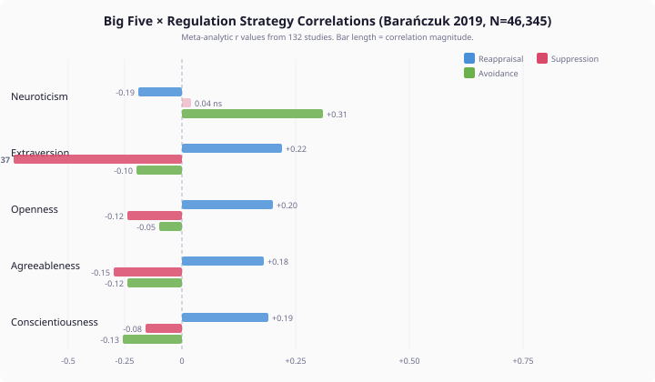
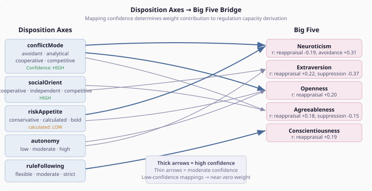

# The Weight of Evidence

*Continues from [When the Predictor Lets Go](2026-11-06-mdp01-when-the-predictor-lets-go.md).*

The predictor works. Five of eight personality-emotion combinations get confident strategy predictions. The LLM handles the other three with personality context. The end-to-end eval scores 4.4 out of 5. We could stop here.

But the predictor works through a mechanism that bothers me: signal counting. It counts how many disposition axis values look "suppressor-like" (avoidant, conservative, competitive) and how many look "reappraiser-like" (analytical, strict, cooperative, high autonomy). Three or more on one side and fewer than two on the other? You get a label. Otherwise you fall through to the LLM.

This is a binary classifier wearing the skin of personality psychology. And the published research says personality and emotion regulation don't relate in binary ways.

## What 46,345 People Told Us

Barańczuk's 2019 meta-analysis — 132 studies, 46,345 participants, 753 effect sizes — measured how the Big Five personality traits correlate with eight different emotion regulation strategies. The correlations are not binary. They are continuous, multidimensional, and smaller than you might expect.

The largest single correlation in the entire meta-analysis is between Neuroticism and avoidance: r = 0.31. That means Neuroticism explains roughly 10% of the variance in avoidance behaviour. The other 90% comes from context, situation, mood, relationships, and everything else that makes a person more than their trait profile.

For reappraisal — the strategy our predictor calls COGNITIVE_CHANGE — no single Big Five trait dominates. Openness correlates at 0.20, Extraversion at 0.22, Conscientiousness at 0.19, Agreeableness at 0.18. They all contribute, modestly, in the same direction. The capacity to reappraise is not a single personality dimension. It is a composite that draws on cognitive flexibility (Openness), social confidence (Extraversion), goal persistence (Conscientiousness), and perspective-taking (Agreeableness).

For suppression of expression, the picture is strikingly different. One trait dominates: Extraversion at -0.37. Introverts suppress expression far more than extraverts. The effect is nearly twice as large as any other personality-suppression correlation. If you want to predict who will suppress, look at introversion first and everything else second.

## From Correlation to Capacity

Hughes, Kratsiotis, Niven, and Holman's 2020 review drew a distinction that changes how we should read these numbers. They separated three stages of emotion regulation where personality operates differently:

**Identification** — which emotions do you notice need regulating? Neuroticism makes you notice more.

**Selection** — which strategy do you reach for? The Barańczuk correlations primarily measure this. Extraverts select socially engaging strategies. Agreeable people select harmony-preserving ones.

**Implementation** — can you actually execute the strategy you selected? This is what our predictor needs but the meta-analysis doesn't directly measure.

The distinction matters most for suppression. High-Neuroticism personalities habitually *attempt* suppression (selection), but they do it *badly* (implementation). The suppression doesn't hold. The emotion breaks through. The rebound makes things worse. A meta-analytic correlation of r = 0.09 between Neuroticism and suppression use masks a fundamental dysfunction: high-N people suppress more often precisely because they fail at it more often and need to try again.

For our weight tables, this means we cannot simply translate "uses this strategy" into "can execute this strategy." Capacity requires a second lens — one informed by the implementation literature, not just the selection data.

## The Bridge: Disposition Axes to Big Five

Our characters don't have Big Five scores. They have disposition axes: conflict mode, social orientation, risk appetite, autonomy, rule-following. These are richer than Big Five — a single axis like "avoidant conflict mode" encodes a specific behavioural pattern, not a broad trait factor. But the published literature is indexed by Big Five, not by disposition axes.

The bridge is approximate by necessity:

Some mappings are high-confidence. Avoidant conflict mode maps cleanly to high Neuroticism and high Agreeableness — avoidance is the canonical combination of emotional sensitivity and harmony preservation. Analytical conflict mode maps to high Openness — the systematic, cognitive approach to problems. Strict rule-following maps to high Conscientiousness.

Others are muddier. "Calculated" risk appetite sits in the middle of the Neuroticism spectrum — neither risk-averse (high N) nor risk-seeking (low N). "Moderate" autonomy tells us almost nothing about Openness or Extraversion. These low-confidence mappings contribute near-zero weight to the capacity derivation, which is the correct response to uncertainty: don't guess.

## Continuous Weights, Not Binary Labels

The new `RegulationDefaults` record replaces the boolean `isSuppressor()` and `isReappraiser()` checks with three continuous values: reappraisal capacity, suppression capacity, and redirect tendency. Each is derived from all five disposition axes through the Big Five bridge, using the meta-analytic correlation magnitudes to set relative weights.

An analytical, cooperative, high-autonomy, strict, calculated personality: reappraisal capacity 1.0, suppression capacity 0.35, redirect tendency 0.15. A strong reappraiser — and the continuous values explain *why*. Every contributing axis pushes toward cognitive flexibility.

An avoidant, cooperative, low-autonomy, moderate, conservative personality: reappraisal capacity 0.30, suppression capacity 0.80, redirect tendency 0.80. A suppressor with strong redirect tendency. But note: the reappraisal capacity is not zero. It is 0.30. This personality has *some* capacity for cognitive change — just not enough to clear the prediction threshold. And that residual capacity matters for shame.

The mixed-anger case — the weakest in our eval at score 3 — is a cooperative, moderate, calculated, moderate, cooperative personality. All capacities cluster near the middle: reappraisal 0.70, suppression 0.55, redirect 0.40. No single capacity dominates. The dominance margin check (0.10) catches this: when capacities are within 10% of each other, the predictor falls through rather than making an arbitrary choice. The LLM gets the full capacity profile and chooses based on the specific situation.

## Shame Needs More Than Personality

The continuous weights improve the predictor for controllable emotions — anger, reproach, fear. For shame, they are necessary but not sufficient. Shame has three dimensions that no amount of personality-based prediction addresses.

**Memory compounds shame.** Unlike anger (a response to this moment's injustice) or fear (a response to this moment's threat), shame accumulates. Previous shame episodes are retrieved during appraisal and amplify the current intensity. A character experiencing their fifth shame episode about the same pattern of failure is not simply feeling shame at 5x intensity — they are experiencing a qualitative shift. The shame is no longer about this act. It is about the pattern the acts reveal. "I failed" becomes "I keep failing" becomes "I am someone who fails."

The memory system already tracks this. Salience-scored retrieval surfaces relevant episodes. The regulation pipeline just never consumed that information.

**Relationships modulate shame's quality.** Missing a stranger's birthday is embarrassment. Missing your child's birthday is identity-threatening shame. The self-evaluation changes with relational closeness — not just in intensity but in kind. "I forgot" vs "I failed them as a parent." The social cognition model already tracks trust, intimacy, and relational role per relationship. Again, the regulation pipeline never consumed it.

**Personality gates shame's depth.** A character high in grandiosity and callousness experiences shame differently — it doesn't penetrate to identity. The grandiose self-concept deflects the self-evaluation externally: "The situation was unfair" rather than "I am inadequate." Callousness means the other person's hurt doesn't register as relevant to self-evaluation. The result is surface-level shame that passes quickly. Treating it with deep temporal containment strategies would be disproportionate — like prescribing surgery for a bruise.

The CDE's expression style derivations already handle the grandiosity-callousness interaction for drive expression. The personality facet infrastructure already models these dimensions. The building blocks exist. The regulation pipeline just needs to assemble them when shame is on the table.

## The Architecture of Not-Knowing

What struck me during this design was where to put the boundary between mechanical computation and LLM judgment. The continuous weights are mechanical — derived once at startup from a literature-grounded formula. The shame context is structured data assembled at runtime. But the *integration* of shame context (memory compounding × relational closeness × personality depth) is not mechanically specifiable.

The literature tells us these dimensions interact. It does not tell us the quantitative thresholds. At what episode count does compounding change the quality of regulation? How does relational closeness interact with grandiosity? The published research describes these as continuous, context-dependent interactions — exactly the kind of nuanced judgment that an LLM with structured context can handle and a lookup table cannot.

So the architecture has a principled boundary. Mechanical where the literature provides quantitative precision (weight tables from meta-analytic r values). Contextual where the literature provides qualitative direction without numerical thresholds (shame dimension interactions). The LLM doesn't guess in a vacuum — it receives computed values (episode count: 4, relational closeness: 0.8, grandiosity: 0.3) rendered as psychologically grounded narrative that explains what each value means for this specific regulation episode.

This is not the LLM as a fallback for things we haven't figured out yet. This is the LLM as the right tool for a specific category of decision: one where the dimensions are known, the directions are known, but the interactions are too context-dependent for a static formula.

## What Evidence Weighs

The title of this entry is deliberate. Evidence has weight — literally, in our architecture. The meta-analytic r values become weights in the derivation tables. The correlations from 132 studies across 46,345 participants set the relative ordering of how personality dimensions contribute to regulation capacity.

But evidence also has weight in the sense of what it costs to ignore it. The boolean predictor worked for clear cases. It will continue to work — the continuous weights produce the same predictions for coherent personalities, just with more precision about *how* coherent they are. The improvement is at the margins: the mixed personalities, the ambiguous cases, the subtle interactions between conflicting trait signals.

And the evidence tells us something important about shame that the original predictor could never represent: shame is not one thing. It is not a fixed emotion with a fixed best-strategy. It is a self-evaluative process that changes with memory, relationships, and personality depth. A system that models shame with the same machinery as anger is not wrong — it is shallow. And shallow models produce shallow responses.

The weight tables are literature-grounded initial values. They will be calibrated empirically against the end-to-end eval. Some weights will shift. Some thresholds will adjust. But the directions are set by evidence, and the evidence is clear: personality affects regulation capacity continuously, not categorically, and shame operates in a space that personality alone cannot navigate.
