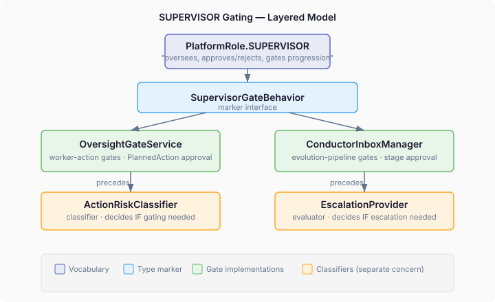
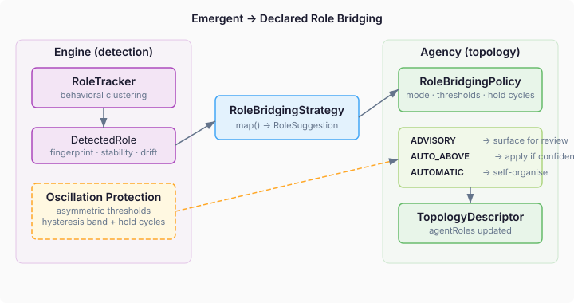

# When Approval Patterns Grow Up

The engine had three separate mechanisms for approval-gating. `ConductorInboxManager` managed an evolution-pipeline inbox — research scope, hypothesis approval, PR review. `OversightGateService` managed worker-action gates — should this `PlannedAction` proceed? `ActionRiskClassifier` decided whether gating was needed in the first place. Three mechanisms, same abstract pattern: pause execution, wait for a decision, resume. None of them knew about the others.

`PlatformRole.SUPERVISOR` described exactly this behavior — "oversees, approves/rejects, gates progression" — but neither the conductor nor the oversight gate referenced it. The relationship was in the designers' heads, not in the type system.

## Formalising what was already true

The fix is a `SupervisorGateBehavior` marker interface that both `OversightGateService` and `ConductorInboxManager` implement. No shared method signatures — the marker is a classification, not an API contract. CDI can now discover all SUPERVISOR gate implementations with `Instance<SupervisorGateBehavior>`. A reader looking at `ConductorInboxManager` sees `implements SupervisorGateBehavior` and immediately understands its relationship to the broader approval-gating architecture.



What the marker deliberately excludes: `ActionRiskClassifier`. The classifier decides *whether* gating is needed — the triage step that precedes the gate. The gate manages the lifecycle once triage says "yes, this needs approval." Marking the classifier as a gate would blur the boundary between classification and enforcement. The relationship is documented in Javadoc cross-references, not in the type hierarchy.

This is a pattern worth naming. When three mechanisms independently implement the same behavioral contract, the missing abstraction isn't a shared base class or a unified SPI — it's a type-level declaration that they belong together. The marker costs nothing at runtime. It costs nothing in API surface. It tells the truth that the code already embodied but couldn't express.

## The gap between observation and declaration

Formalising the marker exposed a deeper question. The engine detects emergent behavioral roles through `RoleTracker` — clustering agents by their `BehavioralFingerprint` (perception, communication, decision, and effect vectors) and emitting `DetectedRole` records when stable clusters appear. These detected roles describe what agents *do*. `AgentRole` in the coordination vocabulary describes what agents *are* — their declared structural position and behavioral contract. Nothing connects the two layers.

A `DetectedRole` whose dominant features match coordinator behavior — high task delegation, low self-execution, strong aggregation patterns — has no path to influence the topology. The agent is *behaving* as a coordinator. The topology still says it's a contractor. The detection is real. The declaration doesn't know.

## A bridge, not a merger

The bridge SPI I designed is a `RoleBridgingStrategy` that maps `DetectedRole` to `RoleSuggestion`. The strategy synthesises detection quality signals — stability count, centroid drift, cluster shape — into a confidence score. The topology decides what to do with the suggestion based on a configurable `RoleBridgingPolicy`.



The policy has three modes:

- **ADVISORY** — suggestions are surfaced for human review. The operator decides.
- **AUTO_ABOVE_THRESHOLD** — suggestions above a confidence threshold are applied automatically. Below it, surfaced for review.
- **AUTOMATIC** — all suggestions above a floor are applied. The system self-organises.

The mode is a policy choice, not an architecture choice. A research swarm can run AUTOMATIC and let emergent leadership patterns reshape the topology in real time. A clinical workflow runs ADVISORY because no one wants an agent auto-promoting itself to supervisor in a patient treatment pipeline. Same SPI, same strategy, different risk tolerance.

## The oscillation problem

A naive implementation with a single threshold flips agents back and forth at the boundary — confidence fluctuates around 0.7, the agent is promoted, demoted, promoted, demoted. The protection is structural: asymmetric thresholds.

Promotion requires confidence above `minConfidence` (say, 0.8). Demotion requires confidence below `demotionConfidence` (say, 0.5). The gap between them is a hysteresis band — confidence wanders freely within it without triggering any role change. A minimum hold period (`minHoldCycles`) adds temporal damping: even if confidence drops below demotion threshold, the role is maintained for a configurable number of detection cycles to ride out transient fluctuations.

The three-parameter set is the minimum needed for safe automatic operation. Each serves a distinct purpose, and the relationship between them is an invariant enforced at construction time: `demotionConfidence` must be lower than `minConfidence`.

```java
public record RoleBridgingPolicy(
    Mode mode,
    double minConfidence,
    double demotionConfidence,
    int minHoldCycles) {

  public RoleBridgingPolicy {
    if (mode != Mode.ADVISORY && demotionConfidence >= minConfidence) {
      throw new IllegalArgumentException(
          "demotionConfidence must be lower than minConfidence for hysteresis");
    }
  }
}
```

## Three concerns, three owners

What makes this design different from most emergent-to-declared role systems in multi-agent literature is the separation of concerns. The *strategy* is the expert on what a behavioral pattern means — it maps fingerprints to roles. The *topology* is the expert on what structural positions are valid — a `CENTRALISED` topology cannot have two `INITIATOR`s. The *policy* is the expert on how much autonomy the system gets. Three concerns, three owners, independently pluggable.

The strategy returns `RoleSuggestion` rather than a fully-constructed `AgentRole`. This matters because the strategy doesn't know topology constraints. It can suggest `PEER` for an agent in a `CENTRALISED` topology where `PEER` is structurally incoherent. The topology filters invalid suggestions before creating roles — filtered, not thrown as exceptions. The strategy's job is to map patterns honestly, not to second-guess structural constraints it can't see.

Formalising behavioral contracts and bridging emergent-to-declared roles are two sides of the same coin. The marker says "these mechanisms implement the same behavioral pattern." The bridge says "observed behavior can inform declared roles." Together they move the platform from static coordination configuration to coordination that evolves — safely, with configurable autonomy, and with the structural protections that make autonomous evolution trustworthy.
