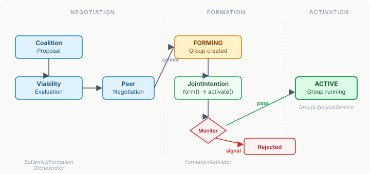

# Groups That Actually Start

A group that never activates is worse than no group at all. It consumes resources, occupies a slot in the org model, and tells every observer "something is happening here" when nothing is. The predecessor epic built the formation pipeline — coalition evaluation, peer negotiation, eidos group creation — and the whole thing worked. Agents proposed coalitions, negotiated via channels, and groups appeared in the org model with members enrolled. All in FORMING state. Permanently.

This is the difference between infrastructure and a system. Infrastructure is components that function correctly in isolation. A system is components that compose into something that works end-to-end. The formation pipeline was infrastructure. Making it a system meant answering one question: what bridges FORMING to ACTIVE?

## The gap between negotiation and commitment

The eidos org model has a clear lifecycle: PROPOSED → FORMING → ACTIVE → REORGANISING → DISSOLVING. The `BottomUpFormationOrchestrator` handles the first two transitions — propose a group, negotiate with peers, create the group with members. But it stops at FORMING. The spec was explicit: "caller transitions to ACTIVE via JointIntention." This was a deliberate scoping decision in the predecessor work, not an oversight. Formation and activation are different concerns with different failure modes.

Formation can fail because the coalition isn't viable, or because peers reject the proposal. These are negotiation failures. Activation can fail because conditions changed between formation and commitment — a member lost a capability, the environment shifted, a precondition was violated. These are commitment failures. Conflating the two in one orchestrator would mean the negotiation path handles commitment semantics it has no business knowing about.



## JointIntention as the commitment bridge

The deliberation package already had `JointIntention` — a Bratman-inspired commitment record with a clear lifecycle: `form()` → `activate()` → `fulfill()`, with `reconsider()` and `drop()` for when things go wrong. And `IntentionMonitor`, an SPI that evaluates whether an intention should be reconsidered. These existed as standalone types with good tests. Nobody was using them.

`FormationActivator` composes the three: create a `JointIntention` for the group, optionally run an `IntentionMonitor` to validate conditions, then call `GroupLifecycleService.activateGroup()`. The result is an `ActivationResult` — either `Activated` (carrying the live intention for downstream lifecycle tracking), `MonitorRejected` (the monitor saw a problem), or `ActivationFailed` (eidos refused the transition).

```java
public sealed interface ActivationResult {
    record Activated(String groupInstanceId,
                     JointIntention intention) implements ActivationResult {}
    record MonitorRejected(
            ReconsiderationSignal signal) implements ActivationResult {}
    record ActivationFailed(String reason) implements ActivationResult {}
}
```

The sealed interface tells the caller exactly what can happen. No exceptions for flow control. No null returns. Pattern matching forces every consumer to handle every case. This is a recurring pattern across agency's SPIs — `FormationResult`, `ExecutionResult`, `ActivationResult` all follow it.

## Why the monitor is optional

The `IntentionMonitor` parameter is nullable, following the same convention as `DegradationCascadeFactory` and `FeedbackHandler` in the topology layer. When null, activation is unconditional — the negotiation already validated consensus, so redundant re-validation adds latency without value. When present, it gates activation on conditions the negotiation couldn't check — runtime preconditions, environmental state, capability integrity.

This isn't a compromise; it's a design principle. The orchestrator already verified that peers agree. The monitor verifies that the world hasn't changed since they agreed. These are independent concerns. Some callers need both checks. Some callers know the world is stable and skip the monitor. Making it mandatory would force the stable-world callers to pass `intention -> null`, which is ceremony pretending to be safety.

## Making the path load-bearing

The activation gap was one of six items in the maturity epic. The others filled in the supporting structure:

**Deployment wiring** connects `HiveTopologyCompiler` to the Quarkus build pipeline. A `@BuildStep` extracts `TopologySpec.Hive` from already-parsed pattern YAML. A `@Record(RUNTIME_INIT)` step compiles and registers `CompiledHive` as a `@Singleton` CDI bean. Before this, consumers declaring a hive topology in YAML had to call the compiler manually — a wiring gap that made the YAML surface unreliable.

**Context threading** ensures `HiveTopology` actually reads the `groupId` and `tenancyId` that `TopologyContext` gained in the predecessor epic. The fields existed. Nothing consumed them. Now the adapter includes group scope in every LLM agent prompt, so pattern execution (supervisor review, debate, voting) is organisationally aware.

**The selfDetermination gate** adds an optional `Predicate<CoalitionProposal>` to `BottomUpFormationOrchestrator`. Engine spec §3.3 prescribes `selfDetermination >= 0.5` on the parent group before bottom-up proposals. Agency exposes the gate; the engine/desiredstate runtime supplies the predicate. The orchestrator doesn't know what selfDetermination means — it just asks the predicate.

**Role incompatibility** threads `incompatibleWith` from YAML through to eidos `RoleSpec`. Without it, role exclusion constraints ("a coordinator cannot also be an auditor") were silently dropped during compilation. The field existed in eidos. The YAML surface didn't expose it.

## The pattern underneath

Every item in this epic follows the same shape: a capability existed at one layer but wasn't connected to the layer above or below it. `JointIntention` existed but nobody composed it with formation. The topology compiler existed but no build step called it. Context fields existed but the topology ignored them. The selfDetermination concept existed in the spec but no code referenced it. `incompatibleWith` existed in the data model but the YAML surface didn't carry it.

This is the maturity pattern for multi-agent systems — and for any compositional architecture, really. The first phase builds the building blocks. The second phase wires them into paths that actually execute. The building blocks feel complete when they pass their unit tests. The paths feel complete when an end-to-end scenario runs without manual intervention. The gap between these two is where most multi-agent frameworks stall.

The society path — from coalition proposal through negotiation, formation, activation, and runtime coordination — now runs end-to-end. An agent proposes a group, peers negotiate, the group forms, members commit via joint intention, the monitor validates, and the group activates with organisational context flowing through every coordination decision. No manual steps. No stubs returning SUCCESS.
