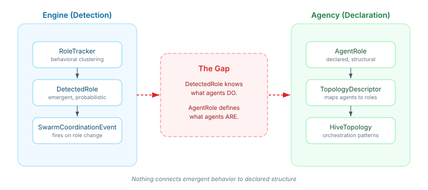
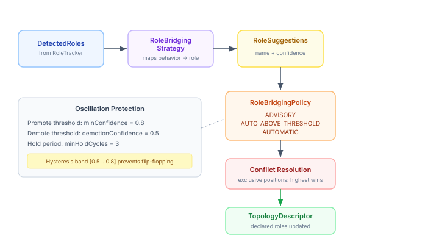

# The Policy Between Detection and Declaration

A swarm detects that one of its agents has started behaving like a coordinator. The behavioral fingerprint is clear: high communication scores, decision-making patterns, central position in the interaction graph. The clustering algorithm has seen this pattern stabilise across multiple cycles. The detection is confident.

Now what?

The engine knows what this agent *does*. The coordination vocabulary defines what agents *are* — their structural position in the topology, their platform responsibilities, their declared role. Detection lives in one world. Declaration lives in another. And between them sits a gap that no amount of detection accuracy can close.



The obvious instinct is to write code that closes the gap directly: if detected behavior matches a coordinator pattern, promote the agent to coordinator. It's a simple mapping. It would work in a demo.

It would also be wrong.

## Why the gap is not a coding problem

The gap between "behaves like X" and "is X" is a policy question, not a technical one. Consider the cases:

A **research team** running exploratory swarms wants to observe emergent coordination patterns without the system acting on them. Detection is valuable as instrumentation — a window into what's happening. Auto-promotion would corrupt the experiment.

A **production orchestration** with well-defined topology constraints needs detected roles to feed into declared structure — but only when confidence is high enough, only for positions that aren't already occupied, and only after the pattern has been stable long enough to trust.

A **fully autonomous system** wants detected roles to flow through to topology changes with minimal friction, accepting the risk of occasional wrong promotions in exchange for faster adaptation.

Same detection. Same agents. Same behavioral fingerprints. Three completely different answers to "what should happen next." The difference is operational context, not algorithmic accuracy.

## The bridging SPI

The new `RoleBridgingStrategy` SPI sits between detection and declaration. It maps `DetectedRole` records into `RoleSuggestion` records — an intermediate type that carries the strategy's assessment without constructing a full declared role:

```java
public interface RoleBridgingStrategy {
  List<RoleSuggestion> map(List<DetectedRole> detectedRoles);
}
```

The strategy receives the full list of detected roles at once, not one at a time. This is deliberate — cross-role decisions matter. If two clusters both look like coordinators, the strategy can assign higher confidence to the more stable one. A `RoleSuggestion` carries a suggested name, optional structural and platform role hints, a confidence score in [0, 1], and a back-reference to the source `DetectedRole`.

The strategy is the expert on what a behavioral pattern *means*. The topology is the expert on what structural positions are *valid*. The strategy proposes; the topology disposes.

## Three modes, not three strategies

The interesting design decision was where to put the policy. The strategy maps behavior to meaning — that's domain knowledge. The policy controls what happens with that meaning — that's operational judgment. Mixing them produces strategies that are simultaneously trying to interpret behavior and enforce deployment rules.

`RoleBridgingPolicy` separates the concerns:

**ADVISORY** — suggestions are surfaced but never applied. The system produces role suggestions as telemetry. An operator or external system decides what to do with them. This is the research team's mode.

**AUTO_ABOVE_THRESHOLD** — suggestions above a configurable confidence threshold are applied automatically. Below the threshold, they're ignored. This is the production mode — trust the detection, but only when it's confident enough.

**AUTOMATIC** — same mechanics as AUTO_ABOVE_THRESHOLD but with the expectation of lower thresholds. The system adapts quickly, accepting more noise in exchange for faster response.

The policy is a record on `TopologyContext`, not a strategy implementation. Switching from advisory to automatic is a configuration change, not a code change.

## The oscillation problem

Confidence fluctuates. A detection at 0.82 in one cycle might drop to 0.76 in the next, then climb back to 0.84. If the promotion threshold is 0.80, that agent would be promoted, demoted, and promoted again across three cycles. Every promotion and demotion ripples through the topology — loops reconfigure, budgets reallocate, coordination patterns shift. Oscillation is expensive.

The fix is a technique borrowed from control theory: hysteresis.



Two thresholds, not one. `minConfidence` controls promotion. `demotionConfidence` — set deliberately lower — controls demotion. The gap between them is the hysteresis band. An agent promoted at 0.80 confidence is not demoted until confidence drops below 0.50. Fluctuations within the band are absorbed without any state change.

A `minHoldCycles` parameter adds temporal stability. Even if confidence drops below the demotion threshold, the bridged role is maintained for a minimum number of detection cycles before demotion is eligible. This protects against transient confidence drops — a single bad clustering cycle doesn't undo a promotion that's been stable for ten cycles.

The compact constructor enforces the invariant:

```java
public RoleBridgingPolicy {
  if (mode != Mode.ADVISORY && demotionConfidence >= minConfidence) {
    throw new IllegalArgumentException(
        "demotionConfidence must be lower than minConfidence for hysteresis");
  }
}
```

If your demotion threshold is at or above your promotion threshold, you don't have hysteresis — you have a single threshold with all the oscillation problems that come with it. The type system won't let you construct that configuration.

## Structural conflicts

Detection doesn't know about topology constraints. Two agents in different clusters might both be suggested for coordinator — a structurally exclusive position in a centralised topology. The strategy shouldn't know about exclusivity; that's topology knowledge.

The resolution is simple and stable: highest confidence wins. Equal confidence uses lexicographic agent ID as a tiebreaker — arbitrary, but deterministic. No randomness, no round-robin, no negotiation protocol. The losing candidate keeps its original role.

Non-exclusive positions (contractors in the CENTRALISED topology) accept multiple simultaneous bridged roles. No conflict resolution needed.

## Where this sits in the larger picture

Role bridging is the third piece of a coordination stack that's been assembling over the past few weeks. The vocabulary (AgentRole, StructuralRole, PlatformRole) defines what roles mean. The enforcement layer (SupervisorGateBehavior, capability guards) ensures declared roles carry real authority. Bridging connects the detection layer to the declaration layer — making the vocabulary responsive to what agents actually do, not just what they were told to do at configuration time.

The SPI is deliberately empty of default implementations. A `BehavioralFingerprintStrategy` that maps fingerprint features to platform roles is the obvious next step. But the bridging policy — the hysteresis, the conflict resolution, the mode selection — is the part that matters. Getting the mapping right is important. Getting the policy wrong is dangerous.
