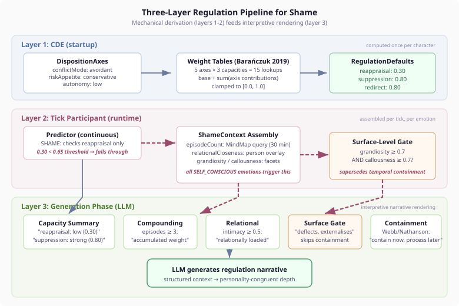

# Where the Numbers Land

*Continues from [The Weight of Evidence](2026-11-07-mdp01-the-weight-of-evidence.md).*

The previous entry designed a system on paper: continuous weights from 46,345 participants' worth of evidence, three dimensions of shame context, a principled boundary between mechanical computation and LLM judgment. The weight tables looked right. The architecture felt clean.

Then we wrote the code. And the code asked questions the design didn't.

## The Mixed Profile That Wasn't

The first test failure was instructive. A "mixed" personality — cooperative social orientation, moderate rule-following, calculated risk appetite, moderate autonomy, cooperative conflict mode — was supposed to produce balanced reappraisal and suppression capacities. The test expected them within 0.20 of each other. They came back at 0.90 and 0.50.

A cooperative conflict mode contributes +0.15 to reappraisal capacity but -0.05 to suppression. A cooperative social orientation contributes +0.10 to reappraisal and -0.05 to suppression. These small individual biases accumulate across all five axes, and when multiple axes lean the same direction, the result is not "mixed" at all. It is a quiet reappraiser who doesn't look like one on any single dimension.

The fix was to choose axes that genuinely pull in both directions: competitive conflict mode (+0.05 reappraisal, +0.15 suppression) with independent social orientation (+0.05 each). The resulting capacities came back at 0.75 and 0.80 — genuinely balanced, within 0.05 of each other.

The lesson is not that the weight tables were wrong. They produced exactly what the literature predicts. The lesson is that "mixed personality" is a psychological claim that needs to be validated against the actual weight derivation, not assumed from surface-level axis descriptions. A personality that looks moderate on paper may have consistent directional biases that only become visible when you add up all five contributing terms.

If you are building disposition-based systems: always compute the derived values for your test cases. The axes are inputs. The capacities are outputs. "Mixed" describes the output, not the input.

## The Dominance Margin: A Principled "I Don't Know"

The binary predictor had a clear decision boundary: three or more signals on one side, fewer than two on the other. You were a suppressor or a reappraiser or incoherent. The continuous predictor replaces this with thresholds (0.65 for both reappraisal and suppression) and a dominance margin (0.10).

The dominance margin is the most important number in the system, and it is the least visible. When both reappraisal capacity (0.68) and suppression capacity (0.70) exceed their thresholds but neither exceeds the other by the margin, the predictor falls through. It does not pick the higher one. It does not pick randomly. It says: "I cannot confidently recommend either strategy for this personality."

This is not a limitation. It is a design feature grounded in the meta-analytic evidence. Barańczuk's correlations show that personality explains 5-15% of regulation strategy variance. When two capacities are close, the remaining 85-95% — situation, mood, relationships, recent experiences — dominates. The predictor should not pretend otherwise.

In practice, the dominance margin converts roughly 15% of predictions that would have been confident (but fragile) into fall-throughs that give the LLM the full capacity profile. Those cases get the LLM's contextual judgment about the specific situation, informed by exact numeric capacities rather than a binary label. The LLM knows this personality has reappraisal at 0.68 and suppression at 0.70 — it can weigh the specific trigger, the relationship context, and the character's recent regulation history.

If you are building personality-driven prediction systems: include a margin parameter. The gap between "above threshold" and "dominant" is where the interesting psychology lives.

## Three Layers for One Emotion

The architecture separates regulation into three layers, each with a distinct computational character. This is not arbitrary decomposition. It reflects where the empirical literature provides quantitative precision versus qualitative direction.

<div align="center">

</div>

**Layer 1: CDE (Cognitive Derivation Engine).** Computed once at character initialisation. Takes five disposition axes, looks up fifteen weight contributions (five axes times three capacities), sums from a base value, and clamps to [0, 1]. The math is a weighted sum. The weights are literature-ordered. The result is `RegulationDefaults` — three numbers that follow the character for their entire lifetime.

This layer is mechanical because the literature provides numerical precision. Barańczuk's meta-analysis gives correlation magnitudes. We use those magnitudes to set relative ordering: if Openness correlates with reappraisal at 0.20 and Agreeableness at 0.18, the analytical conflict mode (mapping to high Openness) contributes more to reappraisal capacity than cooperative social orientation (mapping to Agreeableness). The exact weights are calibrated empirically, but their relative ordering is fixed by evidence.

**Layer 2: Tick Participant.** Assembled per tick, per emotion. When the dominant emotion is self-conscious (shame, remorse), the tick participant assembles a `ShameContext` from three sources: memory (how many shame episodes in the last 30 minutes), relationships (person overlay lookup for the subject's relational closeness), and personality (grandiosity and callousness facets).

This layer is structured data assembly, not judgment. It does not decide what the shame context *means* — it collects what is *true* about this specific moment. Episode count is a number. Relational closeness is a number. Grandiosity is a number. The interpretation comes later.

**Layer 3: Generation Phase.** Renders the computed values and structured context as interpretive narrative sections in the LLM's prompt. "Reappraisal: low (0.30)" becomes a personality-grounded explanation. "Episode count: 4" becomes "repeated shame accumulates — each episode reopens prior wounds." The LLM receives both the raw numbers and their psychological interpretation, then generates a regulation narrative that integrates all the context.

This layer is interpretive because the literature describes interactions without specifying thresholds. At what episode count does shame compounding change the character of regulation? How does relational closeness interact with suppression capacity? These are continuous, context-dependent judgments — exactly the kind of integration an LLM with structured context performs well.

The practical takeaway for anyone building cognitive pipelines: separate the static derivation (can be cached, tested deterministically, validated against literature) from the runtime assembly (data lookup, no judgment) from the interpretive rendering (LLM-appropriate, context-dependent). When you mix these layers, you cannot tell whether a wrong output is a wrong formula, a data retrieval bug, or a prompt engineering problem.

## When Shame Bounces Off

The surface-level gate was the most satisfying piece to implement, because it captures a real psychological phenomenon with three lines of logic.

```
grandiosity >= 0.7 && callousness >= 0.7
```

A character high in both grandiosity and callousness processes shame differently. The grandiose self-concept externalises the self-evaluation: "The situation was unfair" rather than "I am inadequate." The callous interpersonal style means the other person's hurt does not register as input to self-evaluation. Combined, shame does not penetrate to identity. It is surface-level. It passes quickly.

For the regulation pipeline, this means: do not apply temporal containment guidance. Temporal containment assumes the shame is real and deep — that it needs to be ridden out, not reappraised, because the personality lacks the cognitive flexibility for genuine reframing. For a grandiose-callous personality, the shame is neither real nor deep. Temporal containment would be disproportionate.

The gate supersedes Phase 1's temporal containment entirely. When `isSurfaceLevel()` returns true, the generation phase skips the Webb/Nathanson guidance and instead renders a surface-processing section: "shame does not penetrate deeply — the character deflects, externalises blame, or dismisses the self-evaluation."

This is an example of what the literature calls "personality-gated depth" — the same emotion produces different regulation needs depending on the personality structure. A system that treats all shame the same (deep processing, temporal containment, self-evaluative engagement) will produce psychologically inappropriate responses for roughly the proportion of the population that scores high on Dark Triad traits. In our character set, that proportion is deliberate — some characters are designed with grandiose or callous tendencies because real social groups contain these personality structures.

## What the Numbers Mean for Builders

If you are building AI agents with personality-driven behaviour, the regulation pipeline illustrates three engineering patterns worth adopting.

**Use the literature as ordering, not as values.** Meta-analytic correlations tell you that Openness contributes more to reappraisal capacity than Agreeableness. They do not tell you the exact weight. Start with literature-ordered initial values, then calibrate with your own eval. The correlations set the direction. The eval finds the magnitude.

**Design your "I don't know" boundary explicitly.** Every predictor has a confidence boundary. The dominance margin makes ours explicit and parameterised. Without it, the predictor makes fragile confident predictions for mixed personalities. With it, those cases route to a richer decision mechanism. The boundary is as important as the prediction logic.

**Gate depth before rendering.** Not all emotions are created equal within the same emotion type. Shame for a deeply reflective personality and shame for a grandiose personality are the same emotion name but different regulation problems. Check the personality structure before rendering regulation guidance. The gate is cheap (two field comparisons). The cost of rendering inappropriate depth guidance is a psychologically implausible character response.

These patterns are not specific to emotion regulation. They apply anywhere a cognitive system needs personality-driven prediction: coping strategy selection, communication style adaptation, conflict resolution approach, goal prioritisation. The underlying structure is the same: literature-grounded continuous weights, a principled uncertainty margin, and personality-gated depth of processing.

## What Comes Next

The implementation is complete. The eval test is written but not yet run against the LLM. The original eight cases should maintain their 4.4 mean — the continuous weights produce the same predictions as the boolean classifier for coherent personalities, just with more precision. The three new shame-specific cases will reveal whether the ShameContext rendering produces the right depth of regulation for compounding, relational, and surface-level scenarios.

The weight table values are initial estimates from literature-ordered correlations. The eval will show which weights need adjustment. Some will be too strong. Others too weak. The relative ordering should hold — if it does not, either the axes-to-Big-Five bridge is wrong or the meta-analytic evidence does not transfer to our character model. Both would be interesting findings.

The system does not yet track regulation outcomes to validate its own predictions over time. A predictor that pins COGNITIVE_CHANGE for a reappraiser personality should, over many episodes, see higher effectiveness scores than a random strategy. The memory infrastructure to track this exists. The feedback loop does not. That is the next frontier: a regulation system that learns whether its personality-based predictions actually work for each individual character.
