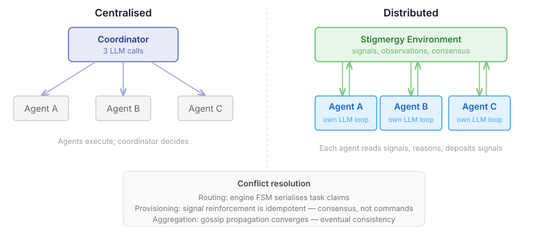

Every multi-agent system starts with a coordinator. One LLM that sees the whole swarm, picks who works on what, synthesises results, decides whether to grow or shrink. Three centralised calls, global view, clean control flow. It works. Then you ask the obvious question: what happens when the coordinator is the bottleneck?

The previous entry in this series — *The Coordinator That Dissolved* — covered how we pulled the monolithic coordinator apart into three independent decision loops inside a `CentralisedTopology`. Routing, aggregation, and provisioning each got their own loop, their own budget, their own observation cadence. The coordinator class vanished; its responsibilities moved into infrastructure that was already there.

That dissolution was the prerequisite. Once coordination concerns lived in independent decision loops, the next step became possible: give every agent its own loop.

## The shift that matters

The centralised model has a structural assumption baked in: one entity understands the whole system well enough to make decisions for everyone. That assumption scales poorly. As the swarm grows, the coordinator's prompt grows. Its context window fills with agent descriptions, experience traces, progress metrics. The LLM call takes longer, costs more, and the reasoning quality degrades as context inflates.

Biological swarms solved this problem by never having a coordinator in the first place. Ants don't hold committee meetings. Each ant reads chemical signals in its local environment, makes a decision, and deposits its own signals. Colony-level behaviour — task allocation, foraging efficiency, nest construction — emerges from thousands of independent local decisions coordinated through a shared medium: the environment itself.

The technical term is stigmergy. Indirect coordination through environmental modification. And the engine already had the infrastructure for it — `SignalRegistry` for pheromone-like signals with reinforcement and decay, `ObservationRegistry` for shared state, `detectSignalConsensus()` for threshold-triggered collective action.

What was missing was the intelligence layer. Each agent needed an LLM that could read signals, reason about them, and deposit new ones.

## One principle, three problems

The architectural insight that unlocks distributed coordination is simple: **agents never directly execute shared-state mutations. They emit signals.**



This single constraint eliminates the three distributed coordination problems that make engineers reach for a centralised controller:

**Routing.** In the centralised model, one LLM picks the entire team and assigns tasks. In the distributed model, each agent reads the environment — available tasks, peer work states, in-progress signals — and picks its own work. When it starts a task, it deposits an `in-progress:task-id` signal. Other agents see the signal on their next observation tick and choose something else. If two agents race for the same task, the engine's work state FSM serialises the claim. Only one transitions to ASSIGNED. The other gets a state change event and re-reasons. No coordinator needed. No conflict.

**Provisioning.** No single agent decides "grow the swarm by three." Instead, each agent that perceives a capacity gap emits a `need-capacity:web-scraping` signal. Signal reinforcement is idempotent — three agents depositing the same signal produce one strong signal, not three provisioning requests. The engine's consensus detection fires when the reinforcement count crosses a threshold. Provisioning is an emergent response to collective perception, not a centralised command.

**Aggregation.** Each agent reads observations from its neighbourhood, produces a local synthesis, and writes that synthesis back as an observation. Other agents read it. Information propagates through the swarm like gossip. The engine's convergence evaluator detects when individual syntheses start agreeing. Inconsistent world views aren't a failure mode — they're the coordination medium. Eventual consistency is the mechanism, not a compromise.

## What the agent actually does

Each agent gets a `ContentSummariser<ObservationEvent, DecisionOutcome>` — the same pipeline interface used by the centralised topology's routing, aggregation, and provisioning loops. The prompt assembles four observation sources: the agent's role and team context, visible stigmergy signals, peer work states, and swarm-level progress metrics.

The LLM returns structured JSON:

```json
{
  "signals": [{"name": "need-capacity:analysis", "strength": 0.8}],
  "taskClaim": "task-42",
  "synthesis": "Agents A and B converge on memory leak as root cause",
  "reasoning": "Three peers report OOM — capacity signal warranted"
}
```

This gets parsed into `DecisionOutcome.WriteBack` — a list of signal deposits, observations, and context writes. A `StigmergyWriteBackHandler` bridges these back to the engine. On failure, the agent emits nothing. In a distributed system, silence is safe — other agents continue operating.

The builder follows the same fluent pattern as the centralised model:

```java
var topology = new DistributedTopologyBuilder()
    .agentProvider(agentProvider)
    .agentRoles(Map.of(
        "analyst", AgentRole.of("analysis", StructuralRole.PEER),
        "researcher", AgentRole.of("research", StructuralRole.PEER)))
    .convergenceThreshold(0.7)
    .buildTopology();
```

Same thing in YAML:

```yaml
topology:
  type: distributed
  convergenceThreshold: 0.7
  agents:
    analyst:
      role: analysis
      model: claude-haiku
    researcher:
      role: research
```

Per-agent model overrides let you run lighter models for routine observation ticks — one of the cost controls that makes N per-agent LLM calls affordable.

## Why this matters beyond CaseHub

The pattern here isn't CaseHub-specific. It's a general answer to a question every multi-agent system faces: how do you coordinate N agents without a central bottleneck?

The standard approaches — leader election, distributed consensus, message passing with acknowledgement — import complexity from distributed systems theory. Stigmergy sidesteps all of it. If your coordination medium is idempotent (signal reinforcement), your serialisation point is mechanical (a state machine), and your consistency model is eventual (convergence detection), then the hard distributed coordination problems don't arise. They're prevented by the architecture, not solved by algorithms.

The trade-off is observability. Emergent behaviour is harder to debug than a coordinator's decision log. When Agent C claims a task that Agent A was "obviously" better suited for, there's no single decision to inspect — only the signals C read and the reasoning it produced. The per-agent decision loop's event stream (`DecisionLoopEvent`) captures this, but reading N event streams is inherently harder than reading one coordinator log. That's a real cost, and it's worth accepting only when the centralised model's scaling limits are the bigger problem.

For a three-agent swarm, use the centralised model. For thirty, the coordinator prompt alone exceeds what an LLM can reason about effectively. That's where distributed coordination earns its keep.
