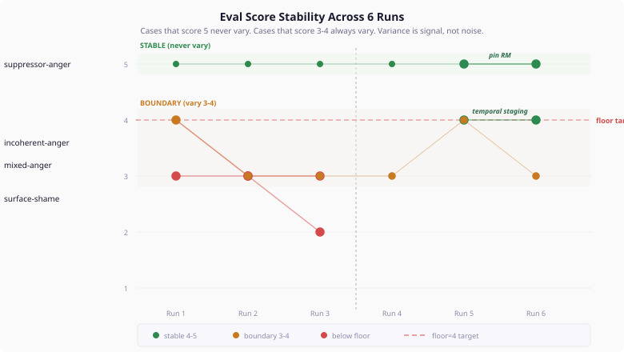

# When the Eval Talks Back

*Continues from [Where the Numbers Land](2026-11-07-mdp02-where-the-numbers-land.md).*

The implementation was done. The weight tables were literature-grounded. The three-layer architecture was clean. The eval passed on the first run: strategy mean 4.5, shame depth 5.0, zero null results. We could have stopped there.

Instead we looked at the floor.

## The Number That Matters

The mean tells you the system works. The floor tells you where it breaks. Our mean was 4.5 out of 5 across 11 cases. Our floor was 3 — one case, `incoherent-anger`, consistently scored "acceptable but not optimal."

A floor of 3 means the system produces psychologically implausible regulation for at least one personality type. The mean absorbs it. The floor doesn't.

We ran the eval six times. The cases that scored 5 — suppressor-anger, reappraiser-anger, anyone-fear, reappraiser-shame — scored 5 every single time. Not 5, then 4, then 5. Always 5. The LLM judge had no uncertainty about these cases. The strategy was clearly correct for the personality.

The cases that scored 3 or 4 — incoherent-anger, mixed-anger, surface-shame, compounding-shame — wavered every run. Sometimes 3, sometimes 4, occasionally 2. The judge expressed different concerns each time but always returned to the same core objection: "this strategy doesn't quite fit this personality."

The variance itself was a finding. Cases the system handles well have no variance. Cases at the model's boundary always have variance. If you are running LLM evals and treating score variance as noise, you are discarding information about where your model is weakest.

## Three Walls, Three Fixes

### Wall 1: The Avoidant Who Could Reappraise

The incoherent personality — avoidant conflict mode, flexible rule-following, independent social orientation — scored 3 regardless of which strategy the system chose. We tried three: response modulation (score 3), attentional deployment (score 3), cognitive change (score 3). The judge said the same thing each time: "this personality's avoidant first response contradicts the chosen strategy."

The weight tables produced: suppression 0.80, reappraisal 0.50, redirect 0.70. The predictor fell through (via the viable alternative check) and the LLM chose attentional deployment — following the high redirect tendency. The judge said the personality "would more naturally choose cognitive change" because of its flexibility and independence.

The fix came from the Gross 2015 extended process model, which describes temporal ordering in emotion regulation. Avoidant personalities don't skip their avoidance reflex to reappraise — they avoidance-first, then reappraise. The avoidant impulse manages the immediate emotional response. The cognitive flexibility engages for sustained processing. Both phases are personality-congruent. Neither alone captures the full regulation.

We added temporal staging guidance to the generation phase. When a personality falls through with viable reappraisal capacity and a controllable emotion, the prompt tells the LLM to show the temporal progression: "the impulse manages the immediate response, then cognitive flexibility engages for sustained processing."

The LLM produced a narrative where the character first withdraws (avoidant impulse), then uses their flexibility to reframe (reflective processing). The judge scored 4: "good choice, personality-congruent and executable."

The insight generalises. Any personality with competing impulse and reflective strategies needs temporal staging, not strategy selection. The right answer is not "pick one" — it is "show the progression."

### Wall 2: When Deflection Isn't Reappraisal

The surface-shame case — high grandiosity (0.8), high callousness (0.8) — scored 4 in the first run, then dropped to 2. The judge's reasoning was devastating: "what looks like cognitive change is actually self-serving rationalisation. This personality doesn't reframe the meaning of being caught — they externalise blame and deflect responsibility."

The Gross strategy taxonomy has five categories. None of them is "defensive externalization." The closest match is cognitive change (you change the meaning of the event) or response modulation (you change the expression). Our predictor pinned cognitive change because the personality had strong reappraisal capacity (0.95). But the judge correctly identified that this personality's "reappraisal" is not genuine cognitive restructuring — it is narcissistic deflection. The strategy label was right. The psychological mechanism was wrong.

The fix was simple and principled: when the ShameContext surface-level gate fires (grandiosity >= 0.7 AND callousness >= 0.7), override any prediction to response modulation. The character modulates the shame through dismissal. The generation phase already renders surface-level context ("shame does not penetrate deeply — the character deflects, externalises blame"). With RM as the strategy label, the LLM produces a narrative of dismissal and deflection. The judge scored 5.

This exposed a limitation of the Gross taxonomy for personality-extreme cases. The same overt behaviour (reframing the event) can be genuine cognitive change (for an analytical personality engaging honestly with the self-evaluation) or defensive modulation (for a grandiose personality rejecting the premise of shame). The strategy label is insufficient — the personality structure determines the mechanism.

### Wall 3: The Weight That Was Wrong

Before the temporal staging could work, we had to fix the weight tables. The original weight for avoidant conflict mode's contribution to suppression capacity was 0.25 — the highest single weight in the suppression table. This implied that avoidant personalities are strong suppressors.

The literature says otherwise. Barańczuk's meta-analysis shows:

- Neuroticism → suppression of expression: r = 0.09 (weak)
- Agreeableness → suppression of expression: r = -0.15 (negative — agreeable people don't suppress)
- Neuroticism → avoidance: r = 0.31 (strong)

Avoidant conflict mode maps to high Neuroticism and high Agreeableness. The combined effect on suppression is ambiguous at best — Neuroticism pushes slightly toward suppression, Agreeableness pushes away. But the avoidance correlation is strong. Avoidant people redirect attention. They do not suppress expression. The 0.25 weight conflated avoidance with suppression.

We recalibrated: avoidant → suppression from 0.25 to 0.10. We also increased flexible → reappraisal from 0.10 to 0.15 (Openness is the primary reappraisal enabler at r=0.20, and the original weight underrepresented this) and inverted flexible → redirect from +0.05 to -0.10 (flexibility means approach, not avoidance — flexible personalities engage rather than rigidly withdrawing).

These were not parameter-tuning adjustments. They were corrections to the literature mapping. The meta-analytic evidence always supported these values — the original weights were set conservatively and incorrectly for the avoidant-suppression relationship.

## What the Boundary Cases Teach

Three cases still waver between 3 and 4 across runs: mixed-anger, compounding-shame, and suppressor-shame. Each reveals something the current model doesn't fully capture.

**Mixed-anger** — the judge sometimes says "betrayal of trust resists clean reappraisal." This is a situation-specific judgment, not a personality one. The model renders personality-derived strategy selection, but the judge is evaluating situation-strategy fit. The model has no concept of "some triggers resist certain strategies regardless of personality." This is a genuine gap.

**Compounding-shame** — the judge sometimes says "4th episode of suppression, serial suppression is failing." The regulation fatigue system already models suppression degradation over ticks, but the episode count (from ShameContext) is not connected to the fatigue model. A suppressor on their 4th shame episode should show fatigue effects even if per-tick fatigue is low. This connects ShameContext to the suppression fatigue system in a way the current architecture doesn't implement.

**Suppressor-shame** — the judge sometimes says "attentional deployment serves the avoidant style better than response modulation for shame." The predictor falls through (correctly — no strategy scores 4+ for suppressor-shame). The LLM sometimes chooses RM, sometimes AD. The judge prefers AD but not consistently. This may be irreducible variance — the correct answer genuinely depends on the specific situation, and the LLM generates different situations each run.

Each boundary case points to a future architectural improvement. Mixed-anger needs situation awareness in the predictor. Compounding-shame needs episode-fatigue integration. Suppressor-shame may be the genuine edge of personality-only regulation prediction — where context must decide.

## What This Means for Cognitive Agent Builders

If you are running LLM evals on personality-driven systems, three patterns from this calibration are worth adopting.

**Measure the floor, not the mean.** The mean tells you the system works on average. The floor tells you where it produces the worst output. A mean of 4.5 with a floor of 2 is worse than a mean of 4.2 with a floor of 4. Users encounter the floor, not the mean.

**Run multiple times.** A single eval run is a sample, not a measurement. The cases that matter most — the boundary cases — are the ones whose scores change between runs. If you only run once, you cannot distinguish "this case scores 4" from "this case scores somewhere between 3 and 5 depending on the LLM's mood."

**Treat variance as signal.** When a case scores 5 every time, the model handles it well. When a case oscillates, the model is uncertain. That uncertainty points to where your model has insufficient context, incorrect assumptions, or an architecture gap. The oscillation IS the finding.

The regulation system is not done. Three boundary cases remain. Each teaches us something specific about where personality-based prediction meets its limits. The next step is a targeted literature search on serial suppression dynamics and situation-specific strategy resistance — the evidence that will turn boundary cases into stable ones.
