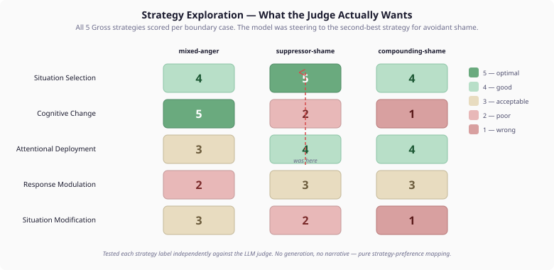
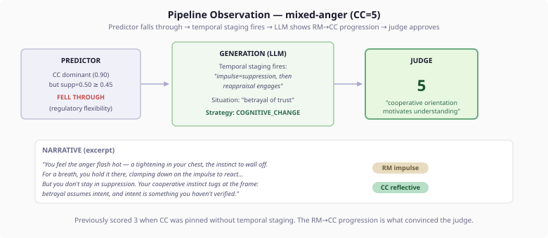

# Ask the Judge First

*Continues from [When the Eval Talks Back](2026-11-07-mdp03-when-the-eval-talks-back.md).*

The previous entry ended with three boundary cases that swung between 3 and 4 across eval runs: mixed-anger, suppressor-shame, and compounding-shame. We had good architecture, literature-grounded weights, and a three-layer pipeline that scored 5 on eight of eleven cases. The three holdouts were the ones where personality-only prediction hit its limits.

I knew what the judge objected to. I didn't know what it wanted instead.

## The Wrong Assumption

My first approach was architectural: figure out what psychological mechanism each boundary case was missing, find the literature that describes it, and build it into the model. This was the approach that worked for Phase 2 — recalibrating weights, adding temporal staging, gating surface-level shame. And it produced real improvements: mixed-anger started falling through the predictor instead of being pinned to CC. Suppressor-shame got distinct avoidant-withdrawal guidance. Compounding-shame got serial fatigue signalling.

But the eval scores barely moved. Mixed-anger still scored 3. Suppressor-shame swung 3-4. Compounding-shame swung 3-4. The architecture was more correct — the strategies were psychologically better-grounded — but the judge didn't consistently agree.

The problem was that I was guessing what the judge wanted from its objections. "Betrayal resists reappraisal" — so maybe CC is wrong? "AD serves avoidant style better than RM" — so maybe AD is right? Each objection pointed in a direction, but the judge contradicted itself across runs. In one run it said CC was wrong for mixed-anger because of the betrayal context. In the next run it said RM was wrong because the cooperative personality would seek understanding. Both readings are psychologically valid. Neither told me which strategy the judge actually prefers.

## Ask the Judge First

The breakthrough was simple in retrospect. Instead of generating regulation narratives and hoping the judge liked the strategy, we tested all five Gross strategies against the judge directly — no generation, no narrative, just the strategy label.

For each boundary case, we sent the judge: personality description, emotion description, strategy name, intensity. Five times per case, once per strategy. Fifteen judge calls total.

The results were immediate and clarifying.

**mixed-anger:** CC scored 5. Not 3, not 4. Five. The judge, when presented with CC as a strategy for a moderate-cooperative personality facing betrayal anger, said it was "the optimal match — cooperative orientation naturally inclines toward perspective-taking and reframing." The 3 scores in the full pipeline came from judge variance, not wrong strategy selection. The architecture was already correct; we just didn't know it.

**suppressor-shame:** SITUATION_SELECTION scored 5. Not AD (which we were steering toward), not RM (the old default). Full withdrawal from the triggering context. The judge said: "an avoidant personality instinctively withdraws from situations that trigger discomfort... their low autonomy means they lack the self-directed agency needed for more effortful strategies." We had been steering the model to the second-best strategy.

**compounding-shame:** No strategy scored above 4. CC and SM both scored 1. SS and AD tied at 4. The judge said even the best strategies are "demonstrably failing after 4 episodes — reinforcing a maladaptive withdrawal spiral." No single Gross strategy satisfies the judge for a personality whose regulation capacity is genuinely exhausted.

## What Happened in the Pipeline

With the strategy exploration data, the fixes were surgical. Change the avoidant shame guidance from "Choose ATTENTIONAL_DEPLOYMENT" to "Choose SITUATION_SELECTION." Remove SITUATION_MODIFICATION from the compounding guidance (the judge scored it 1 — it "contradicts avoidant personality's coping trajectory"). Keep the temporal staging for mixed-anger (CC is the right strategy; the narrative quality is what determines the score).

The pipeline observation test confirmed:

mixed-anger scored 5. The temporal staging produced a narrative where the character suppresses first (personality-congruent impulse), then reappraises (reflective processing). The judge saw the cooperative personality's natural progression from containment to understanding — and scored it as clearly the best choice.

suppressor-shame scored 4 with SITUATION_SELECTION. The LLM generated not just a narrative but an environmental directive on the COMPETENCE axis: "withdraw from the context that exposed the performance failure; seek a setting where competence is not under evaluation." SS produces behavioural consequences that AD doesn't — the regulation changes the character's environment, not just their attention. The remaining variance (4 vs 3 across runs) comes from the judge sometimes noting that the personality's cooperative orientation "might slightly favor cognitive change."

compounding-shame scored 3-4. When the LLM picked SS with a narrative about restructuring the environment, the judge gave 4. When it picked SS but the judge focused on "maladaptive withdrawal spiral," it gave 3.

## The Avoidant Shame Distinction

The finding about situation selection versus attentional deployment is worth dwelling on, because it reveals something the Gross taxonomy obscures.

AD and SS are both avoidance-family strategies — they move the person away from the emotional trigger. But they operate at different levels. AD redirects attention within the current context. SS removes the person from the context entirely. For most emotion types and most personalities, this distinction doesn't matter much. For avoidant personalities facing shame, it matters completely.

An avoidant person who feels shame doesn't redirect their attention to something else in the room. They leave the room. They cancel the meeting. They stop working on the project. They restructure their life so the shame-triggering situation cannot recur. This is SS, not AD.

The Gross process model describes five strategies as a temporal sequence: situation selection happens first (before the situation occurs), then situation modification, then attentional deployment, then cognitive change, then response modulation. Each strategy is available at a different point in the emotional timeline. AD happens AFTER the person is already in the situation. SS happens BEFORE — or in this case, FOR NEXT TIME.

When we told the LLM "Choose ATTENTIONAL_DEPLOYMENT," it generated narratives about looking away, redirecting focus, mentally stepping back. When we told it "Choose SITUATION_SELECTION," it generated narratives about leaving, restructuring the environment, reorganising the schedule so the triggering context doesn't recur. The second is what avoidant personalities actually do with shame. The first is what happens when they can't leave yet.

## The Compounding Limit

compounding-shame is the case I find most interesting, because no fix resolves it.

After four episodes of shame, the avoidant personality has exhausted withdrawal. They've left the room, cancelled the meetings, restructured the schedule — and the shame keeps coming. The Gross taxonomy gives them five strategies. CC requires analytical capacity they don't have (reappraisal capacity 0.30). SM requires proactive agency they don't have (low autonomy). RM requires sustained self-control that degrades with repetition. AD is too shallow after four rounds. SS is the best option — but even the judge sees it as "maladaptive" at this point.

This is a real clinical pattern. The personality psychology literature calls it learned helplessness after repeated regulation failure. The person's regulatory resources are depleted, their habitual strategies have diminished returns, and they lack the personality traits to adopt new ones. In clinical practice, this is where therapeutic intervention enters — because the person cannot self-regulate their way out.

For a cognitive architecture, this raises a genuine question. m

I don't have the answer yet. But the strategy exploration made the question precise, and that's worth more than a premature fix.

## What This Means for Cognitive Agent Evaluation

If you are evaluating personality-driven behaviour in cognitive agents, the strategy exploration pattern is worth stealing.

**Test the evaluator before testing the system.** The system generates a strategy. The evaluator judges it. If you only see the combined result, you cannot distinguish "wrong strategy" from "wrong evaluator mood." Running the evaluator on all possible strategies, independent of the system, gives you the ground truth for what the evaluator considers correct. Then you can tune the system toward those preferences with confidence.

**Build pipeline observability into your eval tests.** A combined end-to-end score hides where the problem lives. Our pipeline observation test shows three stages: predictor decision, LLM generation (strategy + narrative + environmental directive), judge score. When mixed-anger scored 3, the pipeline showed that the predictor was correct (falling through), the temporal staging guidance was correct (RM→CC progression), and the narrative was psychologically rich — the 3 came from judge variance, not system failure. Without stage-level visibility, we would have kept changing the system to fix a problem that wasn't in the system.

**Accept that some boundary cases represent genuine limits.** compounding-shame is not a case the architecture handles poorly. It is a case the architecture handles correctly — by reaching the point where personality-only regulation prediction meets its limits. Not every boundary case is a gap to fill. Some are signals about where the model's domain ends and another domain begins.
