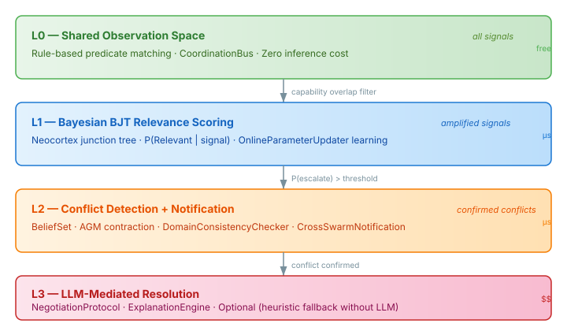
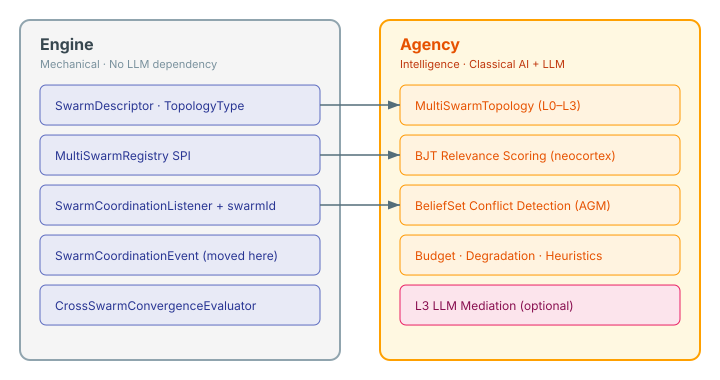

# When Swarms Need to Talk

The previous entry covered giving individual agents their own decision loops — distributed stigmergy coordination within a single swarm. That solves the coordinator bottleneck at the agent level. But there's a harder problem one layer up: what happens when you have multiple swarms?

A clinical case with an analysis swarm investigating symptoms, a diagnosis swarm cross-referencing evidence, and a treatment swarm planning remediation. Each swarm internally handles its own coordination — team formation, collective reasoning, convergence. But they need to share findings, detect contradictions, and hand off results. Analysis discovers something that changes the diagnosis. Diagnosis contradicts an assumption treatment is building on. Treatment needs an agent that analysis is already using.

These are coordination problems that no single swarm can solve by looking at its own environment. They require awareness across swarm boundaries.

## The cost gradient that shapes the protocol

I started the design by listing what swarms actually need to share: progress signals, findings, resource claims, conflict signals, completion events, handoff data. Then I mapped each concern against the coordination properties it requires — latency, coupling, directionality, frequency.

The pattern was clear. Most cross-swarm coordination is low-frequency, low-stakes observation sharing. A small fraction involves conflict detection. An even smaller fraction requires joint decision-making. The coordination cost should match the coordination need.

This led to a tiered protocol — four levels, each using the cheapest mechanism that handles its concern:

**L0** is a shared observation space. All swarms publish signals to a `CoordinationBus`. Rule-based predicate matching routes signals by capability tags. Zero inference cost. Every swarm sees signals tagged with capabilities it cares about.

**L1** scores relevance using a Bayesian junction tree from the neocortex inference engine. When a signal passes the L0 filter, the BJT computes P(Relevant | signal features). Five variables — capability overlap, domain match, signal strength, historical relevance, and the target node. The three-tier incremental propagation means most updates are sub-millisecond: no-op when nothing changed, dirty-subtree for partial updates, fast retraction for evidence changes. `OnlineParameterUpdater` handles the learning — positive feedback when an amplified signal leads to useful action, negative when it's ignored. The system gets better at filtering over time.

**L2** triggers when the escalation gate's posterior on P(EscalateNeeded) crosses a threshold. Three weak conflict indicators accumulating evidence push the posterior past the threshold where a single indicator wouldn't. This is where the BeliefSet comes in — AGM belief revision with a `DomainConsistencyChecker` that uses vocabulary-backed term equivalence to detect formal contradictions. When swarm A concludes "node-7:healthy" and swarm B concludes "node-7:degraded", the checker identifies the structural negation. BeliefSet contraction tells you exactly which beliefs conflict and what minimum removal restores consistency — structured input for whatever resolves the conflict.

**L3** is the expensive path. An LLM mediates via a negotiation channel, using the neocortex `ExplanationEngine` to provide ranked evidence influence — which signals most strongly support each swarm's position. This is optional. Without an `AgentProvider`, the topology works mechanically through L0–L2, with heuristic fallbacks for unresolved conflicts.

## Mechanical base, intelligence on top

The design question I kept circling was: where does the boundary sit between engine and agency? The principle is straightforward — engine is mechanical, agency adds intelligence — but the line is surprisingly specific once you test each type against it.

The test: does this concept make sense in a world without LLMs?

A swarm registry — knowing which swarms exist, what capabilities they declared, when they registered and deregistered — is pure lifecycle management. Mechanical. Engine. The `SwarmCoordinationEvent` sealed hierarchy wraps engine-api data types (`SwarmProgress`, `DetectedRole`, `DetectedTeam`) into a discriminated union. Mechanical. Engine.

But a `CoordinationTopology` that wires up budget pools, degradation triggers, and LLM-backed strategies? That's coordination intelligence. Agency. The BJT relevance scoring? Classical AI. Agency by scope criteria, even though it doesn't touch an LLM. BeliefSet conflict detection? Same reasoning.

Budget pools were the interesting case. My first instinct was to push them to engine alongside the other topology infrastructure. But budget governance exists to manage LLM costs — token budgets for routing, aggregation, provisioning calls. A mechanical swarm has no token budget. No LLM, no budget concept. Budget stays in agency.

The split puts five new types in engine-api: `SwarmDescriptor`, `MultiSwarmRegistry`, `CrossSwarmConvergenceEvaluator`, `TopologyType.MULTI_SWARM`, and the migrated `SwarmCoordinationEvent`. Agency keeps the coordination intelligence: `MultiSwarmTopology`, the BJT scoring layer, BeliefSet conflict detection, and L3 mediation.

## The Bayesian model earns its place

I considered three approaches for the meta-coordinator: full LLM reasoning, rule-based with LLM escalation, or rules plus Bayesian reasoning. The LLM-everywhere approach failed on the cost gradient — L0–L1 operations fire on every signal, potentially hundreds per tick across ten swarms. Microsecond Bayesian inference vs second-scale LLM calls isn't a marginal difference. It's the difference between the coordination layer being invisible and being the bottleneck.

The neocortex BJT engine turned out to be the right foundation. It already has `MultiAgentComposition` for per-agent junction trees with common knowledge variables and belief divergence detection. The `OnlineParameterUpdater` handles streaming CPT updates with exponential decay — exactly what the learning signal from L3 resolution outcomes needs. And the `ExplanationEngine` provides ranked evidence influence when L3 does fire, giving the LLM mediator structured context instead of raw signal dumps.

The integration boundary between BJT (probability) and BeliefSet (logic) was the decision that required the most care. BJT produces posterior distributions over discrete variables. BeliefSet operates on propositions with entrenchment ordering. The translation layer is a `CrossSwarmEscalation` record — carrying the escalation type, the BJT posterior, and top-N evidence contributions from the `ExplanationEngine`. BeliefSet takes `SwarmConclusion` records where confidence maps to entrenchment: higher confidence = harder to contract. The feedback loop runs in both directions — L2 contraction outcomes update L1's escalation gate priors, so false alarms make future escalation more conservative and confirmed conflicts make it faster.

## What this opens up

Hierarchical composition is the pattern I'm most curious to see play out. A meta-swarm that decomposes a problem, spawns child swarms with declared capabilities, and monitors their convergence. Siblings coordinate through the full tiered protocol — L0 signal sharing, L1 relevance, L2 conflict detection. The parent subscribes to all child signals unfiltered and mediates cross-child conflicts with broader context. Bottom-up convergence means the parent can't declare success until all children have individually converged.

The immediate use case is same-case specialisation — the clinical scenario, or an AML investigation where separate swarms handle different evidence streams. Cross-case collaboration is designed-for at the SPI level but deferred. Nobody has articulated a concrete cross-case scenario yet, and I'd rather build for a real use case than an imagined one.

The implementation plan is in slot 220 with both engine and agency clones ready. Fourteen tasks across three batches — engine foundation, agency L0–L2 core, then the LLM layer and YAML surface. The mechanical core comes first because agency depends on the engine SPIs. After it's all implemented, a post-implementation audit will verify the engine/agency seam is clean.

Swarms have been coordinating without central intelligence since before computers existed. The interesting question isn't whether to add LLMs — it's how little LLM you actually need when the mechanical layer does its job.
