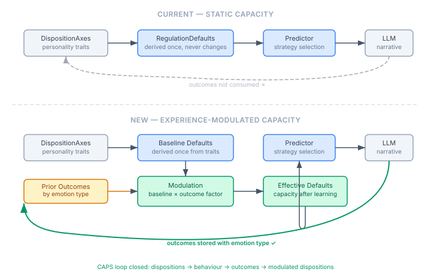

# When Avoidance Stops Working

*Continues from [When Personality Isn't Enough](2026-11-05-mdp01-when-personality-isnt-enough.md).*

The regulation predictor pins an avoidant personality facing shame to SITUATION_SELECTION — withdrawal. The eval judge scores it 4-5. Personality-congruent, psychologically functional. The character leaves the room. Problem solved.

Then the fourth episode hits. Same personality, same emotion, same strategy. The judge docks points: "Four repeated shame episodes signal that avoidance is failing. Even an avoidant temperament should be shifting toward cognitive change."

But cognitive change scored 2 for this personality in the strategy exploration. The judge is simultaneously saying this personality cannot do cognitive reappraisal and that it should be doing cognitive reappraisal. The contradiction is real, and the problem is not the judge.

## Two Dimensions, One Score

The eval was measuring two independent things with a single number. Personality congruence: is this what this personality would naturally do? Regulatory effectiveness: will it actually work in this situation?

For single episodes, they align. The personality-congruent strategy is also the effective one. For compounding episodes, they diverge. Situation Selection is congruent for an avoidant personality — withdrawal is what they do. But it is ineffective after four repetitions — avoidance has been tried and found wanting. A muddled 3 that blends high congruence with low effectiveness tells you nothing useful.

The eval needs to score both dimensions independently. That is a separate piece of work. But the compounding-shame result exposed a deeper architectural problem.

## Fixed Personality Is the Wrong Assumption

The initial reaction to the compounding-shame score was tempting: trying to engineer a higher number would make the model psychologically inaccurate. The personality's regulatory capacity is genuinely exhausted. Accept the 3.

This reasoning has a hidden premise — that regulatory capacity is a personality trait. It is not.

Personality traits are relatively stable. Big Five research supports this across decades of longitudinal studies. An avoidant person does not wake up confrontational. But regulatory capacity — the ability to execute a specific strategy in a specific emotional context — is a learned behaviour that adapts with experience. Gross and John (2003) documented that habitual strategies show diminishing returns. Bonanno and Burton (2013) demonstrated regulatory flexibility: people adaptively adjust their strategies based on feedback from prior attempts. This is not personality change. It is learning.

The current architecture conflates the two:

```
DispositionAxes → deriveRegulationDefaults() → static RegulationDefaults → predictor
```

The derivation happens once. After four shame episodes where avoidance keeps failing, the predictor still sees the same `suppressionCapacity=0.80, redirectTendency=0.85` as if nothing happened. The personality model cannot distinguish "avoidant person encountering shame for the first time" from "avoidant person who has tried avoidance four times and watched it fail."

## What CAPS Actually Demands

The CAPS framework — Mischel and Shoda's Cognitive-Affective Processing System, the model that underpins the entire cognitive pipeline — models behaviour as a function of disposition × situation. Situation is not just what is happening now. It includes the history of prior regulatory attempts. After four failed avoidance episodes, the effective situation has changed even though the external circumstance is the same.

The architecture needs a feedback loop:



The top path is what exists. Personality traits produce fixed regulatory defaults. The predictor consumes them. Outcomes are stored in MindMap but never read back. The bottom path closes the loop. Prior outcomes — filtered by emotion type — modulate the baseline capacity. After repeated low-effectiveness avoidance for shame, the effective redirect and suppression capacities degrade below the pin threshold. The predictor falls through. The LLM sees depleted capacities alongside compounding context and has room to generate something that acknowledges the bind.

This is the CAPS feedback loop completing: dispositions produce behaviour, behaviour produces outcomes, outcomes modulate future disposition-behaviour mapping. The current architecture has the first two steps. The third step was missing.

## The Gap Was Narrower Than Expected

The regulation system already stores every outcome. `EmotionRegulationMindMapAdapter.write()` persists strategy, target emotions, effectiveness, peak and regulated intensity, and narrative after every regulation episode. `loadHistory()` retrieves them. The tick participant already queries history and passes it to the generation phase.

What was missing was a single indexed property: the dominant emotion type. Without it, the query "show me all prior SHAME regulation attempts" required parsing a CSV string. With it, a filtered `loadHistory()` returns exactly what the modulation function needs — the last N regulation outcomes for a specific emotion, ordered by recency.

One property. One query method. The data layer for regulatory learning is done.

## Why This Matters Beyond Our Architecture

Most AI agent frameworks treat personality as a system prompt. Static text injected at the start and never revisited. The agent has the same personality on tick 1 and tick 300. It has no capacity that degrades, no strategy that wears out, no regulatory learning from failure. Every confrontation with shame is the first one.

This is not how people work. And if the goal is agents with psychologically coherent behaviour — agents that a human can predict, trust, and relate to — then static personality is not enough. The personality determines the starting point. Experience determines the trajectory. An avoidant agent that keeps avoiding after repeated failure is not consistent — it is stuck. Consistency means the avoidance capacity degrades and the agent's behaviour shifts, exactly as the psychology predicts.

The modulation function is next — the curve shape, the recency weighting, the threshold at which degraded capacity triggers a strategy change. The literature provides the constraints. The data layer provides the inputs. What remains is the computation that connects them.
