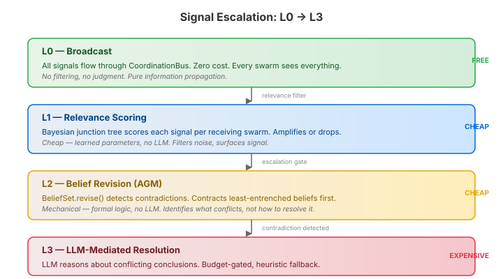
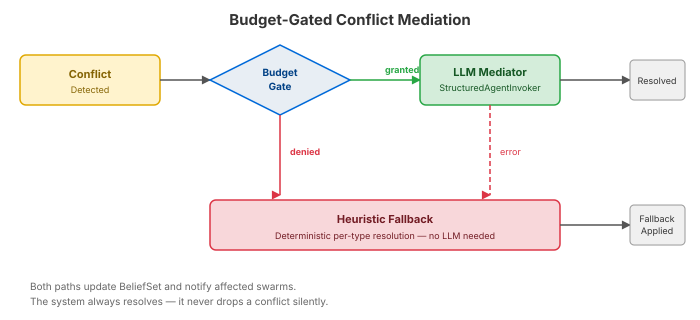

# When Swarms Disagree

A single swarm coordinates agents around a shared problem. Multiple swarms coordinate around *different* problems that happen to overlap. And overlapping problems produce contradictions.

Two investigation swarms look at the same network node. One concludes `node-7:healthy` based on latency metrics. The other concludes `node-7:degraded` based on error rates. Both are right about their evidence. Both are wrong about the whole picture. Someone needs to resolve this — and the answer isn't "pick the one with higher confidence."

This is the coordination problem that multi-swarm architectures must solve. Not "who gets to speak next" (that's a turn-taking problem) and not "how do we combine observations" (that's aggregation). This is genuine disagreement between autonomous groups that each have their own evidence and reasoning.

## The cheapest mechanism that can handle it

The natural temptation is to throw an LLM at every coordination decision. It would work. It would also cost a fortune and add latency to every signal in the system. Most coordination doesn't need an LLM — the trick is knowing when it does.



The tiered protocol runs four layers, each more expensive than the last:

**L0** is broadcast. Every signal from every swarm flows through a shared bus. No filtering, no judgment, no cost. This is the substrate — if a swarm produces a finding, every other swarm can see it.

**L1** applies relevance scoring. A Bayesian junction tree, trained per swarm, scores each incoming signal: how relevant is this finding to the receiving swarm's capabilities and domain? Most signals are noise for most receivers. L1 drops them before anything expensive happens.

**L2** is where contradictions surface. When a relevant finding reaches a swarm, it enters the belief system — a formal AGM belief revision set. If the new belief is consistent with what's already there, it gets incorporated and life goes on. If it contradicts an existing belief, the revision algorithm contracts the set: it removes the least-entrenched beliefs until consistency is restored.

That contraction is the signal. The delta between the pre-revision and post-revision belief set tells you exactly which beliefs were displaced and why. It's a structured description of the conflict — not "something went wrong" but "belief X (entrenchment 80) was contracted to accommodate belief Y (entrenchment 90)."

**L3** is the expensive one. When L2 detects a contradiction, an LLM examines the conflicting conclusions — what each swarm found, how confident they were, what evidence was contracted — and produces a resolution.

The key insight: L3 fires rarely. Most signals don't survive L1. Most L1 survivors are consistent with existing beliefs at L2. L3 handles the residual contradictions that mechanical logic can't resolve alone.

## What the mediator actually does

The mediator receives a `ConflictContext` — a snapshot of everything relevant to the disagreement:

- The two swarms involved and their capabilities
- The current belief set (post-revision)
- The beliefs that were contracted (pre-revision delta)
- Progress state for both swarms (consensus scores, stability)
- Resource claims if the conflict is about agent allocation

Four conflict types get type-specific handling. A belief contradiction ("is node-7 healthy or degraded?") is a different problem from resource contention ("both swarms want the same agent") or a handoff failure ("the receiving swarm can't handle this work"). Each gets a tailored prompt that gives the LLM the right framing.

For the belief conflict case, the prompt includes the AGM contraction delta. This is important. The LLM doesn't just see "A says healthy, B says degraded" — it sees *which beliefs the revision algorithm already tried to resolve, which ones it contracted, and the entrenchment ordering that drove the contraction*. The formal logic does the heavy lifting; the LLM interprets the result.

## Budget gating and the fallback that always works

LLM calls are expensive, and multi-swarm coordination can produce a lot of conflicts during active exploration. The mediator is budget-gated through the same `AutonomyBudgetPool` that governs the rest of the coordination loop. When budget is available, the LLM mediates. When it's exhausted, a deterministic heuristic handles it instead.



The heuristic fallbacks are intentionally conservative:

- **Belief conflicts:** Both conclusions retained, tagged as DISPUTED. Neither overwrites the other. The system preserves disagreement rather than making a bad call.
- **Resource contention:** First-claimer wins. Simple, deterministic, no ambiguity.
- **Joint decisions:** Defer to the swarm with higher consensus score. The swarm that's more internally aligned gets priority.
- **Handoff failures:** Exponential backoff with retry tracking. After three failures, escalate to human oversight.

These heuristics are not the LLM's lesser alternatives — they're the safety net. The system always resolves a conflict. It never drops one silently or leaves it in a pending queue. When the LLM is available, it reasons about the best resolution. When it's not, the heuristic makes the safe choice.

The mediator sits behind a decorator pattern: `BudgetGatedConflictMediator` wraps `LlmConflictMediator` with `HeuristicConflictMediator` as fallback. The LLM path throws `MediationException` on any error — parse failure, timeout, refusal — and the decorator catches it and routes to heuristic. The budget check runs first; if denied, the LLM is never called.

## The interface that enables what comes next

The entire mediation system sits behind a single functional interface:

```java
@FunctionalInterface
public interface ConflictMediator {
    MediationResult mediate(ConflictContext context);
}
```

`MultiSwarmTopology` holds a `ConflictMediator` and calls it. Today that's the budget-gated LLM+heuristic stack. Tomorrow it could be a `NegotiationProtocol`-backed mediator where LLM agents representing each swarm's position negotiate through a structured channel protocol. The topology doesn't change — only the mediator implementation.

This matters because conflict resolution in multi-agent systems isn't a solved problem. One-shot LLM reasoning is a starting point, not an end state. Multi-turn negotiation, evidence-weighted voting, adversarial debate — these are all valid mediation strategies, and the system should be able to adopt them without rewiring the coordination layer.

## Why this matters beyond the architecture

Multi-swarm coordination is where multi-agent systems start behaving more like organisations than programs. Organisations deal with contradictory information constantly — sales says the customer is happy, support says they're churning. The resolution isn't "pick the department with higher confidence." It's understanding the evidence, recognising that both perspectives carry truth, and making a judgment that accounts for both.

The tiered approach models this. Most information just flows (L0). Some of it gets prioritised (L1). Contradictions are detected structurally (L2). And the expensive judgment call — the one that requires understanding context, weighing evidence, and making a decision that might be wrong — happens only when the cheaper mechanisms have exhausted what they can do (L3).

That's not just cost optimisation. It's a design principle: mechanical reasoning should handle everything it can, and expensive reasoning should handle only what it must.
