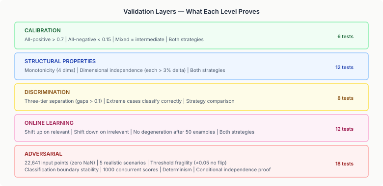
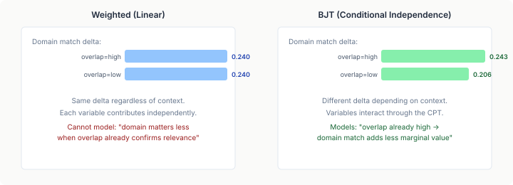

# Proving the Bayesian Layer

The multi-swarm coordination system uses Bayesian junction tree inference to decide which cross-swarm signals are worth attention. A five-variable network scores relevance based on capability overlap, domain match, signal strength, and historical relevance. An escalation network decides when accumulated evidence warrants pushing a signal from L1 mechanical scoring to L2 belief revision.

This is the first production use of the neocortex inference-bayes engine in a coordination pipeline. The junction tree runs every time a signal crosses a swarm boundary — potentially hundreds of times per tick across a multi-swarm topology. If the inference is wrong, signals get dropped or amplified incorrectly, and the entire coordination layer fails silently. Nobody sees an error message when a Bayesian network produces a bad posterior. The swarms just coordinate poorly.

I needed to prove it works. Not "the code compiles and doesn't throw" — that was already true. "The network produces sensible probabilities for realistic inputs, adapts correctly when learning, doesn't degenerate, and adds genuine value over a simpler approach."

## What "works" means for a Bayesian scorer

A weighted linear scorer is easy to validate. Input goes up, output goes up. The relationship is transparent. But a junction tree scorer has a 54-row conditional probability table that encodes beliefs about how four input variables jointly influence relevance. The inference runs message passing between cliques in a junction tree, marginalises over unobserved variables, and produces a posterior distribution. The output isn't a weighted sum — it's the result of probabilistic reasoning.

Validating this requires five layers, each proving a different property:

**Calibration** verifies the CPT produces the right ballpark. All evidence positive should yield P(relevant) > 0.7. All evidence negative should yield P(relevant) < 0.15. Mixed evidence should land in between. These are sanity checks, but they catch a miscalibrated CPT immediately.

**Structural properties** verify monotonicity and dimensional independence. Increasing capability overlap should never decrease the relevance score. Each of the four input dimensions should have measurable independent influence — at least 3% change when varied from low to high while holding others constant. If a dimension has no effect, it's dead weight in the network.

**Discrimination** verifies the network can actually separate relevant from irrelevant signals. Three profiles — clearly relevant, borderline, clearly irrelevant — should produce well-separated posteriors with gaps greater than 0.1. If the tiers collapse, the threshold is meaningless.

**Online learning** verifies the network adapts. Train on 30 relevant examples — the score for matching inputs should increase. Train on 30 irrelevant examples — it should decrease. And critically: after 50 training examples, the score should never degenerate to 0.0 or 1.0. Degeneration means the network has become useless for any future query.

**Adversarial** sweeps the full input space looking for trouble. 14,641 relevance points and 8,000 escalation points — every combination of four dimensions at 0.1 increments. Zero NaN, zero Infinity, all outputs in [0, 1]. Five realistic multi-swarm scenarios verified against domain intuition. Threshold fragility testing — ±0.05 perturbations on clear classifications should never flip the decision. Concurrent scoring from 10 virtual threads to verify thread safety.

## The engine bug nobody knew about

The validation suite caught something the inference-bayes engine's own tests hadn't: `OnlineParameterUpdater.update()` followed by `getInstance()` produced P = 0.0 for all subsequent inference.

The CPT values after update were fine. `getCpt()` returned sensible numbers — [0.68, 0.32], [0.53, 0.47]. But the junction tree inference produced zero. Not close to zero. Exactly zero.

Two bugs, compounding:

First, `initializeStats()` created pseudo-counts as uniform values (alpha=1.0 per cell), ignoring the existing CPT. When `updateCpt()` normalised the counts after a learning observation, it correctly updated the one row that was observed — but the other 53 rows normalised from [1.0, 1.0] to [0.5, 0.5], destroying the carefully designed conditional probability values. The CPT row for "high overlap, matching domain, strong signal → 98% relevant" became 50/50 on the first training observation.

Second, `reinitializeCliquePotentials()` zeroed all clique potentials and re-multiplied from the CPT. This should have been equivalent to building a fresh junction tree, but the in-place re-initialisation corrupted the clique state. The fix that worked: rebuild the junction tree via `JunctionTreeBuilder` instead of modifying potentials in place. More expensive, but correct.

The fix for the first bug: seed pseudo-counts from the existing CPT (`cpt[row][col] * alpha + alpha`), so the learned distribution starts from the designed prior rather than uniform. One-line change, but without it, the first training observation destroys the network.

## Why not just use weighted scoring?

I asked this question seriously. A weighted linear combination of the four features — `0.30 × overlap + 0.30 × domain + 0.25 × strength + 0.15 × history` — is simpler, transparent, supports online gradient-descent learning, and doesn't involve junction trees. I implemented it as a parallel strategy and ran both through the same validation suite.

Both pass. Calibration, monotonicity, discrimination, learning — the weighted scorer handles all of it. So why carry the complexity of Bayesian inference?

Conditional independence.

In the weighted scorer, adding domain match always contributes exactly 0.24 to the score, regardless of what capability overlap says. This is linear independence — each variable contributes a fixed amount.

In the BJT, adding domain match contributes 0.243 when overlap is already high, but only 0.206 when overlap is low. Domain match matters less when overlap already confirms relevance. This is conditional independence — the marginal contribution of one variable depends on the state of another, encoded in the CPT.

Is this difference worth the complexity? For the multi-swarm coordinator, I think so. The decision "should swarm B care about swarm A's finding" is genuinely conditional. A strong signal from a domain you share capabilities in is different from a strong signal in a domain you have no presence in, and the interaction between overlap and domain is exactly the kind of nuance a 54-row CPT captures.

Both strategies are available. The builder defaults to weighted scoring. Consumers who want the conditional independence structure opt in with `.bjtScoring()`. The validation suite tests both through the same parameterised assertions, so neither can silently regress.

## What this approach costs and what it earns

Each scorer is per-swarm — the topology creates one on registration. Each score call creates a fresh `BayesInstance` from the cached junction tree via `OnlineParameterUpdater.getInstance()`. For a five-variable network, this copies ~20 doubles and runs belief propagation across ~3 cliques. Sub-microsecond.

This is the right design at this scale, and it took first-principles analysis to see why. The inference-bayes engine supports incremental propagation — retract old evidence, set new evidence, re-propagate only the dirty subtree. That saves significant work when SOME evidence stays the same between calls. But in the multi-swarm scorer, all four evidence variables change on every call: capability overlap and domain match are target-specific, signal strength and history come from the signal. There is no partial evidence to retain. And with only 3 cliques in the junction tree, "dirty subtree" and "full tree" are the same thing.

The weighted scorer multiplies four doubles and clamps to [0, 1]. Effectively free.

For a topology with ten swarms, each signal triggers nine junction tree inferences. At sub-microsecond scale, invisible. The per-call creation pattern is non-blocking — each virtual thread gets an independent instance with no synchronisation on the score path. Only learning needs synchronisation (it modifies the shared `OnlineParameterUpdater`), and learning is infrequent compared to scoring.

The incremental engine earns its place at scale. A 50-variable network with 200 cliques would make `getInstance()` copy ~10K doubles and full propagation expensive. At that size, a stored instance with partial evidence retraction (changing 2 of 50 variables, re-propagating 5 of 200 cliques) saves 95%+ of the work. The architecture supports that path through the same `OnlineParameterUpdater` — the scorer just stores the instance and uses evidence retraction instead of creating fresh. That's a network-size decision, not a design change.

Online learning is the heavier operation. Each `update()` call adjusts CPT counts, normalises the affected rows, and rebuilds the junction tree via `JunctionTreeBuilder`. For five variables, sub-millisecond. For larger networks, a correct in-place re-initialisation path would eliminate the rebuild cost — the original path was faster but corrupted clique state; a proper fix is future work in inference-bayes.

The real cost is cognitive. A developer looking at the weighted scorer can read the code and understand what it does. A developer looking at the BJT scorer needs to understand junction trees, CPTs, soft evidence, and belief propagation to reason about why the scores come out the way they do. The validation suite is the answer to that — it proves the properties the developer cares about without requiring them to understand the inference mechanism.

Swarms that coordinate well make better decisions than swarms that don't. The mechanism for deciding what signals to amplify is worth getting right, and conditional independence is a real effect in the problem domain, not a theoretical luxury.
