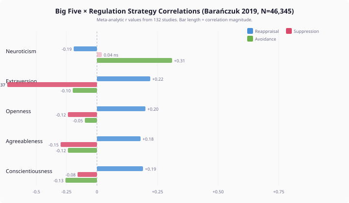

# Your Agent Needs to Learn from Emotional Failure

Most AI agents that claim personality do it with adjectives in a prompt. "You are assertive, competitive, and direct." The adjective sets the tone for every response, every time, regardless of what has happened. Ask the agent to handle conflict after one bad outcome or after ten — same assertive, competitive, direct response.

Real people don't work that way. A competitive person who picks fights and loses four in a row starts avoiding conflict — not because their personality changed, but because they learned that strategy isn't working. Personality tells you where someone starts. Experience tells you where they go.

I built a cognitive architecture that takes personality seriously — grounded in published literature, not intuition. The thing that broke it taught me more than the thing that worked.

## 1. Personality Predicts Less Than You Think

Barańczuk's 2019 meta-analysis — 132 studies, 46,345 participants, 753 effect sizes — measured how the Big Five personality traits correlate with emotion regulation strategies. The largest single correlation in the entire dataset is between Neuroticism and avoidance: r = 0.31.



Personality explains roughly 10% of the variance in someone's choice to avoid. The other 90% is context, situation, mood, relationships, and everything else that makes a person more than their trait profile.

This is the empirical reality that most personality-driven AI systems ignore. They treat personality as the complete explanation for behaviour. The evidence says it is a starting bias, not a deterministic program.

## 2. The Predictor That Worked — Until It Didn't

I built a regulation predictor for our cognitive agent architecture. Agents have disposition axes — five categorical personality dimensions extracted from biographical profiles. The predictor maps those axes to Gross's five emotion regulation strategies: situation selection, situation modification, attentional deployment, cognitive change, and response modulation.

An avoidant personality facing shame gets pinned to situation selection — withdrawal. A high-openness analytical personality gets cognitive change — reappraisal. The weights are derived from the meta-analysis, not invented. Each disposition axis contributes a continuous weight to each strategy's capacity score, and the strategy with the dominant weight wins.


For single emotional episodes, the predictor agrees with an LLM judge 85% of the time after calibration. The mechanical prediction is fast, deterministic, and personality-coherent.

Then the fourth shame episode hits.

## 3. The Fourth Episode

Same agent. Same personality. Same emotion. Same strategy. The predictor pins the avoidant personality to withdrawal for the fourth time. The LLM judge docks points: "Four repeated shame episodes signal that avoidance is failing. Even an avoidant temperament should be shifting toward cognitive change."

But cognitive change scored 2 out of 5 for this personality in strategy exploration. The judge is simultaneously saying this personality *cannot* do cognitive reappraisal and that it *should* be doing cognitive reappraisal.

The contradiction is real. The problem is not the judge.

The predictor treats personality as immutable. It derives regulatory capacity once from trait profiles and applies the same capacity every time. An avoidant personality has high situation-selection capacity and low cognitive-change capacity — permanently. No amount of failed avoidance changes those numbers.


Static personality produces static regulation. Under compounding emotional pressure, static regulation produces agents that are stuck — repeating the same failing strategy because their architecture has no mechanism for learning.

## 4. What the Literature Already Knew

CAPS theory — Mischel and Shoda's cognitive-affective processing system (1995) — models personality not as fixed traits but as stable *patterns of variation*. The same person behaves differently across situations, and those differences are not noise. They are the personality. The stable part is the *if-then* pattern: if this situation, then this response. But the responses update based on outcomes.

Bonanno and Burton's 2013 work on regulatory flexibility makes the same point from the clinical side: adaptive regulation requires adjusting strategy based on feedback. A person who only suppresses, regardless of whether suppression works, is not psychologically healthy. They are rigid. The capacity to shift strategies when one fails is the marker of regulatory flexibility.

Gross and John's 2003 finding that habitual strategies show diminishing returns closes the circle. The strategy that works the first time works less well the second, less well the third, and fails the fourth. Not because the strategy is wrong in general, but because the specific strategy-emotion-context combination has been tried and found wanting.

The predictor was ignoring all three findings. It derived personality once and froze it.

## 5. Experience-Modulated Capacity

The fix is architectural, not parametric. Effective regulatory capacity is not a property of personality alone — it is a function of personality *modulated by experience*.

```
effectiveCapacity = baselineCapacity × modulation(priorOutcomes)
```

When an avoidant agent uses situation selection for shame and the outcome is scored as low-effectiveness, the effective capacity for situation selection degrades. Not because personality changed — the baseline stays fixed. But because the *effective* capacity for that strategy in that emotional context has been updated by experience.


After enough degradation, the dominant strategy falls below the pin threshold. The predictor falls through to the LLM, which now has room to explore alternatives. The agent that was stuck on withdrawal can try cognitive change — not because it suddenly has high reappraisal capacity, but because its avoidance capacity has been worn down by failure.

Recovery happens through consolidation. When the emotion isn't re-triggered for a period, effective capacity recovers toward baseline. The agent doesn't permanently lose access to avoidance — it temporarily learns that avoidance isn't working *here*, *now*, for *this*.

**A fair counter:** isn't this reinforcement learning with extra steps? No. Reinforcement learning optimises for reward. This modulates capacity based on outcomes without changing the reward function. The agent's personality-derived preferences stay the same. What changes is how much room those preferences have to dominate when they're failing. The distinction matters because the goal is agents that remain personality-coherent while adapting to experience — not agents that converge on optimal strategy regardless of who they are.

## 6. What This Means If You're Building Cognitive Agents

Personality predicts the starting strategy, not the continuing one. Trait-based regulation works for single episodes. Under compounding pressure — repeated emotional experiences of the same kind — static trait prediction breaks down. The agent gets stuck.

The meta-analysis gives you the weights. Barańczuk's data maps Big Five traits to regulation strategy preferences with known effect sizes. Use them. Inventing personality-to-strategy mappings from intuition will produce mappings that contradict the evidence.

Experience modulation is the missing loop. Between personality derivation and strategy selection, there needs to be a feedback mechanism that degrades effective capacity when strategies fail and recovers it when they're not needed. Without this loop, personality is a costume, not a cognitive architecture.

The predictor should know its limits. Some personality-emotion combinations have a clear dominant strategy. Others don't. A predictor that always predicts is wrong half the time. A predictor that falls through to richer judgment when it's uncertain is right more often and produces more interesting agents — agents that surprise you, because the architecture gave them room to.
