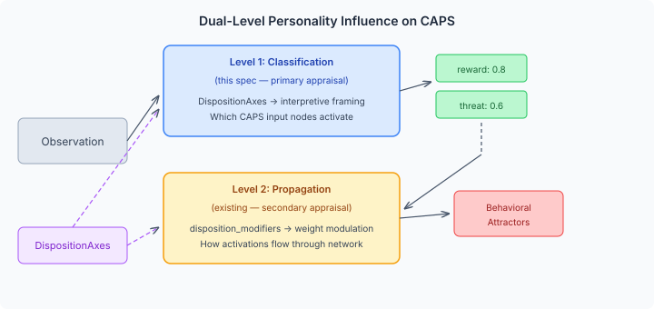
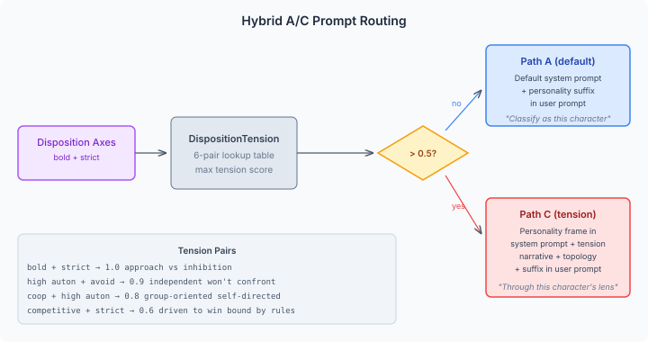

# The Personality That Saw the Same Thing

A competitive agent and a cooperative agent walk into the same room. Someone publicly takes credit for their work. The competitive agent sees a challenge to dominance. The cooperative agent sees a rupture in social harmony.

Except they didn't. Both agents received identical CAPS input activations — the same nodes, the same confidence scores. Personality only kicked in later, when the network propagated those identical inputs through disposition-weighted connections. The competitive agent's `BAS_activation` fired harder because its connection weights favoured approach. The cooperative agent's `social_threat` pathway transmitted more strongly because its weights favoured affiliation.

Different outputs. But identical perception. The system modelled how personalities respond to situations, but not how they perceive them.

## The appraisal theory gap

Richard Lazarus drew a distinction in 1991 that matters here. Primary appraisal is what you notice — which features of a situation register as relevant, threatening, or rewarding. Secondary appraisal is how you respond — what coping resources you bring to bear, what strategies you deploy.

The CAPS topology (Mischel & Shoda, 1995) already modelled secondary appraisal. Connection weights between nodes carry `disposition_modifiers` — tags like `BIS`, `BAS`, `threat` — that let the disposition axes scale specific pathways. A bold character's reward connections fire harder. An avoidant character's threat pathways are more sensitive. This is propagation-level personality influence, and it works.

But the situation classifier — the LLM that decides which input nodes activate in the first place — was personality-blind. Every character received the same prompt, the same system instructions, the same request to classify an observation into CAPS input nodes. The LLM had no idea who was doing the perceiving.

## What personality-aware classification looks like

The fix is architecturally simple: pass the character's disposition axes to the classifier as metadata, then let the LLM apply an interpretive frame.

Disposition flows through the existing `Map<String, String> metadata` on `SituationClassifier.classify()`. No SPI changes. `BehavioralSynthesisPhase` resolves the agent's disposition from `CognitiveDefaultsRegistry`, serialises the five axes as `disposition.*` entries, and passes them to the classifier. The classifier reads them, computes a tension score, and routes to one of two prompt strategies.

The interesting question is how much framing the LLM needs. A simple suffix — "Character disposition: competitive, bold risk appetite. Classify as this character would perceive it" — is enough for most profiles. The LLM applies personality as an external filter: "given that this character is competitive, which nodes would activate?"

But some personality profiles create internal conflict. A character who is simultaneously bold (approach motivation) and strict (rule-following inhibition) doesn't just apply personality as a filter. The tension between approach and inhibition changes what they even notice in a situation — ambiguity reads as a test of whether the rules permit the action they want to take.

## The tension routing mechanism

A static lookup table scores six pairs of conflicting axis values:

| Axes | Values | Tension | Psychological conflict |
|------|--------|---------|----------------------|
| riskAppetite × ruleFollowing | bold × strict | 1.0 | approach vs inhibition |
| autonomy × conflictMode | high × avoidant | 0.9 | independent but won't confront |
| socialOrient × autonomy | cooperative × high | 0.8 | group-oriented but self-directed |
| riskAppetite × conflictMode | bold × avoidant | 0.7 | acts but doesn't confront |
| socialOrient × autonomy | independent × low | 0.7 | independent identity but follows |
| socialOrient × ruleFollowing | competitive × strict | 0.6 | driven to win but bound by rules |

When the maximum tension exceeds 0.5, the classifier switches from path A (personality suffix in user prompt) to path C (personality frame embedded in the system prompt). Path C doesn't just ask the LLM to apply personality — it asks it to inhabit the interpretive frame:

> "You are a psychological situation classifier perceiving the world through a specific character's lens. This character is competitive, strict rule-following, bold risk appetite. Wants to act decisively but feels bound by rules — ambiguous situations feel like tests of whether the rules permit the action."

The narratives are specific to each conflict pair. They describe how the tension shapes perception, not just what the character values. "Values independence but avoids confrontation — perceives social expectations as constraints but won't push against them directly" is a perceptual instruction, not a personality label.

## The caching problem nobody saw

The CBR caching layer (`CbrCachingSituationDecorator`) stores classification results keyed by a SHA-256 hash of description, event type, and cognitive kind. When the same observation appears again, the cached result returns without calling the LLM.

The hash didn't include disposition metadata. Different personalities classifying the same observation would silently share cached results. Competitive agent classifies "colleague takes credit" — result cached. Cooperative agent encounters the same observation — cache hit, receives the competitive agent's activations. Cross-personality contamination, invisible in any single-agent test.

The fix adds all five disposition axis values to the hash, and adds disposition-based categorical filters to the CBR lookup query. Different personalities now produce different cache keys and different lookup scopes.

## What actually changes in the output

The eval test runs four personality profiles against four ambiguous observations — relationship, threat, achievement, and social mediation scenarios. Each observation is deliberately ambiguous: a competitive character could legitimately read the mediation scenario as a power play or as an opportunity to assert leadership.

Three metrics validate the differentiation:

**Inter-profile activation variance.** Pairwise cosine distance between profiles' activation vectors for the same observation. If personality-aware classification works, different profiles should produce measurably different activation patterns for the same input. The distance should exceed the noise floor established by personality-agnostic runs.

**Tension dual-activation.** The bold-strict profile (tension 1.0, path C) should activate both approach nodes (reward, mastery, dominance) and inhibition nodes (norm violation, social threat) for the same observation. Path A profiles should lean one direction. This is the diagnostic for path C doing its job — internal conflict produces dual activation where simple filtering produces single-direction activation.

**Bias detection.** No profile should map more than 80% of its observations to a single CAPS category. Personality should shape interpretation, not dominate it. An anxious character that sees everything as threatening is worse than no differentiation at all.

## The architectural principle

Primary appraisal shapes what you perceive. Secondary appraisal shapes how you respond. Both are personality-sensitive, but they operate at different levels of the processing pipeline.

Implementing personality only at the propagation level — connection weights that modulate how activations flow — is secondary appraisal. It changes the response but assumes all characters perceive the same situation. Adding personality at the classification level — interpretive framing that changes which input nodes activate — is primary appraisal. It changes what the character notices.

The two levels compose cleanly. Classification-level personality determines the activation pattern. Propagation-level personality modulates the flow. A competitive character sees a challenge (classification) and approaches it aggressively (propagation). A cooperative character sees a social rupture (classification) and moves to repair it (propagation). Neither level alone produces realistic differentiation.

The tension mechanism adds a third dimension: internal conflict. When disposition axes pull in opposite directions, the character's perception is genuinely conflicted — both approach and inhibition nodes activate, creating an unstable attractor that the CAPS network must resolve. This is where personality produces emergent behavior rather than predictable filtering.
