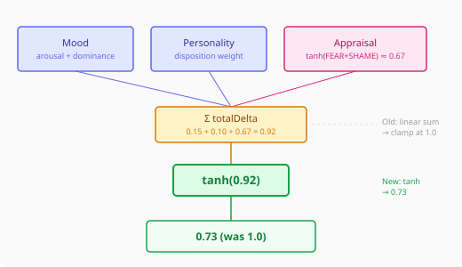

# The Pipeline That Argued with Itself

The SEC→OCC→PAD→Drive→Channel→Prompt pipeline has six stages. Each stage was implemented against published literature, unit tested, and individually correct. The coherence eval (#957) ran the full chain and scored the output. Three scenarios scored below 3.0. The problems were all downstream — not in emotion detection or PAD projection, but in what happened to the appraisal results after they were computed.

This session fixed four of those downstream problems. Every fix was small. Every fix was obvious once you saw the coherence judge's reasoning. None of them were visible from unit tests alone.

## Shame that suppresses its own repair

The `AppraisalDriveModulator` maps OCC emotions to SDT drive axes using Frijda's action tendency framework. SHAME maps to AUTONOMY at BOOST (0.5) — the withdrawal tendency, wanting to escape. The literature says that's correct.

But the mapping also included AFFILIATION at REDUCE (-0.2). Frijda's withdrawal implies pulling away from social contact. The mapping encoded that implication.

The `shameRegulationChain` eval scenario is about lying to a close friend who confronts you publicly. The coherence judge scored full-trace-consistency at 2.1 and identified the structural gap: the regulation stage targeted AFFILIATION as a repair drive (fear of losing the friendship), but the drive modulator actively suppressed it. The prompt output omitted affiliation entirely — in a scenario whose emotional core is relational.

The fix is one line: remove the AFFILIATION reduction from the SHAME mapping. SHAME becomes `AUTONOMY(BOOST)` — the withdrawal tendency is preserved, but it no longer blocks the affiliative drive that other co-occurring emotions might produce. Relational shame generates DISTRESS alongside SHAME; DISTRESS drives AUTONOMY without touching AFFILIATION. The net effect: AUTONOMY is elevated (the agent wants to withdraw), AFFILIATION is neutral (other signals can still engage it), and the regulation stage can target bond repair without fighting the modulator.

The mapping was literature-accurate. The pipeline was literature-incoherent.

## When two fears become one certainty

The same scenario exposed a second problem. FEAR and SHAME both map to AUTONOMY at BOOST (0.5). When they co-occur — which they do in public confrontation — the linear sum hits 1.0. Maximum activation. The AUTONOMY drive saturates at the absolute ceiling.

This contradicts the regulation stage, which had reduced peak emotional intensity from 0.86 to 0.52. If regulation worked, why is the drive at maximum?

The fix is `Math.tanh()` applied to accumulated drive deltas after summation. Tanh provides diminishing returns — two moderate emotions at 0.45 each produce tanh(0.9) ≈ 0.72, not 1.0. It's symmetric (works for negative deltas from REDUCE mappings), bounded at [-1, 1], and doesn't change individual emotion-to-drive weights. The mapping table stays the same; only the accumulation softens.

<svg xmlns="http://www.w3.org/2000/svg" viewBox="0 0 500 280" style="max-width:500px;font-family:system-ui,sans-serif">
  <defs>
    <marker id="arr" markerWidth="8" markerHeight="6" refX="8" refY="3" orient="auto">
      <path d="M0,0 L8,3 L0,6" fill="none" stroke="#555" stroke-width="1"/>
    </marker>
  </defs>
  <rect width="500" height="280" fill="#fafafa" rx="6"/>
  <!-- axes -->
  <line x1="60" y1="240" x2="460" y2="240" stroke="#999" stroke-width="1" marker-end="url(#arr)"/>
  <line x1="60" y1="240" x2="60" y2="20" stroke="#999" stroke-width="1" marker-end="url(#arr)"/>
  <text x="470" y="244" font-size="11" fill="#666">raw sum</text>
  <text x="30" y="18" font-size="11" fill="#666">output</text>
  <!-- linear (dashed) -->
  <line x1="60" y1="240" x2="360" y2="40" stroke="#ccc" stroke-width="1.5" stroke-dasharray="6,4"/>
  <text x="320" y="34" font-size="10" fill="#aaa">linear</text>
  <!-- tanh curve (approximated with polyline) -->
  <polyline fill="none" stroke="#2563eb" stroke-width="2"
    points="60,240 100,197 140,160 180,130 220,108 260,92 300,82 340,76 380,73 420,71 460,70"/>
  <text x="420" y="62" font-size="10" fill="#2563eb">tanh</text>
  <!-- annotation: FEAR+SHAME point -->
  <circle cx="260" cy="92" r="4" fill="#dc2626"/>
  <line x1="260" y1="96" x2="260" y2="240" stroke="#dc2626" stroke-width="0.5" stroke-dasharray="3,3"/>
  <line x1="60" y1="92" x2="256" y2="92" stroke="#dc2626" stroke-width="0.5" stroke-dasharray="3,3"/>
  <text x="265" y="88" font-size="10" fill="#dc2626">FEAR+SHAME → 0.72</text>
  <!-- annotation: saturation point -->
  <circle cx="360" cy="40" r="4" fill="#ccc"/>
  <text x="365" y="36" font-size="10" fill="#aaa">saturated at 1.0</text>
  <!-- scale labels -->
  <text x="50" y="244" font-size="9" fill="#999" text-anchor="end">0</text>
  <text x="50" y="140" font-size="9" fill="#999" text-anchor="end">0.5</text>
  <text x="50" y="44" font-size="9" fill="#999" text-anchor="end">1.0</text>
  <text x="60" y="256" font-size="9" fill="#999">0</text>
  <text x="260" y="256" font-size="9" fill="#999">1.0</text>
  <text x="460" y="256" font-size="9" fill="#999">2.0</text>
</svg>

The test is straightforward: FEAR at 0.9 plus SHAME at 0.9 produces an AUTONOMY delta that is strictly less than 0.9 (diminishing returns) but strictly greater than FEAR alone (stacking still matters).

## The action tendency nobody listened to

The `TopologyChannelWeighter` distributes weight across four expression channels — somatic, attentional, temporal, and action tendency — based on which CAPS input nodes are activated. Threat activations elevate somatic and action tendency channels. Social activations elevate attentional. The profiles are literature-grounded (Easterbrook 1959, Barrett 2017, Frijda 1986).

The curiosity eval scenario produced ATTENDING action readiness at 0.85 — the strongest action tendency. ATTENDING means the agent is directing focused attention toward something. The attentional channel weight was 0.231 — second lowest. The coherence judge flagged it immediately: "the sole action tendency is ATTENDING at 0.82 intensity, which semantically aligns with attentional focus."

The weighter only looked at CAPS topology activations. It never checked what action tendencies the appraisal produced. ATTENDING was computed, recorded, passed to the result — and then ignored.

The fix adds an overloaded `weight(activations, actionTendencies)` method. When ATTENDING intensity exceeds 0.3, the profile blends toward an attention-heavy target (attentional at 0.45) proportional to the tendency's intensity. The `ChannelWeightProfile.blend()` method — which already existed — handles the interpolation and normalisation. The call site in `AppraisalTickParticipant` passes `result.actionTendencies()` through.

## Sixty silent failures

The `LlmSituationClassifier` sends descriptions to an LLM and parses JSON activations from the response. When the backend model isn't available, the response is a plain-text error message: "The model claude-fable-5-2 is not available on your vertex deployment."

The `extractJson()` method looks for `{` and `}`. No braces, no JSON, return null. The `parseResponse()` method gets null, returns an empty list. The `classify()` method returns zero activations. No warning. No log message.

During the #972 eval, all 60 LLM classifier calls returned zero activations. The eval harness reported the results as if the classifier had decided nothing was situationally relevant about any of the test scenarios. It took manual investigation to discover the model wasn't even available.

The fix is four lines: when `extractJson()` returns null and the response text is non-empty, log a WARNING with the first 200 characters. A deployment misconfiguration now shows up in logs the first time it happens, not after an hour of debugging empty eval results.

## What the eval measured that unit tests can't

Every unit test for these components passed before the fixes. The SHAME mapping was tested: AUTONOMY goes up, AFFILIATION goes down. Correct per Frijda. The linear accumulation was tested: two emotions stack. Mathematically sound. The channel weighter was tested: threat elevates somatic. Matches the literature.

Unit tests verify that components do what they were designed to do. Coherence evaluation verifies that what they were designed to do produces sensible output when composed. The gap between those two is where four out of five bugs in this session were hiding.

The fifth wasn't even a bug. It was a missing log statement. The system was doing exactly what it was told — returning empty results for a failed backend call. It just wasn't telling anyone.

And the sixth was the reason the eval couldn't run at all. The `LlmSituationClassifier` constructor defaulted to `"haiku"` as the model name. The eval tests hardcoded the same string. When the backend resolved that alias to a model the Vertex deployment didn't serve, every call failed silently — sixty zero-activation results with no warning (until the log fix above). The real fix wasn't waiting for the deployment to add the model. It was making the model nullable. When null, the classifier skips the `.withModel()` override and lets the agent backend use whatever model it's configured with. The eval tests now pass `null`. The classifier works with any deployment.

## The verification that found more

Six fixes landed. The eval ran again. Both pipeline coherence scenarios passed their 4.0 gate — `curiosityExplorationChain` at 4.025, `shameRegulationChain` at 4.025. The tension threshold sensitivity test produced non-empty activation vectors across all seven personality profiles and three thresholds. The fixes worked.

But the coherence judge gave the shame scenario's `full-trace-consistency` transition a 2.8. The raw appraisal and regulation stages scored well — 4.7 and 4.8. The breakdown was in the drive section of the prompt output. AUTONOMY was still at 1.0. AFFILIATION was at 0.1. In a scenario about lying to your closest friend and being confronted publicly.

The per-layer tanh from the earlier fix compressed appraisal deltas from 0.82 to 0.67. That worked. But `DriveComposer` accumulates modulation from three independent sources — mood, personality, and appraisal — and adds them linearly before clamping. Shame produces high arousal (mood pathway adds ~0.17), negative dominance triggers a compensatory autonomy boost (another ~0.15), and the appraisal layer contributes its tanh-compressed 0.67. Total: ~0.99. Clamp at 1.0. Saturated again.

The fix was the same idea applied one level up. Instead of adding mood + personality + appraisal deltas linearly, accumulate them into a single `totalDelta` and apply `Math.tanh()` to the sum before adding to the raw drive intensity. Two moderate sources at 0.4 and 0.5 produce `tanh(0.9) ≈ 0.72`, not 0.9. Three sources at 0.15 + 0.10 + 0.67 produce `tanh(0.92) ≈ 0.73`, not 0.92.

This means the appraisal layer now passes through tanh twice — once within `AppraisalDriveModulator` (prevents FEAR+SHAME stacking) and once in `DriveComposer` (prevents mood+personality+appraisal overflow). The double compression makes appraisal slightly more conservative than mood or personality modulation. That's the right direction: appraisal is reactive, mood is dispositional, and personality is structural. The transient signal should lose the tiebreak.

## The relational component of shame

The AFFILIATION problem had a different root. `AffiliationDrive` evaluates from `UserModelOrchestrator.activeProfiles()` — it counts how many tracked relationships have been neglected. The eval test had no tracked subjects. Raw affiliation: 0.0. The only contribution came from personality modulation (cooperative disposition added ~0.1). In a scenario saturated with relational content, the drive computation had nothing to compute from.

But even with seeded relationships, the emotion-to-drive mapping had a gap. After the earlier suppression removal, SHAME mapped only to AUTONOMY. The withdrawal tendency is correct — Frijda's action readiness for shame is avoidance. But Tangney and Dearing's research on shame and guilt makes a straightforward case: shame is inherently relational. It arises from social exposure. The self-conscious emotion presupposes an audience — real or imagined — whose judgment triggers the experience.

Adding `AFFILIATION(SECONDARY_BOOST)` to the SHAME mapping captures this. The primary drive is still AUTONOMY (the agent wants to withdraw). The secondary signal is affiliative (the withdrawal is FROM someone, and that someone matters). The combined profile — high autonomy, moderate affiliation — is what you'd expect from someone who wants to run away from the friend they hurt but also desperately wants to repair the relationship.

## Completing the Frijda framework

The earlier session added ATTENDING as the first action tendency mapped to channel weights. `TopologyChannelWeighter` distributes expression weight across somatic, attentional, temporal, and action tendency channels based on CAPS activations. The ATTENDING mapping blends toward an attention-heavy profile when the agent is in focused-attention readiness.

AVOIDANCE and ANTAGONISM are the other two tendencies with clear channel implications from Frijda's framework. Avoidance (withdrawal, escape) is body-level and action-oriented — the somatic and action tendency channels should dominate. Antagonism (attack, assert) is somatic-dominant — the body mobilises for confrontation.

The profiles:
- **AVOIDANCE** — somatic 0.35, attentional 0.10, temporal 0.15, action tendency 0.40. Matches the threat category profile. The body prepares to flee; attention narrows per Easterbrook.
- **ANTAGONISM** — somatic 0.40, attentional 0.10, temporal 0.15, action tendency 0.35. Somatic peaks higher than avoidance because fight involves more body activation. Action tendency is slightly lower because the response is more immediate — less planning, more reacting.

The blend order matters. AVOIDANCE and ANTAGONISM apply first (body-level channels). Then ATTENDING can override (attentional focus is a higher-order cognitive process). If the agent is simultaneously avoiding a threat and attending to a specific detail — a reasonable state in hypervigilant scenarios — the attentional boost partially counteracts the avoidance-driven attentional narrowing.

## Fix, verify, fix deeper

The pattern across both sessions: implement against the literature, test the components, discover that composition introduces incoherence the components can't see, fix the composition. Then: verify the composition fixes, discover that the fix addressed one accumulation layer but not the cross-layer interaction, fix the deeper layer.

Each fix was small. Each was visible only from the coherence judge's output, not from unit tests. The `full-trace-consistency` score at 2.8 identified the same structural category as before — drive modulation contradicting the emotional state — but the mechanism was different. The first time it was linear accumulation within the appraisal layer. The second time it was linear accumulation across modulation sources.

The eval didn't just confirm the fixes. It found the next layer of the same problem. That's the value of running a coherence evaluation after every round of changes — not to verify that what you fixed stayed fixed (though it does that), but to surface what the fixes revealed.
