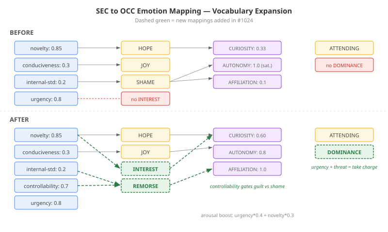

# The Category That Wasn't There

The coherence judge reads the observation, reads the appraisal output, and scores whether the transition makes sense. For the curiosity scenario — "I just discovered a strange pattern in the research data that nobody has documented before" — the judge scored observation-to-appraisal at 4.3 and noted:

> "No explicit curiosity/interest emotion — the CAPS system has curiosity drives, and the observation is a textbook Loewenstein information-gap trigger, yet the appraisal outputs only JOY and HOPE."

The pipeline detected novelty. It produced the right action tendencies. The narrative was vivid — "skin tingle with that pull to dig deeper." But the structured emotion output listed JOY (hedonic pleasure) and HOPE (prospect-based anticipation). Neither is the emotion that makes you want to investigate.

The word for that emotion is INTEREST. And the `EmotionMapper` didn't have it.

## Three missing categories, one root cause

The OCC taxonomy defines 22 emotion types. Our mapper implemented the core set — FEAR, ANGER, JOY, HOPE, SHAME, REPROACH, DISTRESS. These cover the high-valence states that drive most scenarios. But three gaps surfaced when the coherence eval tested diverse emotional contexts:



**INTEREST.** Silvia (2006) extended the OCC framework with epistemic emotions — emotions about knowledge states rather than goal states. INTEREST fires when novelty is high and the situation is non-threatening. It's what makes you lean forward, not what makes you smile. The mapper routed all positive-novelty combinations through JOY and HOPE, which are consummatory and anticipatory. INTEREST is investigatory. Different PAD profile: higher arousal (0.4 vs 0.2), lower pleasure (0.3 vs 0.4). The body language is different. The drive pathway is different.

**GUILT (REMORSE).** The shame scenario has the agent lying to a close friend and being confronted publicly. The judge flagged: "guilt absent as named emotion despite being the most natural response to 'I lied.'" OCC distinguishes shame from guilt on a single dimension: controllability. Shame is "I am inadequate" (low controllability — I couldn't help it). Guilt is "I did a bad thing" (high controllability — I had a choice). Tangney (1996) built an entire measurement framework on this distinction. Our mapper used only SHAME for all internal-standards violations, regardless of whether the agent had agency. That conflation matters downstream: shame drives withdrawal (AUTONOMY), guilt drives repair (AFFILIATION). Mapping both to SHAME meant the pipeline never produced the repair impulse for self-caused harm.

**DOMINANCE tendency.** The security crisis scenario — active data breach, two hours unnoticed, customer PII at risk — produced a single action tendency: ATTENDING. That's the novelty response. The judge expected an urgency-driven protective response alongside it. Frijda's action readiness framework includes DOMINANCE — the assertive take-charge tendency. Our mapper had APPROACH, AVOIDANCE, ANTAGONISM, ATTENDING, and INTERRUPTION. No urgency-driven protective action.

## The architectural pattern

Each gap follows the same pattern: the SEC dimensions contain the information, but the mapping function doesn't have a category to route it into. The LLM appraisal produces `novelty: 0.85, conduciveness: 0.3` and the mapper correctly produces JOY and HOPE. But it can't produce INTEREST because INTEREST doesn't exist in the enum. The information is present. The vocabulary is too small.

This matters because emotion types determine drive pathways. HOPE maps to curiosity via BOOST(0.5). INTEREST should map more directly — it IS the curiosity emotion. Without INTEREST in the vocabulary, the curiosity drive relies on a secondary HOPE pathway that underweights the signal.

```
  SEC dimensions        OCC emotions       Drive modulation
  ┌────────────┐       ┌────────────┐      ┌────────────────────┐
  │ novelty:0.8│──────▶│ HOPE       │─────▶│ CURIOSITY(BOOST)   │
  │ conduc:0.3 │──────▶│ JOY        │─────▶│ ... (no curiosity) │
  │            │  ✗    │ [INTEREST] │──▶?  │                    │
  └────────────┘       └────────────┘      └────────────────────┘
  Information present  Category missing    Signal attenuated
```

## The fixes

**INTEREST (Silvia 2006).** Added to `EmotionType` as an epistemic extension. Fires when `novelty > 0.5 AND conduciveness >= 0 AND relevance > 0.3`. PAD projection: P=0.3, A=0.4, D=-0.1 — pleasant, activating, slight loss of control to the unknown. The arousal is double that of HOPE (0.4 vs 0.2), which makes the pipeline respond to discovery with appropriate activation rather than calm anticipation.

**REMORSE (guilt).** The existing `EmotionType.REMORSE` was already in the enum but never produced by the mapper. Added the controllability gate: `internal-standards < 0.5 AND controllability > 0.5` routes to REMORSE. `controllability <= 0.5` stays as SHAME. This is the OCC distinction operationalised: the mapper now asks "did you have a choice?" before deciding between self-deprecation and self-accountability.

**DOMINANCE tendency.** Added to `mapTendencies()`: `urgency > 0.6 AND conduciveness < -0.2` produces DOMINANCE alongside whatever valence tendency fires. The crisis scenario now generates both AVOIDANCE (fear-driven flight) and DOMINANCE (urgency-driven take-charge) simultaneously — which is Frijda's mixed action readiness in high-activation states.

**Arousal boost from novelty.** Changed from `urgency * 0.5` to `urgency * 0.4 + novelty * 0.3`. The discovery scenario previously got arousal 0.0 (zero urgency) despite being intensely novel. Now novelty contributes to physiological activation. A major scientific discovery feels exciting, not calm.

**LLM calibration anchors.** Added scenario-anchored guidance to the system prompt: "An exciting discovery: novelty >= 0.7. An active crisis: urgency >= 0.8, conduciveness <= -0.5. A personal moral failure: internal-standards <= 0.3, controllability reflects whether they had a choice." These ground the abstract dimension scale in concrete situations, reducing the variance in LLM-generated SEC values.

## The bug the review found

Code review caught a critical downstream issue: `EmotionReinforcementMapper.forEmotion()` throws `IllegalArgumentException` for unmapped types. INTEREST wasn't in the reinforcement map. During CAPS consolidation, `BehavioralSynthesisPhase` calls `forEmotion()` for each emotion in a graduated experience node. An INTEREST emotion would crash the entire consolidation pipeline.

INTEREST maps to BAS (behavioral activation system) — the approach/exploration pathway. Added alongside HOPE and JOY in the BAS group. Without this fix, the enum expansion would have been a ticking time bomb in the background consolidation scheduler.

## Taxonomies as architecture

Emotion taxonomies feel academic. OCC has 22 types, Frijda has 9 action tendencies, Mehrabian's PAD has 3 dimensions. The literature is 40 years deep. It's tempting to implement the core set and defer the rest.

But in a computational cognitive pipeline, the taxonomy IS the routing table. Each missing type is a signal that enters the pipeline with nowhere to go. The LLM generates a rich narrative about curiosity, but the structured layer says JOY. The drive modulator reads JOY and doesn't activate curiosity. The search budget doesn't prioritise investigation. The prompt output says "something nice happened" instead of "you need to dig into this."

The eval judge sees the incoherence because it reads both layers — the narrative and the structured output. It scores the gap. And the gap isn't a measurement error. It's a category error in the mapping.

The fix is small. Six files, 121 lines added. The architectural lesson is larger: when you build a pipeline where each stage reads the structured output of the previous stage, the vocabulary of that structured output determines what the pipeline can express. Extend the vocabulary, and signals that were always present start flowing through.
