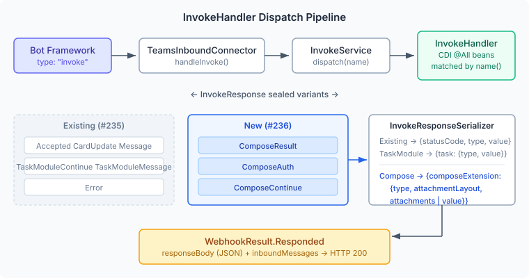
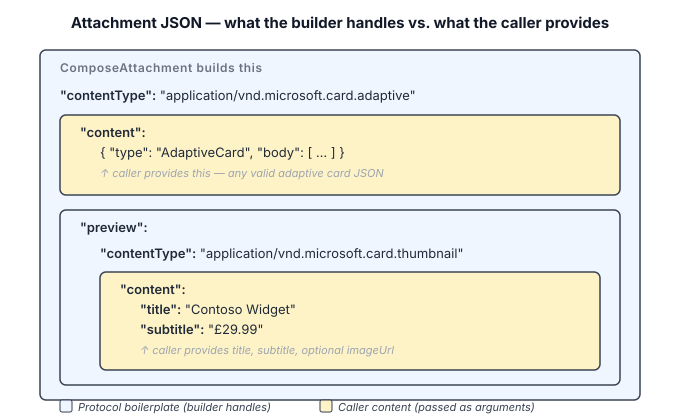

# The Line Between Raw and Ready

Messaging extensions are Teams' mechanism for search, link unfurling, and action forms — all channelled through a single Bot Framework activity type called `invoke`. The connector library needed to dispatch these without taking opinions about what a handler does with them. We ended up with a three-layer design: a sealed response type, a name-based dispatch service, and a convenience builder that sits exactly on the boundary between protocol structure and caller content.

## Dispatch by name, respond by type

The `InvokeHandler` SPI is two methods: `name()` returns the invoke activity name (e.g. `composeExtension/query`), and `handle()` takes an `InvokeRequest` and returns an `InvokeResponse`. The service collects all CDI beans implementing the interface, indexes them by name, and dispatches:

```java
InvokeHandler handler = handlers.get(request.name());
if (handler == null) return new InvokeResponse.Accepted();
return handler.handle(request);
```

No reflection, no annotations, no registration ceremony. A handler exists or it doesn't. Unknown invokes get a 200 Accepted — the Bot Framework requires a synchronous response, and silence is worse than acknowledgement.

`InvokeResponse` is a sealed interface with nine variants. The original six handled card updates, messages, task modules, and errors. The three new variants — `ComposeResult`, `ComposeAuth`, and `ComposeContinue` — handle the compose extension protocol. The serializer switches exhaustively over the sealed type, so adding a variant that doesn't have serialization is a compile error.



## Where the builder stops

`ComposeResult` takes a `List<String>` for attachments — each string is a complete JSON blob. This was deliberate: the moment you model attachment structure in types, you're making decisions about content, and content isn't the connector library's job.

But every consumer building a search extension assembles the same envelope. The Bot Framework attachment format has a fixed shape — a `contentType` that's always `application/vnd.microsoft.card.adaptive`, a `content` object holding the adaptive card, and an optional `preview` block with its own type, title, subtitle, and images array. None of that is caller content. It's protocol boilerplate.

`ComposeAttachment` handles the protocol side:

```java
ComposeAttachment.adaptive(cardJson)
        .preview("Contoso Widget", "£29.99")
        .build()
```

The boundary tracks a real distinction. The card body is the caller's business — it varies per use case, per domain. The envelope structure never varies. The builder handles everything the caller would always type identically; the caller provides everything that changes.



The raw `List<String>` contract on `ComposeResult` doesn't change, so hand-crafted JSON still works. The builder is a convenience, not a requirement.

## Reference handlers as first consumers

Four reference `InvokeHandler` implementations sit in `chat-teams`. `RefSearchHandler` returns three canned search results with thumbnail previews. `RefLinkUnfurlHandler` returns an unfurl card without a preview — link unfurling doesn't need one. `RefFetchTaskHandler` returns a task module form via `ComposeContinue`. `RefSubmitActionHandler` returns a confirmation card.

Each is under 30 lines. They follow the same pattern as `chat-ref`, `bank-ref`, and the other reference implementations — no external dependencies, no state, hard-coded responses. The difference is placement: `InvokeHandler` is Teams-specific, not a cross-platform SPI, so the reference handlers live in `chat-teams` rather than a separate module.

The handlers are plain classes without CDI annotations. The `InvokeService` discovers beans via Quarkus `@All` injection, so consumers opt in by annotating their own implementations with `@ApplicationScoped`. The reference handlers are available as building blocks and test fixtures, not auto-registered services.

They were also the first real consumers of `ComposeAttachment`. The code reads the way consumer code should — protocol mechanics invisible, card content and preview metadata front and centre. When your convenience layer's first consumer looks clean, the abstraction is at the right altitude.
