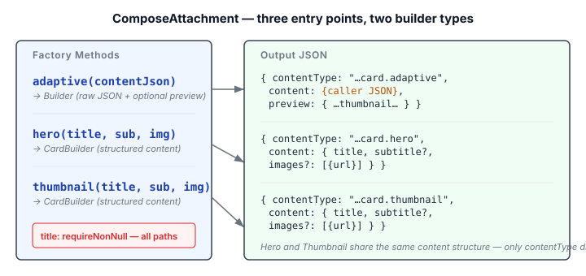

# The Gap Between Works and Trustworthy

A builder that works is not the same as a builder you'd hand to another team. The difference lives in the small things: does it fail at the call site or somewhere deep in a JSON serializer? Does it cover all the card types the protocol supports, or just the first one we needed? Can you prove the CDI wiring works, or do you just hope it does because the unit tests pass?

We spent a session closing that gap on `ComposeAttachment` and the invoke dispatch chain.

## Fail where you call, not where you build

`ComposeAttachment.adaptive(contentJson)` guarded its constructor argument with `Objects.requireNonNull`. The `preview(title, subtitle)` method did not. Passing `null` for `title` produced a `NullPointerException` inside `JsonObjectBuilder.add(null)` — at `build()` time, in a stack trace that says nothing about where the problem was introduced.

```java
public Builder preview(String title, String subtitle) {
    this.previewTitle = Objects.requireNonNull(title, "title");
    this.previewSubtitle = subtitle;
    this.previewImageUrl = null;
    return this;
}
```

The fix is one line per overload. The principle is older than Java: fail-fast contracts catch errors at the point where the caller can still reason about them. A `NullPointerException` that names `"title"` on the line where `preview()` is called is immediately actionable. The same exception from inside a JSON builder three method calls later sends the developer on a debugging detour that teaches them nothing about the API contract.

Subtitle stays nullable — the Bot Framework preview card renders fine without one. Title does not. The asymmetry in the null contract reflects an asymmetry in the protocol.

## Completing the card type coverage

The initial `ComposeAttachment` handled Adaptive Cards only. The Bot Framework compose extension protocol supports Hero and Thumbnail cards as direct content types — not just as preview cards nested inside adaptive attachments.

```java
ComposeAttachment.hero("Product Name", "£29.99", "https://example.com/thumb.png").build()
ComposeAttachment.thumbnail("Search Result", "Found item", null).build()
```

`CardBuilder` is a separate inner class from `Builder`. It takes structured arguments instead of raw JSON, because Hero and Thumbnail cards have a fixed shape — title, optional subtitle, optional image. There is no caller-provided body to pass through.



Hero and Thumbnail produce identical JSON structures; only `contentType` differs. `CardBuilder` handles both via a shared constructor that takes the content type string. The factory methods — `hero()` and `thumbnail()` — are the public API; the content type string is never exposed to callers.

The null guard on `title` is consistent across all three entry points. `adaptive()` guards `contentJson`. `hero()` and `thumbnail()` guard `title`. Every `ComposeAttachment` factory method fails fast on its required argument.

## Proving the wiring

Unit tests for `InvokeService` construct it directly: `new InvokeService(List.of(handler))`. That proves the dispatch logic works. It does not prove that Quarkus CDI discovers `@ApplicationScoped` `InvokeHandler` beans via `@All` injection, wires them into `InvokeService`, and makes the whole chain available for injection.

The `@QuarkusTest` boots the CDI container with two test `InvokeHandler` beans — one returning a `Message`, one returning a `CardUpdate`. The test injects `InvokeService` and dispatches through the full chain: CDI discovery → `InvokeService.dispatch()` → handler → `InvokeResponseSerializer.toJson()`.

```java
@Inject
InvokeService invokeService;

@Test
void fullDispatchChain_handlerThroughSerializer() {
    var request = new InvokeRequest("test/echo", Json.createObjectBuilder().build(),
                                    "user-1", "channel-1", Map.of());
    String json = InvokeResponseSerializer.toJson(invokeService.dispatch(request));
    // ...
}
```

The test also verifies that unknown invoke names return `Accepted` with a bare `{"statusCode": 200}` — no `type` field, no `value`. This is the Bot Framework's expected response for activities a handler doesn't recognise, and getting it wrong means Teams shows an error badge on the message.

The test needed a `StubServiceConnectionProvider` and an `application.properties` to satisfy `TeamsBeans`' other producers — the CDI container validates all beans at startup, not just the ones the test injects. That is exactly the kind of wiring a unit test never catches.

## Teaching through reference code

`RefSearchHandler` returned three canned results regardless of the query text. Correct for a stateless reference implementation, but it missed the opportunity to show the most common pattern in messaging extension search: read the query, filter results, return matches.

```java
String queryText = request.value().getString("queryText", "");
var attachments = allItems.stream()
        .filter(item -> queryText.isBlank()
                || item.title().toLowerCase().contains(queryText.toLowerCase()))
        .map(item -> ComposeAttachment.adaptive(item.cardJson())
                .preview(item.title(), item.price()).build())
        .toList();
```

A blank or missing query returns all results — the same behaviour as before. A non-empty query filters by title substring. The reference implementation now demonstrates the pattern without adding complexity that would obscure it.

Reference implementations serve two audiences: test fixture consumers who need deterministic responses, and developers reading the code to understand how to build their own handler. The filtering change costs nothing for the first audience (blank query still returns everything) and gives the second audience the pattern they're actually looking for.
