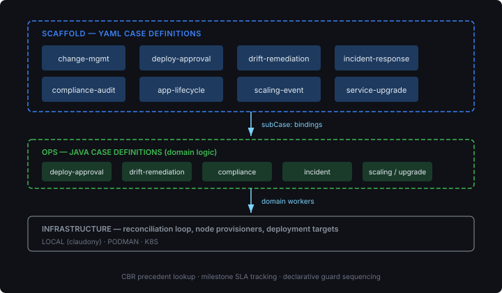
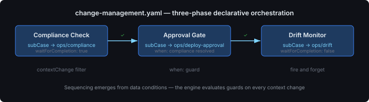

# The Case Composition Layer

Ops has seven domain-level case definitions — deployment approval, drift remediation, compliance, incident response, and more. Each handles its own domain logic: the approval workflow checks risk classification and authorisation, the drift case runs reconciliation loops. What they don't do is coordinate with each other.

A change management workflow that needs a compliance check *before* an approval gate *before* drift monitoring requires something above the individual domain cases. That's the composition layer.



Eight YAML case definitions sit in scaffold's classpath and compose ops' domain cases via `subCase:` bindings. The scaffold case owns the orchestration — sequencing, CBR precedent lookup, milestone SLA enforcement — while the ops sub-case does the domain work. The split is deliberate: domain logic belongs in the domain repo (ops), orchestration logic belongs in the deployment repo (scaffold). Neither has to know the other's internals.

## Declarative Orchestration

The most interesting case definition is `change-management.yaml`. It coordinates a deployment through three phases, each delegating to a different ops sub-case.



The binding that controls the approval gate:

```yaml
- name: approval-gate
  capability: deploy-approval
  on:
    contextChange:
      filter: '.complianceResult != null and .approvalResult == null'
  when: '.complianceResult.status == "resolved"'
  subCase:
    namespace: ops
    name: deployment-approval
    version: "1.0"
    inputMapping: '.changeSpec.deploymentSpec'
    outputMapping: '{ approvalResult: { decision: .approvalDecision } }'
    waitForCompletion: true
```

The `when:` guard is the sequencing mechanism — it won't fire until the previous phase produced a resolved compliance result. No step counters, no explicit ordering. The engine evaluates guards on every context change, so sequencing emerges from data conditions rather than procedural control flow.

This matters because it means the orchestration is *reactive*. If compliance resolves, approval fires. If compliance escalates, the failure goal catches it. The YAML author never writes "step 1 then step 2" — they write the conditions under which each delegation activates, and the engine handles the rest.

## The Long-Lived Case

The `application-lifecycle` case definition is different from the others. It's the umbrella — a long-lived case that doesn't complete when its sub-cases complete. It listens for events across the entire lifecycle of a deployed application:

- Drift detected → delegate to `drift-remediation`
- CVE detected → delegate to `cve-response`
- Upgrade requested → delegate to `service-upgrade`
- Scaling required → delegate to `scaling-event`
- Compliance violation → delegate to `compliance-remediation`
- Approval required → delegate to `deployment-approval`
- Incident detected → delegate to `incident-response`

All seven bindings use `waitForCompletion: false` — fire and forget. The lifecycle case doesn't block on any individual sub-case; it's a dispatcher that routes events to the right domain handler. CBR with `crossType: true` means precedent lookup crosses event boundaries — a prior drift incident informs how a new compliance violation is handled.

This case is what gets created when you deploy a topology. The deploy action compiles the YAML, starts the reconciliation loop, and creates an application-lifecycle case. From that point, every tab in the UI — Fleet, Drift, Cases, Approvals — is a view into the running case.

## The Dual-Impl BFF

The service layer follows the CDI pattern established for topology: interfaces with embedded and client implementations. The embedded impl calls the engine APIs directly; the client impl goes through MP REST Client.

```java
@ApplicationScoped
@Alternative
@Priority(100)
public class EmbeddedCaseService implements CaseService {
    // ...
    @Override
    public CaseDetail getCaseDetail(UUID caseId, String tenancyId) {
        var instance = engineCaseApi.getCaseById(caseId, tenancyId);
        if (instance == null) return null;
        var planItems = engineCaseApi.getPlanItems(caseId, tenancyId);
        var subCases = planItems.stream()
                .filter(pi -> pi.subCaseIds() != null && !pi.subCaseIds().isEmpty())
                .flatMap(pi -> pi.subCaseIds().stream()
                        .map(subId -> new SubCaseSummary(subId, pi.capabilityName(),
                                pi.status().name())))
                .toList();
        // ...
    }
}
```

The sub-case decomposition is worth showing. `PlanItemView` now carries `subCaseIds()` and `capabilityName()` — two fields that didn't exist when the original plan was written. We filed the gap as an engine issue, it landed, and scaffold immediately consumed it. That's the cross-repo feedback loop working as intended: scaffold surfaces what the engine API lacks, the engine fills the gap, scaffold wires it in.

## What's Next

The case definitions are the *what*. The topology catalogue — currently in design — is the *how you get there*. Browse a topology, see the desired-state graph, see the deploy plan (terraform-style "4 additions in dependency order"), click Deploy, and the application-lifecycle case takes over. The YAML definitions you see above become the governance layer over every deployed topology.

The interesting question is what happens when the tutorial levels compose with the case layer. Level 01 deploys four nodes. Level 05 adds drift detection. The same `drift-remediation` case definition handles both — the composition layer doesn't care which level you deployed, only what events your topology produces.
