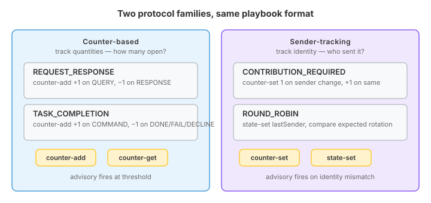
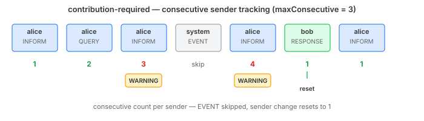
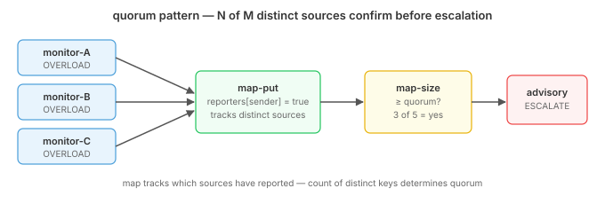

# Protocols You Can Read

Qhorus has four built-in channel protocols — REQUEST_RESPONSE, TASK_COMPLETION, CONTRIBUTION_REQUIRED, ROUND_ROBIN. They enforce communication discipline: warn when queries pile up unanswered, flag when an obligor ignores their open task, catch when one participant dominates the conversation. They work. The problem is that they're Java classes with hardcoded logic, and the only way to understand what they do is to read the source.

That's fine for platform developers. It's not fine for anyone else.

A consumer who wants to know "what does REQUEST_RESPONSE actually enforce?" has two options: read `RequestResponseProtocol.java` (assuming they can find it in qhorus-runtime-core), or trust the one-paragraph description in the consumer guide. Neither option lets them *modify* the behaviour. If the default threshold of 3 open queries doesn't fit their domain, they can't adjust it without writing a new `ChannelProtocol` implementation from scratch.

## Why Not a State Machine?

I started with the obvious approach — express the protocols as state machines. Three tiers: IDLE, ACTIVE, OVERLOADED. QUERY moves you right, RESPONSE moves you left, WARNING fires in the rightmost state. Readable, forkable, done.

Except the built-in protocols don't have states. They count active commitments on every evaluation. REQUEST_RESPONSE counts open queries and warns when that count crosses a threshold. A finite state machine can approximate this with tiers, but it can't reproduce it — the tier boundaries are fixed where the real threshold is configurable.

The playbook system already has the right primitives for this. Counters (`OrcCounter`) with increment, decrement, and reactive threshold listeners. Guards on state transitions. Pattern matching on event types. These compose — and they give exact behavioral equivalence, not an approximation.

## Protocols Are Just Playbooks

The design shift was realising that a protocol playbook isn't a special thing. It's a normal playbook — same YAML format, same compiler, same executor — that happens to be triggered by channel dispatch events and emits advisories. The front-matter metadata declares its role (`type: protocol`) and pre-initializes resources (counter defaults, policyOverride keys for per-channel customisation).

The request-response playbook reads events from the channel dispatch, matches on event type, and maintains a counter of open queries:

```yaml
- step: evaluate
  from: dispatch-events
  loop: continuous
  match: "${event.type}"
  cases:
    - pattern: "QUERY"
      block:
        - counter-add: { name: "openQueries", delta: 1 }
        - advisory: { severity: WARNING, message: "unanswered queries exceed threshold", action: INVESTIGATE }
          when: "${openQueries >= config.maxOpenQueries}"
    - pattern: "RESPONSE"
      counter-add: { name: "openQueries", delta: -1 }
```

No tiered approximation. The counter tracks the exact count. The guard fires when the count crosses the configurable threshold. The playbook does what the Java does.

## Two Families of Protocol

Counter-based protocols — REQUEST_RESPONSE and TASK_COMPLETION — track *quantities*. How many queries are open? How many commands are outstanding? The primitives are simple: `counter-add` to increment and decrement, a `when` guard to fire at a threshold.



CONTRIBUTION_REQUIRED and ROUND_ROBIN are different. They track *identity* — who sent the last message, and should this sender be talking right now? The quantity primitives aren't enough. You need `counter-set` to reset a counter to a specific value (not just increment), and `state-set` to remember the last sender across evaluations.

The contribution-required playbook skips EVENT-type messages (system noise), then tracks consecutive messages from the same sender:

```yaml
cases:
  - pattern: "EVENT"
    counter-add: { name: "consecutiveCount", delta: 0 }
  - default:
      - counter-add: { name: "consecutiveCount", delta: 1 }
        when: "${event.sender == state.lastSender}"
      - counter-set: { name: "consecutiveCount", value: 1 }
        when: "${event.sender != state.lastSender}"
      - state-set: { name: "lastSender", value: "${event.sender}" }
      - advisory: { severity: WARNING, action: LOG }
        when: "${consecutiveCount >= config.maxConsecutive}"
```

When alice sends three messages in a row without bob contributing, the counter hits the threshold and the advisory fires. When bob finally speaks, `counter-set` resets to 1 — not `counter-add: { delta: -N }`, which would require knowing the current value. The reset is absolute.



ROUND_ROBIN is the purest sender-tracking protocol. It doesn't count anything — it remembers who spoke last and checks whether the next speaker is who the rotation expects. The modular arithmetic (`(lastIdx + 1) % participants.size()`) lives in the expression engine, not in the playbook. The playbook just records state and fires when the expectation is violated.

The difference between these two families isn't just the primitives they use. It's what they're watching. Counter-based protocols monitor the *channel's* health — are obligations piling up? Sender-tracking protocols monitor *participant behaviour* — is someone hogging the conversation, or speaking out of turn? Same format, same executor, different lens on the same event stream.

## Beyond the Built-ins

The four built-in protocols only use counters, state, and guards. The playbook executor exposes the full yaml-core primitive set: maps for per-key tracking, gauges for typed values, flags for boolean toggles, and state machines for lifecycle phases. These compose within the same reactive event loop.

The most interesting composition is quorum — "N of M distinct sources must agree before escalation." A counter can't do this because it tracks volume, not identity. You need a map to track *which* sources have reported, then check the map's size against a quorum threshold:



```yaml
cases:
  - pattern: "OVERLOAD_REPORT"
    block:
      - map-put: { name: "reporters", key: "${event.sender}", value: "true" }
      - advisory: { severity: WARNING, message: "quorum reached", action: ESCALATE }
        when: "${map-size('reporters') >= config.quorum}"
```

Three monitors independently reporting overload doesn't mean three separate incidents. The map deduplicates by sender — the advisory only fires when enough *distinct* sources confirm. This is the difference between "something screamed three times" and "three independent things agree there's a problem."

State machines compose with counters too. An onboarding channel might tolerate 10 unanswered queries during setup but only 3 in production — same counter, different threshold per lifecycle phase. And gauges enable temporal patterns: store when a COMMAND was issued, check on each TICK whether the deadline has elapsed without a DONE.

## What This Opens Up

With the playbook executor bridge now wired into channel dispatch, a consumer forks any of the four playbook templates, adjusts the thresholds or participant list, adds domain-specific event cases, and registers it. No Java. And the composition patterns mean custom protocols can express policies that the built-in Java classes never could — quorum, lifecycle-aware thresholds, temporal deadlines — all in the same declarative format.

Protocol logic stops being opaque framework code and becomes something you can read, test, and modify. The playbook format is the same one used everywhere else in the platform. A developer who can read one playbook can read a protocol.
