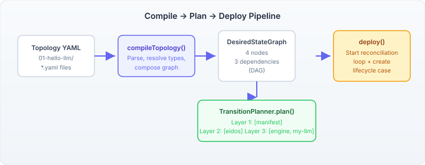
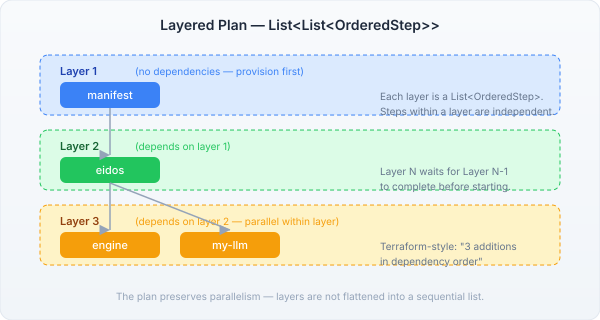

# From YAML to Running Infrastructure

The previous entry described the case composition layer — eight YAML definitions that orchestrate ops' domain cases through an application lifecycle. That layer answers the question "what happens after deployment." This one answers the question before it: how do you get from a topology definition to a deployed, governed application?

The answer is a three-stage pipeline: compile, plan, deploy.



## Compile: YAML to Graph

A topology is a directory of YAML files. Each YAML describes a set of desired-state nodes — services that should exist, their configurations, and their dependencies. `compileTopology()` walks the directory, compiles each YAML through the domain-specific compiler, and composes all the results into a single `DesiredStateGraph`.

The interesting bit is what *doesn't* get compiled. The directory also contains `topology-metadata.yaml` (catalogue display fields — description, methodology step, prerequisites) and `playbook.yaml` (a step-by-step human walkthrough). These are filtered out before compilation. The compiler only sees domain YAML; the catalogue and playbook are consumed by separate paths.

This separation matters because the catalogue needs to list topologies *without* compiling them. Compilation is expensive — it resolves type registries, evaluates invariants, expands node pools. Listing metadata is a filesystem read. Different lifecycles, different costs, same directory.

## Plan: Graph to Layered Transitions

Given a desired-state graph and an empty actual state, `TransitionPlanner.plan()` produces a `TransitionPlan`. The plan is a `List<List<OrderedStep>>` — layers of steps, where steps within a layer can execute in parallel.



For Level 01's four-node topology, the plan produces three layers. Layer 1 provisions `manifest` (no dependencies). Layer 2 provisions `eidos` (depends on manifest). Layer 3 provisions `engine` and `my-llm` in parallel — both depend on eidos but not on each other.

We deliberately preserved the layered `List<List<>>` structure through the entire stack — from `TransitionPlan` through the DTOs to the REST response. Flattening to a flat list would lose the parallelism information. A flat list of four additions looks sequential. A layered plan shows that two of them can happen simultaneously, and it shows *why*: the dependency graph determines the ordering, not an arbitrary sequence.

This is the terraform-style "4 additions in dependency order" that the design spec calls for. The REST response includes both the plan layers and the full DAG (nodes + edges), so the frontend can render both the topology graph and the transition schedule.

## Deploy: Loop + Case

Deploy is where the interesting failure modes live. A single deploy action does two things: starts a reconciliation loop (the desired-state engine working toward the target graph) and creates an `application-lifecycle` case (the governance layer from the previous blog entry).

These two operations have to be compensated. If the reconciliation loop starts but case creation fails — maybe the engine is down, maybe the case definition is missing — we need to stop the loop. A running reconciliation loop with no governing case is an ungoverned deployment. The embedded service handles this:

```java
String loopKey = compilerService.deploy(tenancyId, topologyBasePath, name);
try {
    var caseView = engineCaseApi.startCase(
            new StartCaseRequest("scaffold", "application-lifecycle", "1.0.0",
                    Map.of("topologyName", name, "applicationId", name)),
            tenancyId);
    return new DeployResult(caseView.caseId(), loopKey);
} catch (Exception e) {
    compilerService.stop(tenancyId, name);
    throw new IllegalStateException(
            "Case creation failed after deploy — reconciliation stopped", e);
}
```

The `stop()` call is the compensation. The alternative — letting a reconciliation loop run without a case — means drift detection, approval gates, and incident response all stop working. The topology runs but nobody is watching it.

## The Catalogue Pattern

The catalogue itself follows the same dual-impl CDI pattern as every other scaffold service. `TopologyCatalogueService` is the interface. `EmbeddedTopologyCatalogueService` calls the ops compiler directly. A future `ClientTopologyCatalogueService` will talk to a remote catalogue API. The REST resource doesn't know which implementation it's using — CDI picks the embedded alternative when the ops module is on the classpath.

The metadata parser is deliberately naive — a line-based key:value reader, not a full YAML parser. The metadata file has four fields with no nesting. A full YAML parser would add a dependency for something that `String.split()` handles in ten lines. If the format grows, the parser grows with it.

## What This Unlocks

The pipeline is wired but the UI experience is still one step behind. The catalogue table shows available topologies. The REST API returns the DAG and the layered plan. What's missing is the detail view — select a topology, see the graph rendered as a DAG diagram, walk through the playbook steps, and click Deploy. The data flow is in place; the interactive components are the next piece.

The more interesting question is what happens when the catalogue has more than one topology. The ops repo has topology levels that build on each other — Level 01 deploys four nodes, Level 02 adds accountability services, Level 03 adds case management. The catalogue becomes a progression: each level teaches a new capability, each deploy creates a richer application lifecycle. The case composition layer handles the governance for all of them identically.
