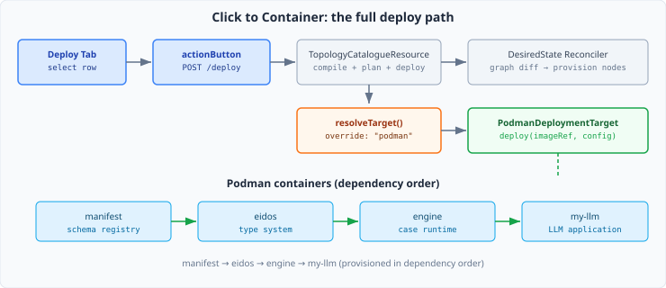
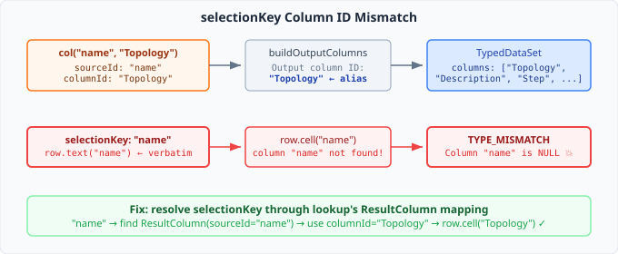
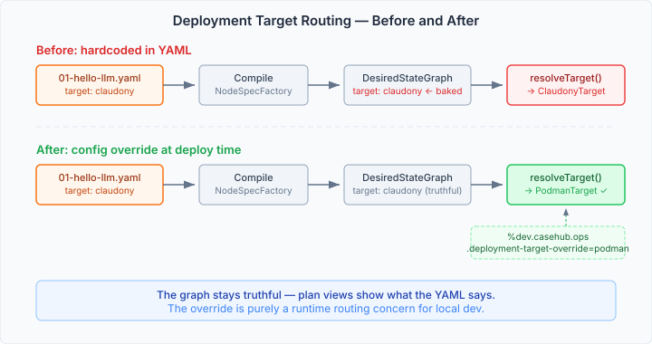
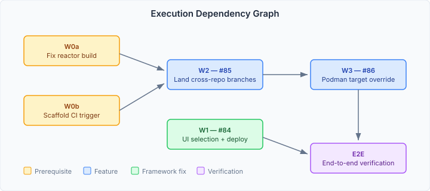

# Five Problems Behind One Deploy Button

The previous entry built the topology catalogue — a compile-plan-deploy pipeline that turns YAML topology definitions into a desired-state graph, plans the transitions, and hands them to a reconciliation loop. The Deploy tab showed a table of topologies with their metadata. What it didn't do: let you click one and actually deploy it.

That's what this epic is about. Select a topology row, click Deploy, watch four Podman containers come up in dependency order. One button, end-to-end. The kind of feature that sounds like a day's wiring work until you look at what's actually standing between you and a working deploy.



## The column alias trap

The first thing I wanted was row selection on the catalogue table. The pages-ui DSL has `selection: "single"` and `selectionKey` — point it at a column and the table tracks which row is selected. Straightforward.

```typescript
dataTable({
  lookup: lookup("catalogue", groupBy(null,
    col("name", "Topology"),
    col("description", "Description"),
  )),
  selection: "single",
  selectionKey: "name",
})
```

It crashed immediately: `TYPE_MISMATCH: Column "name" is NULL, not TEXT or LABEL`.

Claude and I traced it through three layers of the pages framework. The issue is a column ID mismatch hidden by an abstraction boundary. `col("name", "Topology")` creates a `ResultColumn` with `sourceId: "name"` and `columnId: "Topology"`. When `buildOutputColumns` in the data pipeline constructs the output dataset, it uses `columnId` — the alias — as the column's identity. But `selectionKey: "name"` gets passed verbatim to `row.text("name")` in the activation layer, which looks for a column called `"name"` in the output. There is no such column. The output has `"Topology"`.



The fix belongs in `activation.ts`, where the selection wiring happens. When `selectionKey` is set, resolve it through the lookup's `ResultColumn` mapping — if `"name"` matches a `sourceId`, use the corresponding `columnId` instead. And switch from `row.text()` (which throws on non-TEXT types) to `row.cell()` with string coercion:

```typescript
let resolvedKey: ColumnId = selectionKey as ColumnId;
if (lookup) {
  for (const op of lookup.operations) {
    if (op.type === "group") {
      const match = op.columns
        .find(rc => rc.sourceId === selectionKey && rc.columnId !== selectionKey);
      if (match) { resolvedKey = match.columnId; break; }
    }
  }
}
(vizEl as any).getRowKey = (row: TypedRow) => {
  const cv = row.cell(resolvedKey);
  return cv.type === "NULL" ? "" : String(cv.value);
};
```

This is a general framework fix, not a scaffold workaround. Anyone writing `col("name", "Topology")` with `selectionKey: "name"` would hit the same crash. The user writes what they mean — `name` is the column they're selecting by — and the framework closes the gap between source identity and output identity.

## Where do topologies actually deploy?

The Level 01 topology (`01-hello-llm.yaml`) defines four nodes — manifest, eidos, engine, my-llm — in a linear dependency chain. Every one of them hardcodes `deploymentTarget: claudony`. Claudony is the production fleet manager. I need these containers running locally in Podman.

I had three options for overriding the target: change the YAML, make the YAML target-agnostic, or override at runtime. I chose runtime override. The reasoning: the desired-state graph should represent what the YAML says. Plan views, diagnostics, and auditing all benefit from the graph being truthful about the declaration. The runtime environment determines where things actually deploy.



The injection point is `CaseHubAppProvisionHandler.resolveTarget()`. It takes a target ID string, iterates all CDI-registered `ApplicationDeploymentTarget` beans, and matches by `targetId()`. A `casehub.ops.deployment-target-override` config property — when set, it replaces the per-node target before the iteration — keeps the mechanism clean. The same override goes into `CaseHubAppDriftChecker.resolveTarget()` so drift detection stays in sync.

```java
private ApplicationDeploymentTarget resolveTarget(String targetId) {
    String effectiveTarget = (targetOverride != null && !targetOverride.isEmpty())
            ? targetOverride : targetId;
    if (effectiveTarget == null || effectiveTarget.isEmpty()) { return deployTarget; }
    return allTargets.stream()
                     .filter(t -> effectiveTarget.equals(t.targetId()))
                     .findFirst()
                     .orElse(deployTarget);
}
```

Scaffold sets `%dev.casehub.ops.deployment-target-override=podman` and `PodmanDeploymentTarget` handles the rest. The pattern is worth naming: **graph truthfulness with runtime routing**. The declaration says what the system *intends*. The environment says where it *runs*. Mixing them creates graphs that lie — they show "podman" in plan views when the topology says "claudony", which makes auditing meaningless. Separating them means the graph is always an accurate representation of the declaration, and the routing is purely a deployment concern.

One catch: scaffold's classpath included `casehub-ops-service` but not `casehub-ops-container`. Without the container module, `PodmanDeploymentTarget` isn't CDI-discoverable. A missing dependency masquerading as a missing feature.

## The CI problems nobody asked about

I didn't set out to fix CI. I was checking whether the cross-repo branches from the previous epic were safe to merge. That's when I noticed the casehub-all reactor was red. Every recent build — all of them.

As it turned out, the convergence aggregator issue had already been fixed by a prior session. The reactor was red for a different reason entirely: claudony-app test failures in the Apps step. Not a Jandex problem. Sometimes the thing you plan to fix isn't the thing that's actually broken.

But scaffold's own CI had a real gap. The `Build and Publish` workflow triggers on `repository_dispatch`, `pull_request`, and `workflow_dispatch`. Not on `push`. Every commit from the previous epic was pushed directly to main via rebase-merge. The workflow never fired. Scaffold had been running untested since those commits landed. Adding `push: branches: [main]` to the workflow is a two-line fix. The gap it leaves behind is a reminder that CI configurations deserve the same review as production code.

## The image question

The four container images for Level 01 — `casehubio/manifest`, `casehubio/eidos`, `casehubio/engine`, `casehubio/my-llm-app` — don't exist in any registry. Ops operates on a prebuilt-image model: `PrebuiltImagePipeline` passes through the `image` field from the topology YAML. No building happens. For local dev, the images need to come from somewhere — each source repo will need a Quarkus `container-image-podman` Maven profile. This is prerequisite work in each source repo, outside the scope of scaffold, and the last step before end-to-end verification.

## What "end-to-end" actually means here

What started as "wire a deploy button" became work across five repositories: casehub-pages (selectionKey fix), engine (scope annotation), ops (target override + topology metadata), scaffold (UI wiring + dependency + config), and casehub-all (CI investigation).



The dependency graph matters because it reveals something about the platform's architecture. A single user-facing feature — clicking a deploy button — required changes at every layer: the UI component framework, the case engine's CDI scoping, the ops deployment routing, the scaffold integration, and CI infrastructure. Each change was small. The complexity wasn't in any one change but in the coordination across boundaries.

This is the nature of a platform in its early stages. Every vertical feature tests horizontal assumptions. The column alias mismatch in pages-runtime was invisible until someone tried to use selection with aliased columns — a case the DSL makes easy to write but the activation layer didn't handle. The missing `casehub-ops-container` dependency was invisible until someone tried to route deployments to Podman in dev mode — a path that only exists when you bring the right bean onto the classpath. These aren't bugs in the traditional sense. They're gaps between what the abstractions promise and what the wiring delivers.

The implementation is complete except for the end-to-end verification — building the actual container images and watching the full deploy sequence run. The code path from click to container is wired. The column resolves. The target routes. The next session starts Podman and finds out what the containers think about all this.
