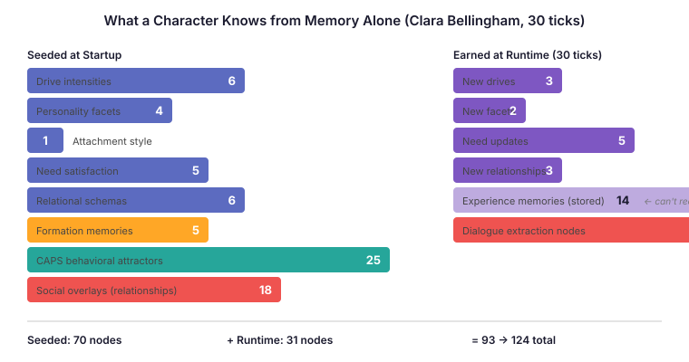
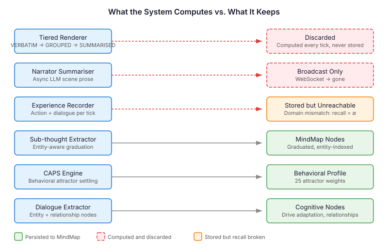

# The Engine Was Already Running

[Previously: [The Body Forgets](2026-10-31-mdp02-the-body-forgets.md) — echo loss proves the Barrett instruction fades under growing context. The fix is periodic context reset with structured memory. But what memory?]

I expected to spend this session designing a memory architecture. Instead I spent it discovering one.

The last entry ended with a three-tier memory proposal — structured briefs, timestamped logs, sub-agent deep dives. Sensible architecture. Literature-grounded. Before building any of it, I wanted to answer one question: if I cleared a character's LLM context right now, what would it actually know from the existing memory system alone?

So Claude and I built a snapshot endpoint that queries everything — the MindMap graph, the memory store, the consolidation output — and ran a 30-tick autonomous scenario with five GENERIC-profile characters. Then we looked at what was there.

## 93 Nodes Before the First Tick

The MindMap wasn't empty. Before a single character had spoken or moved, Clara Bellingham (the GENERIC-profile version of Penelope Pitstop) already had 93 nodes of cognitive state persisted in the graph:

Six drive intensities with body-location anchoring and Barrett channel emphasis. Four personality facets from the Big Five. An attachment style with anxiety and avoidance scores. Five need-satisfaction levels across Maslow-inspired tiers. Six relational schemas — who she trusts, who she's wary of, calibrated on trust/intimacy/utility axes. Five formation memories graduated from backstory episodes at ages 5, 7, 9, 11, and 13. Twenty-five CAPS behavioral attractors — fight, flight, freeze, trust, explore, rebel, fawn, persist — each weighted by her disposition profile. Eighteen social overlay nodes mapping how she sees others and how they see her.

This isn't a blank slate waiting for a memory system. This is a rich cognitive profile. It's just static — a photograph of who she is, not a record of what she's done.

## 31 New Nodes in 30 Ticks

I started the scenario in autonomous mode. Thirty ticks of five characters moving through rooms, talking, scheming, examining objects. Then I hit the snapshot endpoint again.

93 nodes became 124. Thirty-one new nodes, all earned at runtime:

Three new drive intensities — the drive adaptation pipeline detected shifts from the character's behaviour and recalibrated. Two new personality facets inferred from interaction patterns. Five need-satisfaction updates. Three new relational schemas from first encounters. Nine new nodes from dialogue extraction — the system parsed what characters said to each other and created entity and relationship nodes in the listeners' cognitive subgraphs.

The computation was happening. Drive adaptation was running. Dialogue extraction was running. CAPS was settling attractor weights on every tick. The consolidation pipeline had 10 phases — graduation, merge detection, community clustering, sub-thought extraction, goal prioritisation. All of it producing output. All of it writing to the MindMap.

## What Wasn't Being Kept

Three things computed every tick and thrown away:

**The tiered observation renderer.** Every tick, the system computes three versions of what happened — VERBATIM (full detail for few events), GROUPED (clustered for moderate event counts), SUMMARISED (LLM-condensed for many events). This is a condensation chain, already running. The output goes into the LLM prompt and vanishes.

**The narrator summaries.** An async agent on a virtual thread calls the LLM to produce scene-level narrative prose. "Clara examined the inscription while Marsh watched from the doorway, his fingers drumming against the frame." Broadcast over WebSocket for the UI. Never stored.

**The experience observations.** Each tick records what the character did — dialogue, action, room, thinking. These ARE written to the memory store. The InMemoryMemoryStore receives them. They accumulate. Fourteen new memories in 30 ticks.

But nobody can find them.

## The Domain Mismatch

This was the session's most significant finding. Claude traced the code path and found a one-constant bug that breaks the entire recall loop.

`ExperienceRecorderCore` stores every memory in domain `"experience"` — that's hardcoded in `ExperienceEvents.DOMAIN`. The storage works. Memories accumulate. You can verify they're there with a scan.

`AgentExperienceService.recall()` queries domain `"manor"` — that's a separate constant defined in the service class. The InMemoryMemoryStore buckets by `(tenant, subject, domain)`. Different domain string = different bucket. Recall returns empty. Every time.

The characters have been running 300-tick evaluations with zero memory recall. The LLM context window was carrying all the weight. The evaluations still produced quality output — because the context window is big enough for 300 ticks. But the moment you need context reset, you discover that nobody wired the return pipe.

One string constant. The difference between a memory system and a write-only log.

## What This Means

The three-tier architecture I proposed in the last entry — structured briefs, timestamped logs, sub-agent deep dives — is still the right design. But the implementation path is radically different from what I expected.

I expected to build condensation from scratch. Instead, the tiered renderer already computes three levels of condensation on every tick. I need to add a `store()` call, not a condensation algorithm.

I expected to build entity-indexed memory. Instead, sub-thought extraction already does entity-aware graduation by `(entity, type)` pairs. Dialogue extraction already creates entity nodes in listeners' cognitive subgraphs. The entity index exists in practice — it just isn't surfaced for recall.

I expected the hard part to be "how do we compress 300 ticks of experience into something useful." The hard part is actually "how do we stop throwing away the compressed version we already produce."

## For Anyone Building Agent Memory

If you're building memory for LLM-based agents, check what you already compute before designing what you need.

Most agent frameworks follow a pattern: compute rich context for the LLM prompt, get the response, discard the context, repeat. The prompt assembly is the most sophisticated part of the system — it already knows how to summarise, prioritise, and structure information for the model. That computation is your memory system. You're just not keeping its output.

The condensation chain — raw observations compressed into grouped summaries compressed into narrative prose — is what memory consolidation looks like in biological systems too. The hippocampus replays episodic memories during sleep, gradually extracting the gist and transferring it to neocortical storage. Your tiered renderer is doing the same thing. The difference is that the hippocampus keeps the output.

The practical sequence: fix the plumbing (make sure stored memories can be found), persist what you already compute (add store calls to existing computation), then build the novel parts (context reset injection, decay, reconstructive recall). Don't start with the novel parts. You probably have more infrastructure than you think.

We found an engine that was already running. It just needed an exhaust pipe.
