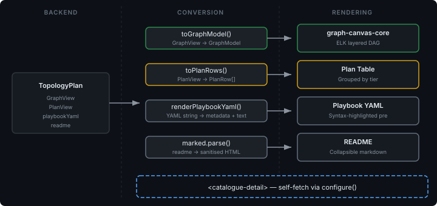

# Wiring a Detail View Without Touching the Backend

The previous catalogue entry described the compile-plan-deploy pipeline — how a topology directory becomes a `DesiredStateGraph`, then a layered `TransitionPlan`, then a running case. That pipeline exposes everything through a single REST endpoint: `GET /api/scaffold/catalogue/{name}/plan` returns `GraphView`, `PlanView`, `playbookYaml`, and `readme`. The data was available. Nothing in the UI consumed it.

This entry is about wiring the consumption side: selecting a topology in the catalogue table and seeing its dependency DAG, deployment plan, playbook, and documentation — without adding a single backend class.

## The Conversion Seam

The interesting architectural decision is where the data transformation lives. The backend returns `GraphView` — nodes with `id`, `type`, and `dependsOn`, plus edges with `from` and `to`. The graph-renderer expects `GraphModel` — nodes with `id`, `type`, and a `properties` record, plus edges with `id`, `type`, `source`, and `target`. Similar shapes, different contracts.

The conversion lives in a standalone TypeScript file — pure functions, no DOM dependency, fully unit-testable:

```typescript
export function toGraphModel(graph: GraphViewData): GraphModelData {
  const nodes = graph.nodes.map((n) => ({
    id: n.id,
    type: "topology-node",
    properties: { label: n.id, nodeType: n.type },
  }));
  // ...
}
```

Three functions handle the three data shapes: `toGraphModel` for the DAG, `toPlanRows` for the layered plan table, and `renderPlaybookYaml` for the playbook metadata extraction. Each one maps a backend DTO to a frontend component model. The seam is clean — if the backend shape changes, one function changes. If a component is swapped out, one function changes. Neither side knows about the other.

This matters because the alternative — doing the conversion inline in the component's render method — ties the backend contract to the rendering lifecycle. Every time you refactor the component, you're also refactoring the data mapping. Separating them means the conversions are testable in isolation, and the component only deals with pre-shaped data.



## Self-Fetch, Not Dataset Binding

The scaffold console has two ways to feed data to components. Most tables use the dataset pipeline — a dataset is declared (either in `app.yaml` or `datasets.ts`), the pages runtime binds it to the component, and data flows automatically. The other way is self-fetch: the component receives an endpoint URL via `configure()` and handles its own data loading.

I chose self-fetch for the detail view because the app runs in app-config mode. Datasets declared in `datasets.ts` are only registered through `createDatasets()`, which is the non-app code path. When `app.yaml` is active, `createAppDatasets()` runs instead and only sees what `app.yaml` declares. A selection-parameterised dataset like `catalogue-plan` would need to go into `app.yaml` — but `app.yaml` is a static declaration file, not a place for dynamic template expressions.

Self-fetch sidesteps this entirely. The component receives its endpoint and topology name as props from the `hostPanel()` DSL call:

```typescript
hostPanel("catalogue-detail", {
  endpoint: "/api/scaffold/catalogue",
  "topology-name": "#{selection.catalogue.name}",
})
```

The pages runtime resolves `#{selection.catalogue.name}` from the catalogue table's selection context and passes it through. The component watches for `topologyName` changes in its `updated()` lifecycle and fetches on demand. The same pattern orchestration-workbench uses.

## Stencils: Teaching the Graph Renderer Your Domain

The graph-renderer is a general-purpose React Flow bridge wrapped in a Lit web component. It knows about nodes, edges, and layout algorithms. It does not know what a topology node looks like.

That's where stencils come in. A stencil is a render function — it takes a `GraphNode` and returns a Lit `html` template. The graph-renderer's internal bridge (`createStencilNodeComponent`) wraps the Lit template into a React component for React Flow to render. The application author writes Lit; React Flow never leaks through.

The topology stencil is minimal — a coloured rounded rect with the node ID and type as labels. The colour is driven by the node type: green for application nodes, blue-grey for infrastructure, amber for storage, neutral grey for anything unrecognised. Registered once at startup, consumed by any `graph-canvas-core` instance that encounters a `topology-node` type node.

The edge type registration follows the same pattern. A `dependency` edge gets a closed arrowhead and a grey stroke. Two registrations, and the graph renderer knows enough about the topology domain to render a readable DAG.

## Progressive Enhancement on the Playbook

The playbook panel is the one place where the implementation deliberately falls short of the original design. The intent was to use `pages-step-viewer` — a rich component that renders step definitions as cards, swim lanes, and control flow diagrams. Claude caught during the design review that `pages-step-viewer` requires `ResolvedStep[]`, a complex discriminated union that needs a `Walker` and a populated `Catalog` for resolution. You can't just parse YAML and hand it over.

Since no sample playbook.yaml files exist in the repo yet, there's nothing to confirm whether the playbook format matches the step DSL. Rather than write a speculative adapter for an unknown format, the playbook panel renders the YAML as syntax-highlighted text with optional front-matter metadata. If the YAML includes a `playbook:` and `schema:` header, those are extracted and displayed as tags above the code block.

The upgrade path is explicit: when sample topologies exist and the playbook format is confirmed, the left panel switches from a `<pre>` block to `<pages-step-viewer>`. One component change inside `<catalogue-detail>`, no architectural revision. The conversion seam makes this clean — `renderPlaybookYaml` already parses the YAML and extracts metadata. A future version replaces it with a function that feeds the Walker instead.

## Surface Area

The whole change is three new files and two modified lines-of-code files: a conversion utility with 13 unit tests, a Lit component, a stencil registration module, a `hostPanel()` call in the deploy view, and a stencil registration call in the app bootstrap. No backend changes. No new dependencies beyond what the graph-renderer already requires as peers. The detail view appears below the catalogue table when a row is selected, and disappears when the selection clears.

The smallest possible change that wires an existing API to existing platform components and delivers a meaningful detail view. Everything else — the step viewer upgrade, the responsive collapse on narrow viewports, runtime status overlays — is additive work on a working foundation.
