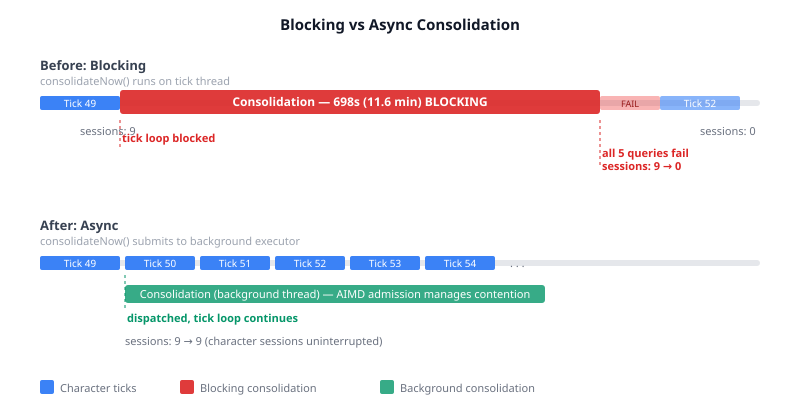
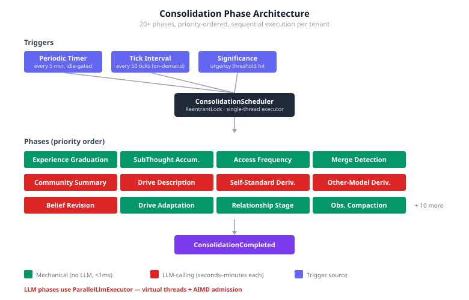

# Don't Stop the World to Remember

Our cognitive agents have a sleep cycle. Every 50 ticks, the system runs a consolidation pass — modelled on sleep-dependent memory consolidation from Complementary Learning Systems theory. Experience memories graduate to long-term storage. Drive profiles get re-derived. Beliefs revise. Relational schemas evolve. It's 20+ phases of cognitive housekeeping, some mechanical, some requiring LLM inference.

The problem: we were stopping the world to do it.

## 12 Minutes of Silence

During the ERA6 three-layer validation run, consolidation triggered at tick 50. The tick loop blocked for 698 seconds — 11.6 minutes. When it finally resumed, all five character queries failed. The API was unreachable. Sessions had dropped from 9 to 0. The system auto-paused to recover, and it took another 90 seconds before characters could speak again.



The root cause was embarrassingly simple. `consolidateNow()` ran on the caller's thread. The tick loop called it. The tick loop waited.

```java
// The bug: runs all 20+ phases on the caller's thread
public void consolidateNow(String tenantId) {
    if (!lock.tryLock()) return;
    try {
        beginTickAllPhases();
        runPhases(tenantId);  // 698 seconds later...
    } finally {
        lock.unlock();
    }
}
```

## The Cognitive Science Tells You This Is Wrong

Real brains don't stop the world to consolidate. A sleeping organism is not a halted organism — the body regulates temperature, the brainstem manages breathing, the auditory cortex still processes loud sounds. Sleep-dependent consolidation in CLS theory is about hippocampal replay reactivating neocortical traces *while other systems continue operating*. The hippocampus and neocortex run concurrently. They have to — an animal that loses motor function during memory consolidation gets eaten.

We were building cognitive agents that go catatonic every time they need to reflect. That's not sleep. That's anaesthesia.

The architectural principle is the same one that makes garbage collection interesting: you have a system doing real-time work (character ticks, object allocation) and a background process that needs to reorganise internal state (memory consolidation, heap compaction). Stop-the-world is the simplest implementation and the worst for latency. Every modern GC moved to concurrent collection for exactly this reason. Our consolidation scheduler needed the same evolution.

## The Fix Was Already Built

Here's the thing I find most interesting about this bug. The infrastructure for async consolidation already existed. `ConsolidationScheduler` creates a `ScheduledExecutorService` at startup — a dedicated background thread named `consolidation-scheduler`. The periodic timer already runs on this thread. The `ReentrantLock` already handles mutual exclusion between concurrent consolidation requests. The AIMD admission strategy in `ParallelLlmExecutor` already manages session contention between consolidation's LLM calls and character ticks.

All the hard concurrency problems were solved. The only thing missing was one line: submit to the executor instead of running inline.

```java
// The fix: submit to background thread, return immediately
public void consolidateNow(String tenantId) {
    knownTenants.add(tenantId);
    if (executor != null) {
        executor.submit(() -> runConsolidation(tenantId));
    } else {
        runConsolidation(tenantId);
    }
}
```

The tick loop dispatches consolidation and keeps ticking. Characters keep talking while their memories settle.

## Why This Matters Beyond Our Codebase



Multi-agent AI systems that maintain persistent memory will all face this problem. The moment you add memory consolidation — any periodic process that reorganises, compresses, or derives from accumulated state — you have to decide when it runs and what it blocks.

The tempting answer is "between turns" or "between ticks" — a natural pause in the action loop. That works at small scale. At 5 characters and 50 ticks it's 12 minutes of downtime. At 50 characters it would be catastrophic. And the LLM phases scale linearly with character count — each one derives drive descriptions, self-standards, and belief revisions per agent.

The right answer borrows from both cognitive science and systems engineering:

**From CLS theory:** Consolidation and active cognition are concurrent processes with different time scales. The hippocampus replays traces over hours of sleep while the neocortex continues processing sensory input. Design for the same concurrency in your agents.

**From GC design:** Never block the mutator thread for maintenance work. Use concurrent execution with admission control (our AIMD strategy) to manage resource contention. Accept that consolidation might take longer when it runs concurrently — but the system never goes dark.

**From the evidence:** Background consolidation at tick 73 in the same run (observation compaction only, mechanical, no LLM) took 1 millisecond and caused zero disruption. The architecture was already proving itself for the simple case. We just hadn't applied it to the full consolidation pass.

## What This Opens Up

With consolidation off the tick thread, two things become possible that weren't before. First, we can run consolidation more frequently — triggered by significance accumulation rather than a fixed interval — without worrying about disrupting the scenario. The significance trigger was already implemented but practically unusable because it would block whatever thread noticed the threshold was crossed.

Second, we can observe consolidation's effect on subsequent ticks in real time. When consolidation ran synchronously, the "before" and "after" were separated by a 12-minute gap and a session wipe. Now they're continuous — tick 51 runs while consolidation is still processing, and tick 55 picks up the results. That continuity is what we need to measure whether consolidation actually improves character behaviour, not just whether the system survives it.
