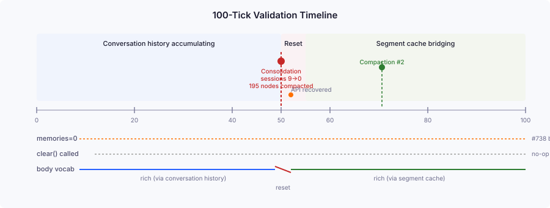
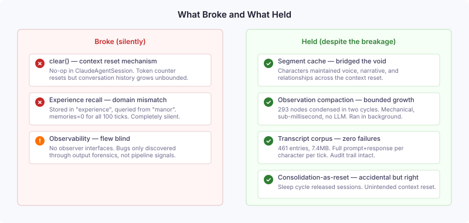

# The Body Remembers

*Continues from [Three Layers Deep](2026-11-01-mdp01-three-layers-deep.md), where we built a three-layer memory architecture to survive context resets.*

Yesterday I had architecture. Today I have evidence.

We ran 100 ticks of a GENERIC autonomous scenario — five characters in Doily Manor, no pop-culture priors, full cognitive pipeline. The run took about 90 minutes. Two mechanisms I designed were completely broken. The architecture held anyway.

## What I Expected

Five validation targets: body vocabulary stability across context resets, transcript ZIP integrity, observation compaction bounding node count, segment cache injection after reset, and prompt cache hit rates. Run the scenario, check the boxes, move on.

What I got was more interesting than confirmation.

## What Actually Happened

The first 50 ticks ran clean. Characters explored the manor, discovered puzzles, formed relationships. Vincent found rat poison and started planning to poison the tea. Clara worked out that the "treasure" was the group itself. The narrative arc was genuine — five characters with seeded personalities, no script, arriving at an emotional climax around tick 40 where Clara declared "the Doily Diamond is us."

Then consolidation ran. The characters went to sleep.

This is the memory consolidation cycle — drives adapt, self-standards evolve, relationships deepen. It takes about 12 minutes because it involves hundreds of LLM calls for cognitive derivation. And when it finished, something I didn't expect: every session was released. The session count dropped from 9 to 0.

This was the context reset. Not the one I designed. I'd built a `clear()` mechanism in `ManagedSession` that tracks estimated tokens and clears the conversation at 80,000 tokens. Claude found that `ClaudeAgentSession.clear()` is a no-op — the Claude CLI SDK has no clear capability. The method does nothing. The token counter resets (the session *thinks* it cleared), but the actual conversation history grows indefinitely.

The real reset happened because consolidation released the session pool. When tick 52 started, every character opened a fresh session. No conversation history. No memory of the previous 50 ticks. Just the system prompt with their personality profile and the segment cache with their compacted observation history.

## The Body Remembers

Tick 52's output was the moment of truth. Fresh sessions, no conversation history, two broken mechanisms (clear was a no-op, experience recall was silently returning zero memories due to a domain mismatch in the store). The characters had only two things to work with: their consolidated personality and the segment cache.

Vincent's aside at tick 52: *"He doesn't know about the bottle in my pocket."* The poison subplot survived the void. That knowledge could only have come from the segment cache — the conversation that discovered the poison was gone.

Reginald at tick 52: *"Thirty-three minutes ago I stood RIGHT HERE and lied about ALL of it. And now I'm walking through this room on my way to TEA."* Spatial memory, temporal awareness, self-knowledge of his own deception — all from the observation history injection.

Clara at tick 64: *"like the locked box finally opening and finding not old letters but everything"* — a callback to her seed experience, the locked box in grandmother's house. This is the cognitive derivation pipeline meeting the segment cache: the personality profile carries the emotional template, the segment cache carries the narrative context, and the LLM weaves them together.

Clara at tick 76, PAD values [0, 0, 0] — perfect emotional neutrality: *"the fullest silence Clara has ever sat inside."*

These aren't canned responses or template fills. They're the output of a character whose personality was built from seeded experiences, whose drives were derived through consolidation, and whose recent history was reconstructed from compacted observation nodes. Two of the designed mechanisms were broken. The body remembered anyway.

## What Broke and What Held

Three things broke silently. Two had been broken since they were written.

`ClaudeAgentSession.clear()` has never cleared anything. The comment in the source says "Claude CLI SDK 1.0.0 has no clear() — subprocess restart is the only reset path." The `ManagedSession` wrapping it dutifully tracks token estimates, decides "time to clear," calls `clear()`, resets its counter, and carries on — never knowing the conversation kept growing. The token counter was a hallucination.

Experience recall has never found a runtime memory. Every memory stored through `ExperienceRecorderCore` goes into domain `"experience"`. Every query through `AgentExperienceService.recall()` looks in domain `"manor"`. The observation builder showed `memories=0` for all 100 ticks. Characters have been running for months in ERA5 and ERA6 without recalling a single experience memory, and nobody noticed because the output quality was good enough without them.

The third failure was mine: no observability. No observer interface on memory recall to report empty results. No observer on session clearing to report the no-op. No observer on segment cache injection to confirm it was actually providing content. We discovered all three failures through output forensics — reading character dialogue and server logs — not through pipeline signals.

The observability gap is the actionable finding. The other two bugs are fixable. But if I'd had a `MemoryRecallObserver` that fired `onRecall(agentId, domain, resultCount)`, the experience recall bug would have been caught at tick 1 of ERA5 — months ago, not today.

## Why This Matters

If you're building cognitive agents — systems that maintain personality, relationships, and coherent identity across long interactions — the context window is your enemy. Not because it's too small, but because it creates an illusion of memory. The agent sounds like it remembers because the conversation history is right there. But conversation history isn't memory. It's a scratchpad. Eventually it fills up, or the session ends, or the system restarts. When it does, everything the agent "knew" evaporates.

The three-layer architecture solves this by putting memory where the scratchpad can't reach it. Raw transcripts (permanent, lossless) feed into compacted observations (bounded, lossy, authoritative) which materialise into a segment cache (budgeted, injected, readable). When the scratchpad clears, the segment cache repopulates it. The agent wakes up knowing who Clara is, why the inscription matters, and where the poison is.

The deeper lesson from this run is about architectural redundancy. Two mechanisms were broken. The output quality didn't degrade noticeably. This isn't luck — it's the result of multiple independent paths carrying different aspects of the agent's identity. The personality profile carries emotional templates. The drive descriptions carry behavioural tendencies. The segment cache carries narrative history. Any one of these can compensate for failures in the others. Experience recall being broken meant characters had less episodic detail — but the segment cache covered the narrative, and the personality profile covered the emotional register.

This is the same principle that makes biological memory resilient. You don't recall an experience from a single neural trace — you reconstruct it from multiple overlapping representations: sensory, emotional, spatial, semantic. Damage one pathway and the others compensate. The reconstruction isn't perfect, but it's coherent. Our characters proved the same thing: imperfect recall, coherent identity.

## What I Still Don't Know

The body vocabulary assessment is qualitative. I read the output, it sounded rich. But "sounded rich" isn't a measurement. The formal classification pipeline — running `classify_emotions.py` across the full transcript — is blocked by the experience recall fix. Once that lands, we can get actual per-drive, per-character scores and compare to the BASELINE0 benchmark (mean 3.93 from ERA5's 300-tick eval). The number I want is whether post-reset body vocabulary matches pre-reset. Qualitatively it does. Quantitatively, I don't yet know.

The clear threshold experiment is blocked by `clear()` being a no-op. The hypothesis — that there's a knee in the instruction effectiveness curve somewhere between 40k and 120k tokens — remains untested. Fixing `clear()` is the prerequisite. The observation that consolidation provides an accidental reset gives us a fallback mechanism, but it's too coarse: consolidation runs every 50 ticks, not at a specific token threshold. We need both.

The register conflict I predicted — between the factual segment cache ("You were in the Library") and the Barrett instruction ("show, don't tell") — didn't obviously manifest. Characters produced rich embodied language across all 50 post-reset ticks. But I didn't test with a very large cache budget. At 2,000 tokens, the factual prose might be small enough that it doesn't compete. At 8,000 tokens, the balance might shift. Worth testing once the baseline is solid.

The body knows how to feel. Now it knows how to remember. Next: give it eyes to see itself working.
