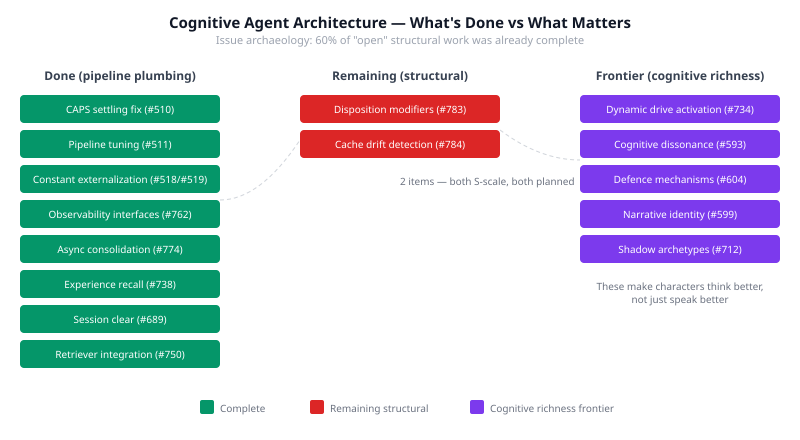

# The Plumbing Is Done. Now Make Them Think.

I spent part of today doing issue archaeology. We had an epic — "cognitive pipeline hardening" — with 8 items tracking bugs, structural fixes, and code quality in the formation memory → graduation → behavioural synthesis → rendering pipeline. Five items were closed. Three were still open, all filed against the examples repo despite being neocortex code.

I expected to find unfinished work. What I found was that the work was already finished.

Three of those five open items turned out to be stale duplicates. The CAPS settling fix — attractors stuck at 'emerging' regardless of formative input — had been solved in neocortex months ago. Pipeline tuning, constant externalisation, same story. The examples issues were orphans pointing at code that had moved on without them.

Two items were genuinely open: disposition modifiers (7 personality axes that can't resolve against the CAPS topology) and consolidation cache drift (stale caches silently disabling drive descriptions). I transferred both to neocortex where the code lives. Both are S-scale. Both are planned.

The pipeline hardening epic is effectively done.

## The shift this reveals

Adding up what's landed recently: observability interfaces across the pipeline (#762), async consolidation (#774), experience recall fix (#738), session clear (#689), retriever integration (#750), entity references, biography pipelines, modulation wiring. That's the plumbing. The infrastructure that makes cognitive agents possible — memory storage, memory consolidation, memory retrieval, session management, observability — is largely in place.

The question is no longer "can the system run?" It's "do the characters think well?"

And the answer, based on the 300-tick evaluation, is: not yet. Not because the pipeline fails, but because it doesn't make characters cognitively interesting. They have drives but every drive fires every tick regardless of situation. They hold beliefs but never experience the tension of contradictory beliefs. They have personality but it doesn't degrade under stress. They remember but don't rationalise.

## What cognitive richness actually means

The tempting response is to generate more text — richer descriptions, longer internal monologues, more elaborate scene-setting. That's verbosity, not richness. We reached the limit on 300 ticks and realised the gap isn't volume. It's cognitive ability.

Five capabilities that would make characters genuinely think better:

**Dynamic drive activation.** This one has empirical evidence behind it. In the Barrett v5c experiment, removing gloating from a character under threat instantly produced golden survival prose. Leaving it at 0.7 intensity always leaked gloating into the output. The model cannot ignore drives that are present in the prompt. Situation classification already exists in the pipeline — using it to gate which drives appear is mechanically straightforward and proven to matter.

**Cognitive dissonance.** A character who simultaneously trusts and distrusts someone should feel the tension, not calmly render both facts. Constraint satisfaction resolution — Shultz and Lepper's 1996 model — gives a computational framework for how beliefs in conflict pressure each other toward resolution. The belief revision phase already runs during consolidation. What's missing is the detection of contradictions and the discomfort they produce.

**Defence mechanisms.** People don't just think wrong things — they think wrong things for self-protective reasons. Projection, denial, rationalisation. These are the mechanisms that create the gap between what someone does and why they think they're doing it. That gap is what makes fictional characters compelling. Characters without defence mechanisms are transparent to themselves, which makes them boring.

**Narrative identity.** McAdams' actor/agent/author framework. Characters need a self-story — not just traits and drives, but a sense of who they are becoming. "I used to be naive, but after what happened in the parlour, I know better." This gives behaviour a narrative arc that pure personality scoring can't produce.

**Shadow archetypes.** Personality degradation under stress. A character with high agreeableness who, under sustained threat, stops being agreeable. The personality isn't lost — it's compressed, and what emerges is the shadow form. Characters that behave identically under pressure and in calm are psychologically flat.

## Where this leaves us

The structural debt is nearly paid. Two small items remain. The 300-tick eval infrastructure works — async consolidation means no more 12-minute gaps, working clear means sessions don't grow unbounded, experience recall means characters actually access their memories.

What's needed now isn't more infrastructure. It's the cognitive mechanisms that turn a well-plumbed pipeline into characters worth watching.
