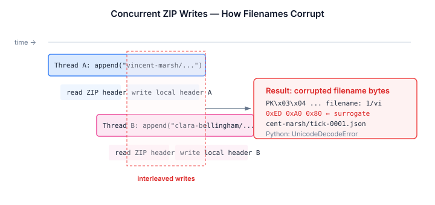
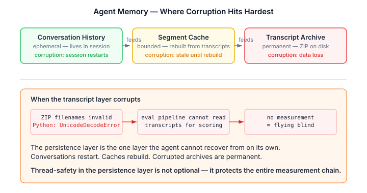

# When Agents Corrupt Their Own Memory

*Continues from [The Body Remembers](2026-11-02-mdp01-the-body-remembers.md), where we validated a three-layer memory architecture across 100 ticks.*

The ERA6 validation run proved that agents can survive context resets. Today I found out they'd been sabotaging their own ability to prove it.

## The Symptom

Python's `zipfile` module refused to read the transcript archives:

```
UnicodeDecodeError: 'utf-8' codec can't decode byte 0xed in position 30:
  invalid continuation byte
```

The transcript ZIPs are the permanent record — every tick of every character's prompt and response, archived into rolling ZIP files by `ZipCorpusStore`. They're the foundation of the eval pipeline. The `classify_emotions.py` scorer reads them, scores each drive expression 1–5, and produces the per-character profiles that tell us whether the cognitive architecture is actually working.

If Python can't read the ZIPs, there are no scores. No scores means no comparison to the BASELINE0 benchmark. No comparison means I'm evaluating output quality by reading dialogue and going "yeah, that sounds right." That's not science. That's vibes.

## The Investigation

Byte `0xed` is the lead byte for UTF-8 encoding of code points U+D000–U+DFFF — the surrogate range. Surrogates are illegal in standard UTF-8. They exist only in UTF-16 as a mechanism for encoding characters outside the Basic Multilingual Plane. Finding `0xed` in a filename that should be pure ASCII — `1/vincent-marsh/tick-0001.json` — is like finding a French subjunctive in a shopping list. It doesn't belong.

The obvious hypothesis was wrong. I traced the encoding chain through zip4j (the ZIP library): `ZipParameters.setFileNameInZip()` → `HeaderWriter.writeLocalFileHeader()` → `HeaderUtil.getBytesFromString()` → `String.getBytes(UTF_8)`. Clean standard UTF-8 throughout. The filenames are ASCII. The library encodes them correctly. There is no encoding bug.

The actual transcript ZIP on disk — the one generated after a recent fix — read perfectly. All 466 entries, every filename clean ASCII, Python happy. I scanned every local file header in the raw bytes: zero occurrences of `0xed`.

So the filenames weren't being encoded wrong. They were being written by two threads at the same time.

## The Root Cause

`TranscriptStore.appendTick()` spawned one virtual thread per character per tick:

```java
Thread.ofVirtual().name("transcript-" + agentId + "-" + tick).start(() -> {
    store.append(path, json.getBytes(StandardCharsets.UTF_8));
});
```

Five characters, five virtual threads, all calling `store.append()` on the same `ZipCorpusStore` instance simultaneously. zip4j is not thread-safe. Each `append` creates a new `ZipFile` object pointing at the same file on disk, reads the existing central directory, writes a new entry, and rewrites the central directory. Two threads doing this concurrently interleave their writes at the byte level.



When Thread A is halfway through writing `1/vincent-marsh/tick-0001.json` to the local file header and Thread B starts writing `1/clara-bellingham/tick-0001.json` to the same file region, the resulting bytes are a splice of two filenames. The `0xed` byte wasn't a surrogate — it was a fragment of one thread's data landing in another thread's filename field.

A recent commit had already serialized the caller: `TranscriptStore` now batches all character entries and writes them sequentially on a single virtual thread. That fixed the symptom. But the underlying `ZipCorpusStore` was still unsafe for any concurrent caller.

## The Fix

A `synchronized` block on the `append` and `delete` methods:

```java
private final Object writeLock = new Object();

@Override
public void append(String path, byte[] content) {
    validatePath(path);
    synchronized (writeLock) {
        // ... zip4j write, index update, manifest save
    }
}
```

Defense in depth. The caller shouldn't need to know that the persistence layer can't handle concurrent writes. That's the store's contract to enforce.

## Why This Matters Beyond the Bug

If you're building cognitive agents — systems with personality, memory, and identity that persist across sessions — you have a layered memory architecture whether you designed one or not. At minimum: conversation history (ephemeral), some form of context injection (reconstructed), and a persistence layer (permanent).



The ephemeral layer is self-healing. Session restarts, conversation resets, context window overflow — the agent loses immediate memory but the system recovers by rebuilding from the layer below. We proved this in the ERA6 run: five characters lost their entire conversation history at tick 50 and kept their identities through the segment cache.

The reconstruction layer is self-healing too. Stale caches rebuild from the persistence layer. Bad compaction gets overwritten on the next consolidation cycle. Errors here are temporary.

The persistence layer is the one that doesn't heal. Corrupted transcripts stay corrupted. Missing entries stay missing. And because the layers above depend on it — the segment cache rebuilds from transcripts, the eval pipeline reads from transcripts — corruption at the bottom propagates upward through every measurement and recovery mechanism the architecture provides.

This is why thread-safety in the persistence layer isn't a nice-to-have. It's the foundation. Virtual threads in Java 21+ make concurrency cheap and easy, which means more code paths will exercise concurrent writes that were previously sequential. The bug I found wasn't in new code — it had been there since `ZipCorpusStore` was written. It just never manifested until someone spawned virtual threads per character per tick.

The pattern generalises. Any agent framework that persists state — memory stores, experience logs, relationship graphs, drive profiles — needs to ask: what happens when two agents write to the same store concurrently? If the answer is "we haven't tested that," the answer is "corruption, eventually."

The body remembers. But only if the archive is intact.
