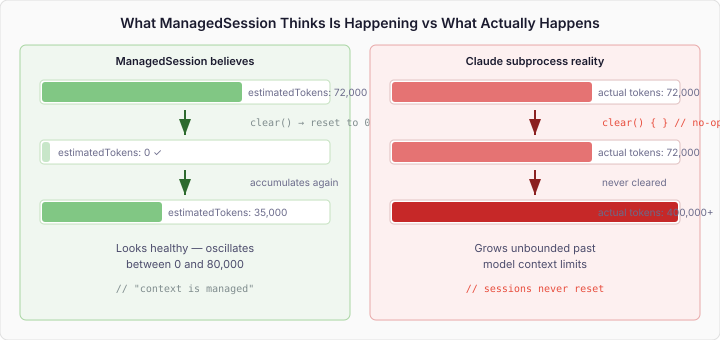
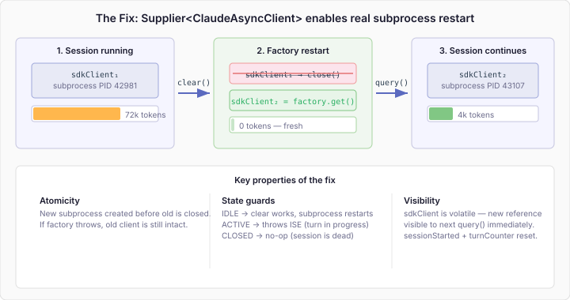

# The Reset That Never Was

*Continues from [Three Layers Deep](2026-11-01-mdp01-three-layers-deep.md), where we built a three-tier memory architecture to bridge context resets. This entry is about what happened when I went looking for why those resets never fire.*

Two days ago I wrote confidently about context resets. The three-layer memory architecture was designed to bridge them — raw transcripts at the bottom, compacted observations in the middle, a segment cache injected into each fresh prompt at the top. The whole point was that when the session clears at 80,000 tokens, the character still knows who Clara is.

There was one problem. The session never clears.

## The Evidence Was Already There

The ERA6 validation run — 100 ticks, 17 autonomous characters, `clearAtTokens` set to 80,000 — logged zero context clears. I'd noted this in the findings. The observation prompt sizes plateaued at ~10k tokens per tick (the observation text itself), while cumulative session size grew past 400,000 tokens. The only context reset in the entire run was accidental: consolidation released all sessions at tick 50, which forced new sessions to be created. That wasn't a clear. That was a side effect.

I treated this as "the clearing threshold needs tuning" and filed it as a bug. But the threshold wasn't the problem.

## The No-Op

The platform's `ClaudeAgentSession.clear()` method:

```java
@Override
public void clear() {
    // Claude CLI SDK 1.0.0 has no clear() — subprocess restart
    // is the only reset path.
    // The pool handles this by closing the session and
    // pre-warming a replacement.
}
```

An empty method body. The comment explained the intent: the SDK doesn't support clearing conversation history, so the only way to reset is to kill the subprocess and start a new one. The pool was supposed to handle this by closing the session and pre-warming a replacement.

The pool didn't handle it either. Here's what `SessionPool.release()` does when a session is returned:

```java
delegate.clear();  // no-op
if (warm.size() < config.minActive()) {
    warm.offer(new WarmEntry(delegate, Instant.now()));
    // session goes back in the pool with full history
    return;
}
```

It calls `clear()`, gets nothing, and puts the session back in the warm pool. The session goes back with its entire conversation history intact. The next checkout gets a session that remembers everything from every previous conversation.

## The Counter That Lies

`ManagedSession` wraps the underlying session with clearing policies. When `SIZE_AWARE` mode detects that `estimatedTokens` exceeds the threshold, it calls `clear()` and resets the counter:

```java
if (clearingPolicy == ClearingPolicy.SIZE_AWARE
    && clearAfterTurns > 0
    && estimatedTokens.get() > clearAfterTurns) {
    pooledSession.delegate().clear();  // no-op
    estimatedTokens.set(0);            // counter resets
}
```

The counter resets to zero. The actual session is untouched. On the next query, the counter starts climbing again from zero while the real session continues growing from 400,000 tokens. The counter oscillates between 0 and 80,000 indefinitely. The session never oscillates at all.



This is the worst kind of bug: the monitoring tells you everything is fine while the thing being monitored is broken. If you logged `estimatedTokens`, you'd see a healthy sawtooth wave. If you measured actual session size, you'd see a monotonic ramp to infinity.

## Why This Matters Beyond Our Platform

If you're building LLM agents that run longer than a single prompt-response cycle — and that includes every agent framework I'm aware of — you have a version of this problem.

**Context windows are finite.** Every model has a limit. When your agent accumulates enough conversation history, something has to give. Either the provider silently truncates old messages (losing instructions that were at the top), or you hit an error, or the model starts hallucinating because the instruction-following signal is diluted by hundreds of thousands of tokens of accumulated dialogue.

**The SDK layer might not support clearing.** The Claude CLI SDK 1.0.0 wraps a subprocess. There's no API to say "forget everything and start fresh." The only path is to kill the process and start a new one. If your session abstraction doesn't account for this — if it assumes `clear()` is implemented by the underlying provider — your clearing policies are decorative.

**Token counting is not context management.** Counting tokens in and out gives you an estimate of session size. Resetting the counter doesn't reset the session. This sounds obvious stated plainly, but when the counter and the clearing call are in the same code path, it's easy to trust that both sides of the operation work. The counter side always works. The clearing side might not.

**Session pooling amplifies the damage.** Without pooling, a session that can't clear will eventually error out or be garbage-collected. With pooling, the unclearable session goes back into the warm pool and gets handed to the next consumer — carrying its full history. Every consumer pays the cost of every previous consumer's conversation.

## The Fix

The session needs the ability to replace its subprocess. Since `ClaudeAsyncClient` wraps a process and doesn't support in-place clearing, the only option is to close the old client and create a new one. For that, the session needs a factory — a `Supplier<ClaudeAsyncClient>` — that can produce a fresh client with the same configuration.



The `openSession()` call already has all the configuration — CLI options, MCP servers, environment variables, working directory. I extracted the client-creation logic into a supplier and passed it to the session constructor alongside the initial client. When `clear()` is called, the session creates a new client from the factory, closes the old one, and resets its internal state. The session stays in `IDLE` — same semaphore slot, same place in the pool — but with a clean subprocess underneath.

The ordering matters. The new client is created before the old one is closed. If the factory throws — binary not found, permissions issue, whatever — the old client is still intact. The session degrades to the old no-op behaviour rather than leaving itself in a broken state with no client at all.

```java
@Override
public void clear() {
    // ... state guards ...
    if (clientFactory != null) {
        final ClaudeAsyncClient newClient = clientFactory.get();
        final ClaudeAsyncClient oldClient = this.sdkClient;
        if (oldClient != null) {
            activeSessions.remove(oldClient);
            oldClient.close().subscribe();
        }
        activeSessions.add(newClient);
        this.sdkClient = newClient;
    }
    sessionStarted.set(false);
    turnCounter.set(0);
}
```

The pool's `release()` path already has a `try/catch` around `clear()`. If `clear()` throws, the session is destroyed and a fresh one is pre-warmed. So the factory-based `clear()` works in both directions: it succeeds and the pool reuses a clean session, or it fails and the pool creates a new one. Either way, stale sessions don't go back in the pool.

## The Real Lesson

I spent two days building a three-layer memory architecture to bridge context resets that weren't happening. The architecture is sound — it solves a real problem. But I was solving it on the assumption that resets would occur, without verifying that they did.

The validation run showed zero clears and I wrote it down as a data point. I didn't follow it to its source. The session lifecycle code had a comment explaining exactly why clearing couldn't work ("subprocess restart is the only reset path") and an empty method body that was as clear a signal as you could ask for. The evidence was sitting in plain text.

The generalisable version: if your system has a capability that's never been observed in production, check whether the capability actually works before building infrastructure around it. The three-layer architecture isn't wasted — it's needed — but the clear() fix should have come first. The memory architecture bridges resets that now, finally, can actually happen.
